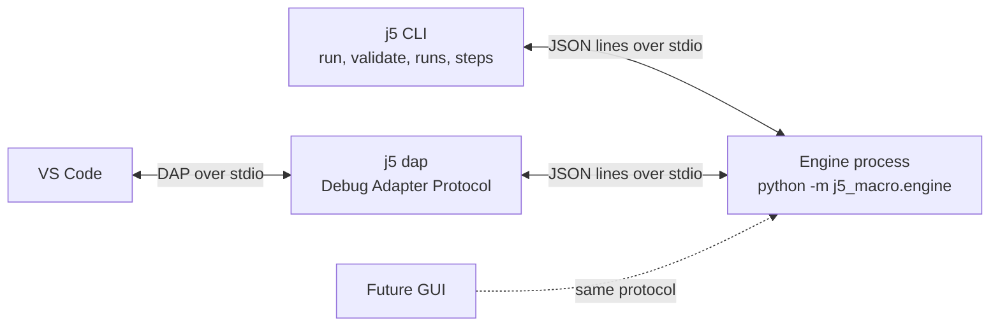
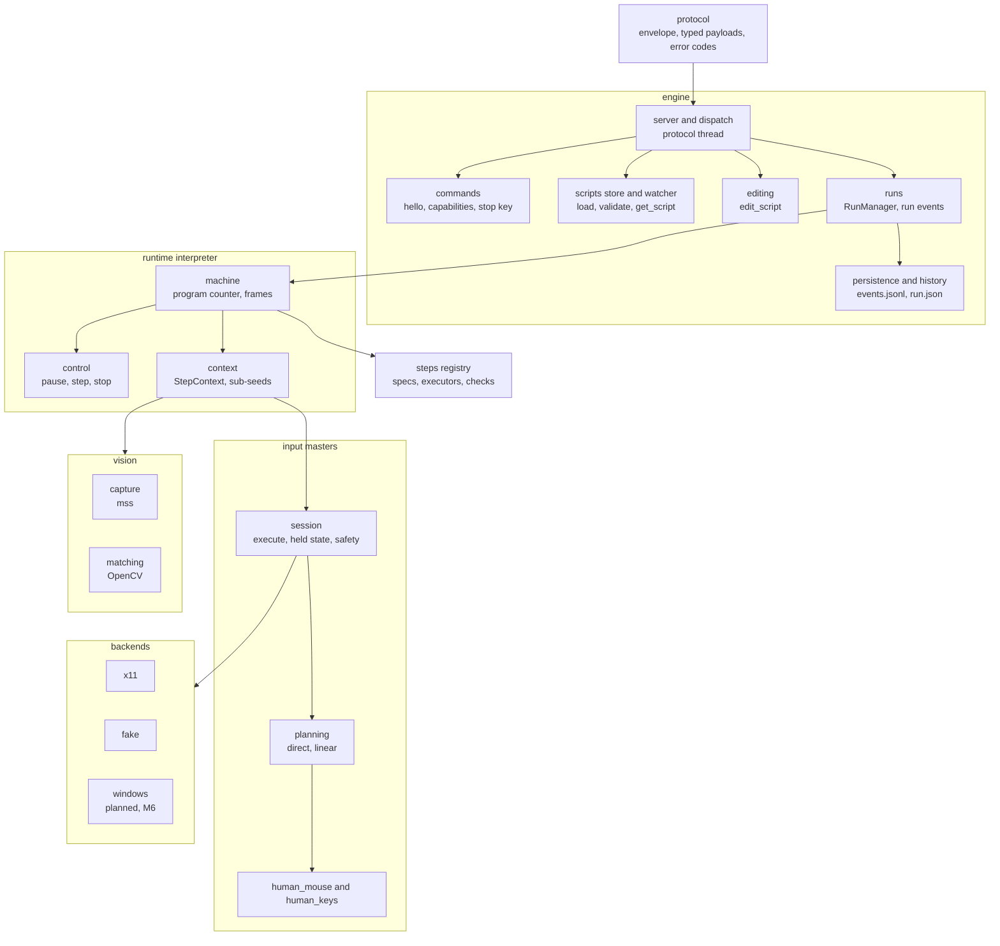
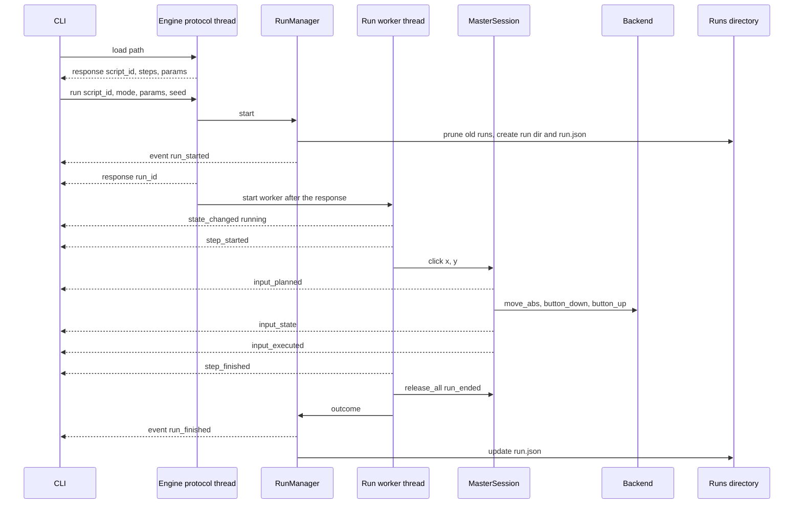

# Architecture

This page is for contributors and for people who want to integrate j5-macro into another
tool. It explains how the pieces fit together: the processes, the layers inside the
engine, how a run flows through them, which threads exist and where the code can be
extended. The deeper internals and the reasons behind them are in
[technical-design.md](technical-design.md); the exhaustive protocol (every command, event,
field and error code) is in [contract.md](contract.md), which is the source of truth.

## Goals and design rules

j5-macro automates a desktop with scripts that a person can read, debug step by step and
trust not to leave a key stuck. Six rules shape the code:

| Rule | What it means in the code |
| --- | --- |
| Headless engine | The engine never prints or reads stdin directly. `stdio_transport()` even points `sys.stdout` at stderr, so a stray `print` cannot corrupt the protocol. |
| Everything is an event | Whatever the engine does (a step starting, a planned trajectory, an image score, a held key) is published as a protocol event. A debugger or a GUI is built by listening to them. |
| GUI-ready | Steps have stable ids and source lines, planned trajectories and match scores are in events, and scripts are edited through structured commands, so no client has to parse YAML. |
| Backends are primitives | A backend only knows `move_abs`, `key_down`, `char_down`, `find_window`... All human-like behaviour lives in `j5_macro.input` and is the same on every platform. |
| Pure, seeded planning | Every mouse movement and keystroke sequence is planned by a pure function of a seed before anything is sent, so plans are reproducible and testable without a display. |
| Safety | Held keys and buttons are tracked and released on stop, on error and when the run ends; a global hotkey and a screen-corner failsafe stop a run; if the engine dies, the client releases what it last reported as held. |

See [contract.md, "Goals and design rules"](contract.md#goals-and-design-rules) for the
contract's own list.

## Processes



Every client starts its own engine as a subprocess (`python -m j5_macro.engine`, or the
JSON list in `J5_ENGINE_CMD`) and talks to it over its stdin and stdout. The engine serves
exactly one client and ends when its stdin closes. Clients:

- **CLI** (`j5`, [cli/](../src/j5_macro/cli)): `run` (with `--dry-run`, `--step`,
  `--break`, `--fast`), `validate`, `steps`, `runs`, `schema` and `dap`. Every command
  except `schema` and `dap` starts an engine; even the run history is read through it.
  See [cli.md](cli.md).
- **DAP adapter** (`j5 dap`, [dap/](../src/j5_macro/dap)): a Debug Adapter Protocol server
  on stdio that starts an engine and translates DAP requests into engine commands. The
  VS Code extension in [editors/vscode](../editors/vscode) registers it as the `j5`
  debugger. See [debugging.md](debugging.md).
- **Future GUI**: will be one more client of the same protocol.

### The message envelope

Every message is one JSON object on one line. A command, its response and an event:

```json
{"v":1,"kind":"command","type":"pause","id":"7","payload":{"run_id":"r-20261012-151051-d36f"}}
{"v":1,"kind":"response","type":"pause","id":"7","ok":true,"result":{}}
{"v":1,"kind":"event","type":"state_changed","run_id":"r-20261012-151051-d36f","seq":15,"ts":"2026-10-12T15:10:53.530Z","t_ms":2238,"payload":{"state":"paused","reason":"user"}}
```

Commands carry a client-chosen `id` that the response repeats. Events are not
acknowledged; each stream (one per run, plus one for engine-level events with
`run_id: null`) has a gap-free `seq`, a wall-clock `ts` for display and a monotonic `t_ms`
for timing. The engine emits `ready` when it starts; the client must then send `hello` to
negotiate the version before any other command. Field-by-field details are in
[contract.md, "Transport and message format"](contract.md#transport-and-message-format).

### Why a separate process

- **The GUI never freezes.** A GUI event loop, a debugger UI and the engine's run worker
  never share an interpreter or a GIL.
- **One protocol for every client.** The CLI, the DAP adapter and a GUI written in any
  language use the same commands and events; nothing is reachable only from Python.
- **Crash isolation and supervision.** If the engine dies, the client is still alive to
  release whatever the last `input_state` event reported as held
  ([cli/release.py](../src/j5_macro/cli/release.py)), so a crash never leaves Shift or
  Ctrl down.
- **Clean Ctrl+C semantics.** The engine ignores SIGINT; the client decides what Ctrl+C
  means (the CLI sends `stop`) and the engine ends when its stdin closes, stopping an
  active run and waiting up to 5 s for its `run_finished`.

## Layers inside the engine



From top to bottom:

1. **Protocol** ([protocol/](../src/j5_macro/protocol)). The message envelope
   (`Command`, `Response`, `Event`, `ErrorInfo`), JSON-lines `encode`/`decode`, the
   `ErrorCode` enum and a typed, validating dataclass for every command payload, result
   and event payload. Both the engine and the clients use it.
2. **Engine** ([engine/](../src/j5_macro/engine)). `EngineServer` reads lines, dispatches
   each command to its registered handler and writes the response. `commands.install`
   registers every contract command. `ScriptStore` holds loaded scripts (`s1`, `s2`...)
   and `ScriptWatcher` polls their files. `editing` applies structured edits.
   `RunManager` owns the active run: its `run_id`, its event stream, the
   one-run-at-a-time rule and its files on disk (`persistence`); `history` serves
   `list_runs`, `get_run` and `delete_run`.
3. **Runtime** ([runtime/](../src/j5_macro/runtime)). The interpreter executes one script
   on a worker thread with an explicit program counter over a frame stack (`machine`,
   `frames`), takes pause, stepping and stop requests through a condition variable
   (`control`) and gives each step attempt a `RunContext` with its seeded random
   generator, its input and its vision.
4. **Steps** ([steps/](../src/j5_macro/steps)). The `StepRegistry` is the single list of
   step types: each has a `StepSpec` (parameters, types, defaults, docs, block slots), an
   optional cross-field check and, for action steps, an executor. Validation,
   `list_step_types` and the editor JSON Schema all come from it. `if` and `loop` are
   control steps run by the interpreter itself.
5. **Input masters** ([input/](../src/j5_macro/input)). One `MasterSession` per run plans
   each action (`planning`, `human_mouse`, `human_keys`), replays the plan against a
   monotonic clock, tracks held keys and buttons, and watches for user interference and
   the corner failsafe.
6. **Backends** ([backends/](../src/j5_macro/backends)) and **vision**
   ([vision/](../src/j5_macro/vision)). Backends are platform primitives behind the
   `Backend` protocol; `select_backend` picks one at startup. Vision captures the screen
   with mss and matches templates with OpenCV; it does not go through the backend except
   to find windows.

The interface between engine and interpreter is deliberately small
([runtime/api.py](../src/j5_macro/runtime/api.py)): the engine calls a `RunFactory` to get
a `RunController`, runs its `run()` on a worker thread and forwards control commands to
it; the interpreter reports through a `RunEventSink(type, payload)`. Everything visible on
the wire or on disk (run ids, stamping, persistence, masking, `run_started` and
`run_finished`) belongs to the engine; everything about executing the script belongs to
the interpreter.

## Package map

| Package | Responsibility | Key modules |
| --- | --- | --- |
| [`protocol`](../src/j5_macro/protocol) | Wire format shared by engine and clients | `messages.py` (envelope), `errors.py` (codes), `payloads/` (typed commands, results, events; `codec.py`) |
| [`engine`](../src/j5_macro/engine) | The engine process: commands, scripts, runs, history | `app.py` (entry point), `server.py`, `dispatch.py`, `commands.py`, `scripts.py`, `editing.py`, `runs.py`, `persistence.py`, `history.py`, `events.py`, `backend.py`, `transport.py` |
| [`client`](../src/j5_macro/client) | Asyncio client that launches the engine and speaks the protocol | `engine_client.py` (`EngineClient`), `sequencer.py` (gap detection), `stderr.py` |
| [`script`](../src/j5_macro/script) | Script model, YAML loader, params and secrets, structured editor | `model.py`, `loader.py`, `params.py`, `editor.py` |
| [`steps`](../src/j5_macro/steps) | Step specs, registry, built-in steps, editor schema | `spec.py`, `registry.py`, `builtins.py`, `input_steps.py`, `basic.py`, `control.py`, `images.py`, `conditions.py`, `schema.py` |
| [`expr`](../src/j5_macro/expr) | Safe expression evaluator and `${}` interpolation | `evaluator.py`, `interpolation.py`, `functions.py` |
| [`runtime`](../src/j5_macro/runtime) | The interpreter | `api.py`, `interpreter.py`, `machine.py`, `frames.py`, `control.py`, `context.py`, `seeding.py`, `input.py`, `vision.py`, `emitter.py`, `resolve.py` |
| [`input`](../src/j5_macro/input) | Mouse and keyboard masters | `api.py` (profiles, plans, protocols), `planning.py`, `human_mouse.py`, `human_keys.py`, `session.py`, `keys.py` (combinations) |
| [`backends`](../src/j5_macro/backends) | Platform primitives and backend selection | `base.py` (`Backend`, `Capabilities`), `select.py`, `fake.py`, `x11/` |
| [`vision`](../src/j5_macro/vision) | Screen capture and template matching | `api.py`, `toolkit.py`, `capture.py`, `matching.py`, `templates.py`, `drawing.py` |
| [`cli`](../src/j5_macro/cli) | The `j5` command | `main.py`, `commands.py`, `debugger.py`, `render.py`, `interrupt.py`, `release.py`, `options.py` |
| [`dap`](../src/j5_macro/dap) | Debug Adapter Protocol server | `server.py`, `session.py`, `script_map.py`, `framing.py` |

The optional dependencies follow the layers: `ruamel.yaml` is the only hard dependency;
the `x11` extra adds python-xlib (and mss), the `vision` extra adds OpenCV, numpy and
mss. The vision package and the X11 backend import their extras lazily, so the engine
starts without them and reports what is missing.

## Data flow of a run



Step by step:

1. `load` parses and validates the YAML into a `Script` and registers it in the
   `ScriptStore`. The response carries the step tree with ids, paths and lines.
2. `run` resolves the run's initial variables (script `vars`, the run's `vars`
   overrides, then the declared `params`, type-checked), creates the controller through
   the `RunFactory`, prunes old run directories and creates the new one, and publishes
   `run_started`, all before the response. The worker thread starts only once the
   response is written (`EngineServer.after_response`), so no run event can precede the
   `run` response except `run_started`.
3. The worker emits `state_changed` and then, for each step, `step_started` (with its
   interpolated params) before acting, then whatever the step does (`image_search`,
   `input_planned`, `input_state`, `input_executed`, `variable_changed`, `log`...), then
   `step_finished` or `step_failed`.
4. When the script ends, is stopped or fails, the interpreter releases everything still
   held (`keys_released` with reason `run_ended`) and returns a `RunOutcome`; the engine
   emits `run_finished` and records the outcome in `run.json`.

**Where persistence happens.** Every run event goes through `Run._publish`
([engine/runs.py](../src/j5_macro/engine/runs.py)), which, under one lock, stamps it,
appends it to the in-memory list used by `get_events`, appends it to `events.jsonl` and
writes it to the client. Screen captures are written by the run's vision
(`<run_dir>/captures/`), and events carry their relative path. A persistence failure only
logs an engine warning; the run carries on.

**Where secrets are masked.** Also in `Run._publish`: every run event payload is masked
before it is stamped, so the client and `events.jsonl` see the same masked event.
`get_state`, `evaluate` and control-command error messages are masked in the command
handlers, and `run.json` gets the masked `run_finished` payload. The interpreter itself
works with the real values. Details and limits are in
[technical-design.md, "Secret masking"](technical-design.md#secret-masking).

## Threads and concurrency

The engine is a small multi-threaded program; the client libraries are asyncio.

| Thread | Created by | Does |
| --- | --- | --- |
| Protocol thread (main) | `EngineServer.serve` | Reads stdin line by line, runs one command handler at a time, writes responses. Control commands only set flags and return. |
| Run worker `j5-run-<run_id>` | `RunManager.launch` | Runs `RunController.run()` for the active run: steps, waits, input, vision. At most one exists at a time. |
| Script watcher `j5-script-watcher` | `ScriptWatcher.start` (on `ready`) | Polls every loaded script with a path about twice a second and emits `script_changed`. |
| Hotkey watcher `j5-hotkey-<combo>` | `X11Backend.watch_hotkey` | Owns its own X connection, receives the grabbed stop key and calls `RunManager.stop_active`. |
| Remap restore timers | X11 backend | Restore a temporarily remapped keycode after a grace period (see [technical-design.md](technical-design.md#x11-backend)). |

All of them are daemon threads, so none keeps the process alive. The locks that matter:

- **`LineTransport` write lock**: every protocol line is written whole, whatever thread
  writes it.
- **`EngineServer._emit_lock`** (engine stream) and **`Run._lock`** (each run stream):
  stamping, buffering, persisting and writing happen under the stream's lock, so the wire
  order and the file order always match `seq`. The two streams are independent: an engine
  `log` may appear between two run events.
- **`RunManager._lock`**: guards the active run, which is how `busy` is enforced.
- **`RunControl.lock`** (a `threading.Condition`): the run state, pending pause, pending
  step command, stop reason, breakpoints, and the variables and current position that
  `get_state`, `set_variable` and `evaluate` read from the protocol thread. The worker
  waits on it while paused and inside interruptible sleeps, so a `stop` or `pause`
  notifies it at once.
- **`ScriptStore.file_lock`**: held by the watcher for each check and by `edit_script`
  and `create_script` while they write a file and update the store, so an edit is never
  also reported as a disk change.
- **`MasterSession._lock`**: the held keys and buttons; `release_all` is safe from any
  thread, also while an action runs.
- **`X11Backend._lock`**: serializes every call on the backend's display connection
  (the run worker and the hotkey thread both use the backend).

How a control command reaches the worker: `pause` sets a flag that the worker checks at
the next checkpoint (before each step) and inside waits; `resume` and the `step_*`
commands are only accepted while paused and wake the worker; `stop` records a reason and
wakes any wait. Input masters never pause mid-action, but they notice `stop` between two
primitives through their `AbortSignal`, release what the action pressed and unwind.

On the client side, `EngineClient` ([client/engine_client.py](../src/j5_macro/client/engine_client.py))
runs a reader task for stdout, a task that drains stderr and a monitor that notices the
process exiting; `events()` fills `seq` gaps with `get_events`. The CLI debugger and the
DAP server read their own stdin on a thread and hand lines to the event loop, because
asyncio cannot read a console or an anonymous pipe portably.

## Extension points

### Step plugins

Third-party step types register through the `j5_macro.steps` entry point group. Each
entry point resolves to a callable that receives the `StepRegistry` and registers
`StepType(spec, executor)` objects, optionally with a cross-field check:

```toml
[project.entry-points."j5_macro.steps"]
my_steps = "my_package.steps:register"
```

An executor receives a `StepContext` and its interpolated parameters and returns the
`step_finished` result. Through the context it gets the step's seeded `rng`, the
variables, logging, interruptible `wait`, `check_stop`, `ctx.input` (the mouse and
keyboard masters) and `ctx.vision` (image searches); see
[steps/spec.py](../src/j5_macro/steps/spec.py). Neither the interpreter nor the protocol
changes for a new step: validation, `list_step_types` and the JSON Schema come from the
spec.

Current state: `StepRegistry.load_plugins()` runs the entry points and
`default_registry(plugins=True)` calls it, but the engine process builds its registry
with `default_registry()`, which does not load plugins. Until that is wired up, plugin
steps are available to code that embeds the engine with its own registry
(`create_server(transport, registry=...)` in
[engine/app.py](../src/j5_macro/engine/app.py)).

### Backends

A backend implements the `Backend` protocol in
[backends/base.py](../src/j5_macro/backends/base.py) and declares its `Capabilities`
(`pointer_position`, `move_abs`, `move_rel`, `char_input`, `screen_capture`, `windows`,
`hotkey`); the masters and steps adapt to what is missing. Backends are chosen in
[backends/select.py](../src/j5_macro/backends/select.py) from `J5_BACKEND` and the
session type, so adding one means adding a branch there. Backends never implement
human-like behaviour. The primitives are listed in
[contract.md, "Mouse and keyboard masters"](contract.md#mouse-and-keyboard-masters).

### Clients

Any program that can start a subprocess and exchange JSON lines can drive the engine:
send `hello`, `load` a script, `run` it and consume events. Python clients can reuse
`EngineClient`, which handles the handshake, correlation ids, gap filling and engine
death. A client must ignore event types and fields it does not know, and should release
the last reported held input if the engine dies. Script editing goes through
`get_script` and `edit_script` rather than through YAML parsing in the client
([contract.md, "Script management"](contract.md#script-management)).

### Embedding and tests

`create_server` accepts a `registry`, a `run_factory`, a `runs_dir` (None keeps history
in memory only) and a backend; `create_run` accepts a clock, an input `SessionFactory`
and a vision `ToolkitFactory`. The tests use these seams to run the interpreter with a
fake clock, the `FakeBackend` and fake vision.

## Platform support

| Platform | Backend | Status |
| --- | --- | --- |
| Linux, X11 session | `x11` (XTest via python-xlib) | Supported; tested on XFCE and under Xvfb in CI. Needs the `x11` extra. |
| Windows | `windows` | Planned for milestone M6. Today `select_backend` returns no backend with the reason "the Windows backend arrives in milestone M6". |
| Linux, Wayland session | none | Later, as an experimental backend. A Wayland session gets no backend even if `DISPLAY` is set; `J5_BACKEND=x11` forces X11 (it then only reaches XWayland applications). |
| macOS | none | Not supported. |
| Any | `fake` | `J5_BACKEND=fake` records input and touches nothing; for tests and demos. |

The engine still starts without a backend, and reports `backend: null` (and no input
strategies) in `ready` and `hello`. What still works and what does not:

- **Works:** `load`, `validate`, script management, run history, dry runs, and runs of
  scripts without input steps (variables, loops, branches, logs, sleeps). Image searches
  over the whole desktop or a `region` only need the `vision` extra and a screen mss can
  capture, not a backend.
- **Fails with `capability_missing`:** every input step (`click`, `move`, `drag`,
  `scroll`, `type`, `key`), with the engine's reason in the message, and window-relative
  coordinates and searches (`window: {title: ...}`), which need a backend with the
  `windows` capability.
- **Missing safety features:** there is no emergency stop key (the engine logs a warning
  at startup) and no corner failsafe, which only exists while a master moves the pointer.
