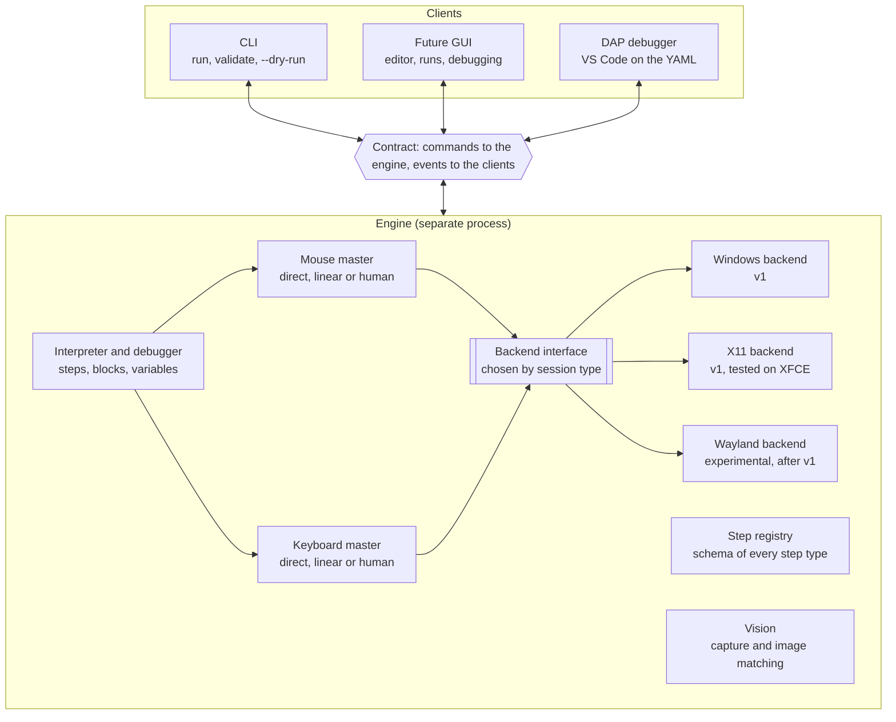
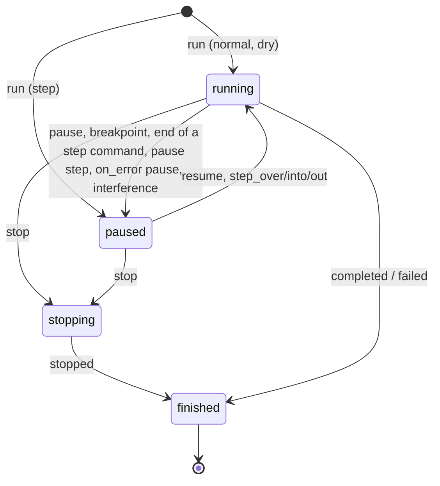

# j5-macro: command and event contract

> The source of truth for the design. Any protocol change lands here first, in the same pull request.

## Goals and design rules

The j5-macro core does not know who is using it: it receives commands and emits events, and everything else (CLI, GUI, debugger) is a client of that contract.

Scope of v1: Windows, and Linux with an X11 session (tested on XFCE). Wayland comes later as an experimental backend.

1. **No UI in the core.** No `print`, `input()` or dialogs: all output is an event.
2. **Everything is serializable.** Commands and events are JSON, with the same schema inside a process and between processes.
3. **The engine runs in its own process.** Clients never share its event loop, so a GUI never freezes and never competes with the engine that drives the mouse.
4. **Whatever a GUI needs is in the contract.** Steps with stable ids, planned trajectories, image-match scores, variables.
5. **Reproducible.** Every run has a seed, recorded in its events.
6. **Safe to abort.** Stopping a macro releases every held key and button, and there is a global emergency key.
7. **Steps describe themselves.** Each step type declares its parameters, types and documentation; the JSON Schema and the GUI forms are generated from that.

## Process and layer architecture



The engine runs in its own process: the CLI, the GUI and the debugger only send commands and receive events, and the input masters reach the system only through the backend interface, chosen by session type.

## Transport and message format

Every message is a JSON object on a single line (JSON Lines), identical over stdio, a local socket or an in-process call.

| Field | Type | Description |
| --- | --- | --- |
| `v` | integer | Schema version; starts at 1 and only increases on incompatible changes |
| `kind` | `command` \| `response` \| `event` | Direction and role of the message |
| `type` | string | Name, e.g. `run` or `step_started` |
| `id` | string | Commands and responses: correlation id chosen by the client |
| `run_id` | string or `null` | Events: the run; `null` for engine events outside any run (`ready`, `log`, `script_changed`) |
| `seq` | integer | Events: gap-free counter, one per run plus one for engine events |
| `ts` | string | UTC time, ISO 8601 with milliseconds; for display only |
| `t_ms` | integer | Events: milliseconds on a monotonic clock since the start of the run or the engine. The reference for timing and replay, since it never jumps when the system clock changes |
| `payload` | object | Content specific to the `type` |

Example event:

```json
{"v":1,"kind":"event","type":"step_started","run_id":"r-20261012-151051-d36f","seq":14,"ts":"2026-10-12T15:10:53.412Z","t_ms":2120,"payload":{"step_id":"open_menu","path":[0],"line":9,"type":"click","params":{"x":120,"y":40}}}
```

Rules:

- **Command and response.** The client sends a command with an `id`; the engine answers with `kind: response`, the same `id`, and either `ok: true` with `result` or `ok: false` with `error` (see the codes at the end).
- **Events are not acknowledged.** The engine emits them in order. If a client sees a gap in `seq`, it fetches the missing ones with `get_events`.
- **Handshake.** The engine emits `ready` when it starts. The client then sends `hello` with the range of versions it understands, and the engine answers with the chosen version and its capabilities: active backend (its name, or `null` without one), available input strategies (`direct`, `linear` and `human` with a backend, none without), registered step types and `vision` (`true` when the vision toolkit and its `vision` extra are installed; capturing the screen may still fail at run time, with `capability_missing`). Right after `ready`, the engine logs which emergency stop key it watches, or a `warning` with the reason when there is no backend or no stop key. Any other command before `hello` gets `invalid_state` with `details.reason: hello_required`.
- **No binaries in messages.** Screenshots and crops are saved under the run's directory and events carry the relative path.
- **Compatibility.** Unknown fields are ignored; a client must never fail on a new event or field. Optional fields whose value is `null` are omitted when serializing, so omitted and `null` mean the same.
- **Invalid lines.** A line that is not a valid command cannot be answered (it has no trustworthy `id`): the engine emits an engine `log` event at level `error` and carries on.
- **The client supervises the engine.** If the engine process dies, the client that started it releases the keys and buttons the last `input_state` event reported as held, newest first, with a backend of its own process (`button:<name>` with `button_up`, `char:<c>` with `char_up`, any other entry, a physical key name, with `key_up`), and says so.
- **Ctrl+C.** In a terminal, Ctrl+C reaches every process of the console. The engine ignores SIGINT when serving stdio: the client decides what Ctrl+C means (the CLI sends `stop`), and the engine ends when its stdin closes. On end of input with a run active, the engine stops the run, waits up to 5 s for `run_finished`, and exits with code 0.
- **Channels.** v1: stdio, with the client starting the engine as a subprocess (`python -m j5_macro.engine [--runs-dir DIR] [--stop-key COMBO]`). Later: a Unix socket or a Windows named pipe for a long-lived engine, and WebSocket if a web GUI needs it. Since those channels can inject input, they only accept the same user (socket permissions) and require a token handed over when the engine starts.

## Commands

There are 16 execution and debugging commands; script management commands have their own section. Control commands (pause, stepping, variables) only apply to an active run and return `not_running` otherwise.

| Command | Payload | Result and notes |
| --- | --- | --- |
| `hello` | `v_min`, `v_max`, `client` | Chosen `v` and capabilities (backend, input strategies, registered steps) |
| `list_step_types` | — | The step registry: name, parameters, types, defaults, documentation and JSON Schema |
| `load` | `path` or `source` | `script_id` (`s1`, `s2`, ...), the step tree with its ids, the declared `params` (name, `type`, `description`, `secret`, `required` and, unless secret, `default`), and `warnings`. On failure, the error code is the first problem's code and `details` holds `errors` (all of them) and `warnings` |
| `validate` | `script_id` | `ok`, `errors` and `warnings`. Re-reads a script loaded from a path, so it reports the file as it is now; never replaces the loaded script |
| `run` | `script_id`, `mode` (`normal`, `step`, `dry`), `params?` (values for the script's declared `params`), `vars?` (overrides for the script's `vars`, for debugging), `seed?`, `input_profile?`, `captures?` (`on_failure` by default: only the last attempt of an image search that fails; or `all`: every attempt) | `run_id`. Captures are saved in the run's directory (see run history); a run that is not saved keeps none. The engine emits `run_started` before answering. In `step` mode the run starts paused before the first step. If another run is active the answer is `busy`. A missing required param, an undeclared param or var, or a value of the wrong type answers `validation_failed` with `details.param` (or `details.var`) and `details.reason` (`missing`, `unknown` or `type`); every missing param is listed in `details.missing` |
| `pause` | `run_id` | Applies at the next atomic action: never cuts a movement or a key sequence in half, but does interrupt waits (`sleep`, `wait_image`), which continue with the remaining time on resume |
| `resume` | `run_id` | Continues until the next breakpoint or the end |
| `step_over` | `run_id` | Runs the current step completely, blocks included, and pauses at the next step at the same depth or shallower |
| `step_into` | `run_id` | Pauses at the very next step, entering blocks (`loop`, `if`); on a simple step it is the same as `step_over` |
| `step_out` | `run_id` | Finishes the current block and pauses right after it; at the top level it runs to the end or the next breakpoint |
| `stop` | `run_id`, `reason?` (`user` or `interference`) | Aborts immediately, releases keys and buttons, emits `run_finished` with `status: stopped` |
| `set_breakpoints` | `script_id`, `step_ids` | Replaces the client breakpoints of a script; applies to new runs and to the active run of that script. `break: true` steps in the script are added on top and only go away by editing the script. Unknown `script_id` → `script_not_found` |
| `get_state` | `run_id` | `state`, and the current step: `step_id`, `path`, `iterations` (as in step events: the current iteration of each enclosing `loop`, outermost first, 0-based; omitted outside loops), `line`; and the `variables`. The step is the one paused at or, while running, the one being run (absent before the first step). `path` and `iterations` together identify the position inside loops, and give the client the stack of enclosing blocks; the stepping depth is `(len(path) + 1) / 2`. Secret values in `variables` are masked (see "Secrets") |
| `set_variable` | `run_id`, `name`, `value` | Only while paused |
| `evaluate` | `run_id`, `expression` | `value` of an expression over the variables; only while paused |
| `get_events` | `run_id?`, `from_seq` | Returns in `result.events` the events with `seq >= from_seq`, without re-emitting them; used after a gap. Omitted or `null` `run_id` means the engine stream, of which the last 1000 events are kept. Run events are kept for the last 20 runs of the engine session |

Design rules:

- **Pause at the next atomic action, stop immediately.** `pause` and the `step_*` commands never leave the cursor or a key half-way, but they do not wait for a `loop` or a long `sleep` to end either: the engine reacts within one action. `stop` interrupts even in the middle of a movement, and the engine releases everything held before answering.
- **One run at a time.** There is one mouse and one keyboard, so `run` while another run is active answers `busy`.
- **One controller.** In v1 only one client may send control commands for a run; other clients, if any, only receive events.

## Events

Events describe everything the engine does, so a debugger or a GUI is built by listening to them. They all carry the common fields (`run_id`, `seq`, `ts`, `t_ms`). Step events add `step_id`, `path` (static position in the tree, see the script format), `iterations` (current iteration of each enclosing `loop`, outermost first; omitted outside loops) and `line`. Loop indices are 0-based.

| Event | When | Payload |
| --- | --- | --- |
| `ready` | When the engine starts, no `run_id` | `v`, `backend`, `capabilities` |
| `script_changed` | A loaded script's file changed on disk, was deleted, or was edited with `edit_script`; no `run_id` | `script_id`, `version` (`null` when deleted), `source` (`disk`, `edit` or `deleted`), `valid`, `errors?` (the validation problems when not valid) |
| `run_started` | First event of a run | `script_id`, `script_name` (the script's `name`), `mode`, `seed` (generated when the client gave none), `backend` (the engine's backend name, `none` without one), `input_profile` |
| `state_changed` | On every state change | `state` (`running`, `paused`, `stopping`), `reason?` (`breakpoint`, `step`, `user`, `error`, `interference`) |
| `run_finished` | Last event of a run | `status` (`completed`, `stopped`, `failed`), `reason?` (`user`, `interference`), `duration_ms`, `error?` |
| `step_started` | Before a step runs, before any effect; once per attempt | `step_id`, `type`, `params` with variables already resolved |
| `step_finished` | When the step completes | `step_id`, `duration_ms` (time spent paused excluded), `result` |
| `step_skipped` | A step was skipped | `step_id`, `reason` (`user`) |
| `step_failed` | Error or timeout in a step | `step_id`, `error` (`code`, `message`, `details.attempt`), `screenshot?` (the capture of a failed image search, relative to the run's directory) |
| `breakpoint_hit` | A breakpoint is reached, before the step runs | `step_id` |
| `branch_taken` | After an `if` is evaluated | `step_id`, `condition`, `value` (boolean), `branch` (`then` or `else`) |
| `loop_iteration` | At the start of each iteration | `step_id`, `index`, `total?` |
| `variable_changed` | A variable changes | `name`, `old` (`null` for a new variable), `new`, `step_id?` (absent when set by `set_variable`) |
| `image_search` | Each image search attempt, inside the step that searches | `template` (as written in the script), `threshold`, `found`, `best_score` (even when below the threshold), `bbox?` (best location, `[x, y, w, h]` on the desktop, reported even when not found; absent only when the template does not fit the searched area), `region` (the searched rectangle: the `region`, else the window, else the whole desktop), `attempt` (1-based, within the search), `elapsed_ms` (capture and matching of this attempt), `screenshot?` (path relative to the run's directory, as the `captures` policy decides) |
| `input_planned` | An input master finished planning; clicks and drags report each movement they make (none when the pointer is already there), scrolls their notches (no `from`/`to`) | `device` (`mouse` or `keyboard`), `strategy`, `seed` (the plan's own seed: planning again with it gives the same plan), summary (`from`, `to`, `duration_ms` or `chars`, `wpm`), `plan_ref?` (reserved: path, relative to the run's directory, to the JSON with the points or key events; not written yet) |
| `input_executed` | Input finished | `device`, `actual_duration_ms`, `aborted` |
| `input_state` | The set of held keys or buttons changed | `held` (list in press order: physical key names such as `ctrl` or the `a` of `ctrl+a`, layout-independent characters as `char:<c>`, and buttons as `button:<name>`); used by the client to release them if the engine dies |
| `user_interference` | The user moved the mouse during a planned movement (mouse only in v1); emitted before the action's keys and buttons are released | `expected` (the last point the master sent), `actual` (the real pointer), `action` (`pause` or `stop`) |
| `keys_released` | Pending keys or buttons were released | `keys` (in release order), `reason` (`aborted`: an interrupted action; `failsafe`: the corner failsafe; `interference`: user interference; `run_ended`: the end of a run) |
| `log` | Free text, including the script's `log:` step | `level`, `message`, `step_id?` |
| `trigger_fired` | Reserved for the triggers milestone | `trigger_id`, `kind` |

Emission rules:

- **`step_started` comes before acting.** A GUI can highlight the step and show the planned trajectory before the cursor moves.
- **Strict order by `seq`.** `step_started` precedes everything that happens inside the step, and `step_finished` or `step_failed` closes it.
- **Blocks wrap their children.** `if` and `loop` emit `step_started` before their children and `step_finished` after them, with results `{branch}` and `{iterations}`.
- **Heavy details by reference.** Screenshots, crops and point lists are saved under the run's directory and the event only carries the path.
- **A new event breaks nobody.** Clients ignore types they do not know.

## Run states and debugging semantics



A run starts in `running` (normal and dry modes) or `paused` (step mode) and always ends in `finished`. `stop`, or an interference configured to stop, is the only way to interrupt it, and goes through `stopping` to release keys and buttons before closing.

**Stepping.** Depth is the number of nested step lists (the top level is depth 1). A step command given while paused at depth `d`:

- `step_over` pauses at the next step at depth `d` or shallower. Over a `loop` it runs all iterations; over an `if` it runs the chosen branch. On the last step of a loop body, the next step is the first one of the next iteration.
- `step_into` pauses at the very next step, entering blocks (for an `if`, the chosen branch).
- `step_out` pauses at the next step shallower than `d`, finishing the current block including its remaining iterations. At the top level it runs to the end or the next breakpoint.
- Every step command goes `paused → running → paused` with `state_changed` events (reason `step`), so a GUI always knows when the engine is acting. `resume` goes to `running` with reason `user`.

**Breakpoints and pauses.**

- Breakpoints are the client's plus the script's `break: true` steps. The engine emits `breakpoint_hit` and pauses (reason `breakpoint`) before the step runs; after continuing, the step runs without triggering the same breakpoint again. Inside a `loop` a breakpoint fires on every iteration.
- A `pause:` step pauses right after it finishes, with reason `breakpoint`.
- Breakpoints and `pause:` steps also pause runs in `normal` mode. What happens next is the client's choice: the CLI asks for Enter when it runs in a terminal, and otherwise resumes on its own and says so; with `j5 run --step` or `--break` it gives its debugger prompt instead, at every pause.

**Errors.** A step that fails with `on_error: continue` logs the error and moves on. `retry` makes up to 3 attempts in total (each failure emits `step_failed` with `details.attempt`), then behaves like `stop`. `pause` emits `step_failed` and pauses with reason `error`: `resume` retries the step, `step_over` skips it (`step_skipped`, reason `user`), and `step_into` and `step_out` retry it and then pause as stepping says; in a terminal the CLI offers both (Enter retries, `s` and Enter skips and then carries on), and otherwise retries on its own up to twice per step and says so, then stops the run and exits with code 1. `stop` ends the run with `status: failed`.

**Interference.** User interference interrupts the movement: the master emits `user_interference` and releases what the action held (`keys_released`, reason `interference`). The step's `on_error` does not apply. With the profile's `interference: stop` the run logs a `warning`, goes through `stopping` and ends with `status: stopped` and `reason: interference`. With `pause` it pauses with reason `interference`, like `on_error: pause`: `resume` runs the step again (a new attempt, so a new sub-seed, starting from wherever the user left the pointer) and `step_over` skips it (`step_skipped`, reason `user`). The interrupted step emits neither `step_finished` nor `step_failed`. The CLI treats this pause like an `on_error: pause` one.

**Dry runs.** In `dry` mode no input is sent: input steps describe what they would do (`step_finished.result` holds `dry_run: true` and a `description`, plus an info `log`). Each image search (`wait_image`, image targets, `image_visible`) runs once, reports its `image_search` and moves on, found or not, since without clicks the screen never changes and a wait would always fail; the step's result adds `found`, `score` and `bbox`, and the description says where the target was found. When the search cannot be made (vision not installed, no window), the step logs a warning and goes on, and image conditions evaluate to false with a warning. With vision available, a missing image file still fails with `template_missing`. `while` loops are capped at 1000 iterations with a warning. Everything else (variables, loops, branches, logs, sleeps) runs as usual.

**Message sequence** of a `step_over` in step mode (abbreviated; → client, ← engine):

```
→ run {script_id: s1, mode: step}
← run_started                              seq 1
← response ok {run_id: r-1}
← state_changed paused (reason: step)      seq 2
→ step_over {run_id: r-1}
← state_changed running (reason: step)     seq 3
← step_started open_menu                   seq 4
← image_search found                       seq 5
← input_planned mouse, human               seq 6
← input_executed mouse                     seq 7
← step_finished open_menu                  seq 8
← state_changed paused (reason: step)      seq 9
```

## Debug Adapter Protocol

`j5 dap` (or `python -m j5_macro.dap`) is a [Debug Adapter Protocol](https://microsoft.github.io/debug-adapter-protocol/) server on stdio (`Content-Length` framed JSON, binary streams), so editors such as VS Code debug scripts with breakpoints on the YAML lines (extension skeleton in `editors/vscode`). It is an ordinary client of the engine: it starts it like the CLI (`J5_ENGINE_CMD` included), one engine and one run per debug session, with a single thread, `j5 run`. Lines and columns follow the client's `linesStartAt1`/`columnsStartAt1`; the engine's are 1-based.

| DAP request | Engine | Notes |
| --- | --- | --- |
| `initialize` | — | Capabilities: `supportsConfigurationDoneRequest`, `supportsEvaluateForHovers`, `supportsSetVariable`, `supportsTerminateRequest`; no restart, step back or exception filters. The `initialized` event follows the response |
| `launch` | starts the engine, `hello`, `load` | Arguments: `program` (the YAML, relative to `cwd`), `stopOnEntry` (`step` mode), `dryRun` (`dry` mode), `noDebug`, `params`, `paramsFromEnv` (param name to environment variable of the adapter), `seed`, `fast` (`direct` mouse and keyboard `input_profile`); others are ignored. Load errors are sent as `output` events (`path:line: message`) and fail the launch, as do missing required params |
| `setBreakpoints` | `set_breakpoints` | Lines become step ids (see below); before `launch` they stay unverified and a `breakpoint` event (`changed`) reports each one after the script loads. Breakpoints in another file are not verified |
| `configurationDone` | `run` | Starts the run once the script is loaded |
| `continue`, `next`, `stepIn`, `stepOut`, `pause` | `resume`, `step_over`, `step_into`, `step_out`, `pause` | |
| `stackTrace` | `get_state` | The current step (`<id> (<type>)`, its line) and its enclosing `loop`/`if` steps, innermost first; loops add `iteration <n> of <total>` (1-based), from `get_state`'s `iterations` when reported, else the latest `loop_iteration`. Paused before the first step, the first step |
| `scopes`, `variables` | `get_state` | One `Variables` scope; values as JSON (secrets arrive as `***` and are shown so); lists and maps expand, with `evaluateName`s such as `data["list"][0]` |
| `setVariable` | `set_variable` | The value is parsed as JSON, else taken as text; an item inside a list or map replaces the whole variable, refused when the variable holds a masked secret |
| `evaluate` (`repl`, `watch`, `hover`) | `evaluate` | Only while paused |
| `terminate` | `stop` | The run ends through `run_finished` |
| `disconnect` | `stop`, then close the engine | Waits up to 5 s for `run_finished` |

| Engine event | DAP event |
| --- | --- |
| `state_changed` `paused` | `stopped` with reason `entry` (the first pause with `stopOnEntry`), `step`, `breakpoint`, `pause` (reason `user`), `exception` (reason `error`, with the failed step's error message as `text`), or `pause` with description `user moved the mouse` (reason `interference`) |
| `state_changed` `running` | `continued` |
| `run_started`, `step_started`, `step_skipped`, `log` (`info`, `debug`) | `output`, category `console`, with the step's source and line when known |
| `step_failed`, `user_interference`, `log` (`warning`, `error`) | `output`, category `stderr` |
| `run_finished` | `output`, then `exited` (`exitCode` 0 completed, 1 failed, 3 stopped) and `terminated` |
| `loop_iteration` | none; feeds the iteration shown in the call stack |

**Breakpoint lines.** A line where a step starts is that step. A blank or comment line counts as the next line with content. A content line inside a step (indented deeper than the step's `-` and not closed by a line at or left of it) is the innermost step containing it, so a breakpoint on `click:` or on an `if`'s `else:` works. Any other line before a step (the header) is the first step after it. A line past the last step has no step and stays unverified. Verified breakpoints report the step's line, which moves the marker there.

**Dry runs and `noDebug`.** `dry` mode cannot start paused, so `dryRun` with `stopOnEntry` adds a breakpoint on the first step and removes it at the entry stop. With `noDebug` no breakpoints are sent and the adapter resumes every pause on its own (breakpoint steps, `pause:` steps); a pause for an error or interference stops the run instead, since nobody can decide.

## Mouse and keyboard masters

There is one master per device, and it decides *how* the mouse moves or the text is typed; the backend only knows how to execute primitives. All human-like behaviour lives in the master and is identical on every operating system.

**Backend selection.** The engine picks one backend at startup and reports it in `ready`, `hello` and `run_started`. `J5_BACKEND` overrides the choice: `auto` (default), `x11`, `windows`, `fake` (records input and touches nothing, for tests and demos) or `none`. With `auto` on Linux, a Wayland session (`XDG_SESSION_TYPE=wayland` or `WAYLAND_DISPLAY` set) gets no backend, even if `DISPLAY` is set, since XWayland only reaches X11 applications: log in with an X11 session instead, or set `J5_BACKEND=x11` explicitly. Otherwise `DISPLAY` selects X11 (it needs the `x11` extra: `pip install j5-macro[x11]`). Windows gets its backend in milestone M6. Without a backend, dry runs still work and input steps fail with `capability_missing` giving the reason.

**Backend interface** (the only part that changes per platform):

| Primitive | Notes |
| --- | --- |
| `pointer_position()` | Real cursor position, the starting point of every movement. Optional: Wayland cannot always report it, and without it there is no interference detection |
| `move_abs(x, y)` or `move_rel(dx, dy)` | The backend declares which it supports; Wayland with uinput is usually relative only |
| `button_down(b)`, `button_up(b)`, `scroll(dx, dy)` | Buttons and wheel |
| `key_down(k)`, `key_up(k)` | Physical keys, for shortcuts and modifiers |
| `char_down(c)`, `char_up(c)` | Press and release a character regardless of the keyboard layout (ñ, accents, dead keys, symbols). Separate calls so the `human` profile controls how long each key is held |
| `screen_bounds()` | The virtual desktop: the bounding box of every screen |
| `find_window(title)` | Client area (without decorations), in desktop coordinates, of the topmost visible window whose title contains `title` (case-sensitive); for window-relative coordinates |
| `watch_hotkey(keys, callback)` | Calls back whenever a combination (modifiers plus exactly one other key) is pressed, whatever the lock keys and even when another application has the focus; for the emergency stop. Raises if another program already owns the combination: the engine then warns and relies on the corner failsafe |
| `close()` | Releases anything still held, then the display connection and any temporary state, such as key remaps |
| `capabilities` | Which of the above exist (`pointer_position`, `move_abs`, `move_rel`, `char_input`, `screen_capture`, `windows`, `hotkey`); the master adapts |

Physical keys are named in lowercase: modifiers `ctrl`, `shift`, `alt`, `super`; named keys `enter`, `tab`, `escape`, `backspace`, `delete`, `insert`, `space`, arrows `up`/`down`/`left`/`right`, `home`, `end`, `pageup`, `pagedown`, `capslock`, `menu`, `printscreen`, `f1` to `f24`; and single printable ASCII characters. The input layer resolves aliases in scripts (`esc`, `return`, `control`, `cmd`, `win`, `del`, `pgup`...) before calling the backend.

**Plan, then execute.** Every input action goes through three phases:

1. **Plan.** A pure, seeded function produces the timed points (`t_ms`, `x`, `y`) or key events (`t_ms`, `key`, `down` or `up`). It does not touch the system, so it is testable without a display. `input_planned` is emitted.
2. **Execute.** The plan is replayed against a monotonic clock: the position is computed from the elapsed time, not from fixed sleeps, so errors never accumulate and the movement lasts what was planned.
3. **Close.** `input_executed` is emitted with the actual duration.

**Strategies:**

| Strategy | Mouse | Keyboard |
| --- | --- | --- |
| `direct` | Jumps to the target | Types the whole text at once |
| `linear` | Straight interpolation at constant speed | Fixed interval between keys |
| `human` | Curve with random deviations (Bézier or WindMouse), bell-shaped speed, Gaussian target inside the matched area, occasional overshoot and correction, micro-jitter | Log-normal intervals whose mean matches the WPM, longer pauses after spaces, punctuation and `enter`/`tab`, rare thinking pauses between words, log-normal hold times with slight rollover (at most two keys down; `enter`, `tab` and `backspace` never overlap), optional typos |

**Input profile parameters:**

| Device | Parameter | Meaning |
| --- | --- | --- |
| Mouse | `strategy`, `speed` | Strategy and speed multiplier (1.0 = normal) |
| Mouse | `path` | Path shape for `human`: `windmouse` (default; gravity and wind, slightly erratic) or `bezier` (smooth curves). Both are implemented in j5-macro as pure seeded functions; a shared timing layer adds the rest: a duration from Fitts' law (`a + b·log2(D/W + 1)`, `W` the target's smaller side, divided by `speed`, with slight noise), a minimum-jerk speed curve peaking slightly before the middle, a point every ~8 ms, overshoot and jitter. Points stay inside the desktop and, except the landing, clear of its corners so the failsafe never fires on a planned point |
| Mouse | `overshoot`, `jitter` | Overshoot probability (0 to 1; only movements over 100 px: aim a few percent past the landing, at most 40 px, pause 30–100 ms, then correct) and amplitude in pixels of smoothed sideways jitter that fades out at both ends |
| Mouse | `interference`, `tolerance` | Action on interference (`pause`, `stop` or `off`) and allowed deviation in pixels (20 by default) |
| Keyboard | `strategy`, `wpm` | Strategy and speed in words per minute |
| Keyboard | `variance`, `typos` | Spread of the intervals (log-normal sigma; `0` is fully regular, without pauses), and typos (`false` by default): about 3% of ASCII letters hit a neighbouring QWERTY key, noticed at once or one or two characters later, then erased with `backspace` and retyped |
| Both | `seed` | Base seed of the run |

Each step's effective profile is the defaults, then the script's `input`, the run's `input_profile`, the step's `input` and, last, step parameters such as `type`'s `keyboard`; an invalid profile fails the step with `validation_failed`.

**Safety and reproducibility:**

- **Held state.** The master tracks which keys and buttons are held and emits `input_state` on every change. On `stop`, or on an error, it releases them all and emits `keys_released`.
- **Backends with relative movement only.** If the backend can neither move absolutely nor report the pointer, the first movement of a session pushes the pointer to the top-left corner of the desktop so later movements start from a known place.
- **If the engine dies.** The client that started it releases whatever the last `input_state` reported as held, so an engine crash never leaves Shift or Ctrl stuck.
- **Interference detection, mouse only in v1.** Before each point of a movement after the first (every strategy) the master reads the real pointer position once and compares it with the last point it sent; a distance beyond `tolerance` pixels is user interference (see "Interference" under run states). The same read serves the corner failsafe, which wins when both apply. It requires `pointer_position`: with `interference` other than `off` on a backend without it, the steps that move the pointer (`click`, `move`, `drag`) fail with `capability_missing` (`details.capability: pointer_position`) before sending anything. The keyboard is left out because on X11 injected keys are hard to tell apart from the user's.
- **Emergency stop.** A global hotkey, `ctrl+alt+shift+q` by default (engine option `--stop-key`, else env `J5_STOP_KEY`; key names and aliases as above, joined with `+`), stops the active run with reason `user` after a `warning` `log` in that run. It needs the backend's `hotkey` capability; without it the engine logs a warning at startup. As a fallback, moving the cursor into a corner of the virtual desktop (within 2 pixels) while the run is moving it stops the run too: masters check the real pointer position between points, release what they hold and raise `EmergencyStop`, and the interpreter stops the run with reason `user` and a `warning` `log`. On Wayland global hotkeys depend on the compositor, which is why the fallback matters.
- **Per-action seeds.** Each attempt of a step gets a random generator seeded with a sub-seed derived (the first 64 bits of the SHA-256 of a canonical JSON encoding) from `seed`, `step_id`, `iterations` and the attempt number (1 for the first attempt; a retry with `on_error: retry` or `pause`, or after interference, is a new attempt), so every iteration of a `loop` and every retry moves differently. The step's random choices (duration variances included) come from that generator, and each plan draws its own seed from it, reported in `input_planned`. The same seed, start point and target give the same plan, and a whole run with the same seed sends the same input if the screen behaves the same; if the cursor position or the matched image location changes, the plan changes even with the same seed.
- **Typos never change the result.** With `typos` on, an automated test checks that the planned key events, corrections included, produce the original text. A correction never erases past an `enter` or `tab`, nor runs past the end of the text. It cannot check the target application (autocomplete may interfere), which is why `typos` is off by default.
- **Fast mode.** `run` accepts an `input_profile` with `direct` strategies to debug without waiting.

## Script format and step registry

A script is declarative YAML: every step is data with a type, parameters and a stable id, so a GUI can read it, show it and rewrite it without losing comments (parsed with `ruamel.yaml`).

```yaml
version: 1
name: Save report
input:
  mouse:    {strategy: human, speed: 1.0}
  keyboard: {strategy: human, wpm: 55}
params:
  customer: {description: Name to type in the form}
  password: {secret: true}
vars:
  filename: october_report
steps:
  - id: open_menu
    click: {image: img/file_menu.png, threshold: 0.9}
  - id: wait_dialog
    wait_image: {image: img/save_dialog.png, timeout: 10s}
    on_error: stop
  - type: {text: "${filename}", keyboard: {strategy: direct}}
  - id: confirm
    break: true
    key: {press: enter}
  - loop:
      times: 3
      do:
        - if:
            when: {image_visible: img/error.png}
            then:
              - click: {image: img/retry.png}
              - sleep: 2s
```

**Format rules:**

- **One type per step.** A step is a mapping with one step-type key and optional common fields: `id`, `break`, `timeout`, `on_error` (`stop`, `continue`, `retry` or `pause`) and `input` to override the input strategy for that step. The type's value is a mapping of parameters, a scalar for the type's shorthand parameter (`sleep: 2s`, `log: hello`), or nothing.
- **Params.** `params` declares the values a script takes from outside, so the same script can type different text on every run. Each entry maps a name (an identifier, not also in `vars`) to `{type?, description?, default?, secret?}`, or to nothing for a required string. `type` is `string` (the default), `integer`, `number` or `boolean`. A param without `default` is required. When the run starts, params become variables like `vars`, so steps use them as `${customer}`. Values arrive with `run` and must match the type; a string is converted for the other types only when it is exactly an integer, a number, or `true`/`false`. A string param is taken verbatim: no YAML or expression parsing, so `#`, quotes, leading zeros and line breaks survive. Secret params (`secret: true`) cannot have a default (a secret must not live in the script file); see "Secrets".
- **Secrets.** The values of secret params never leave the engine: every run event (on the wire and in `events.jsonl`) and the `get_state` and `evaluate` answers have each occurrence of a secret value replaced with `***`, whatever carried it (a `step_started` parameter, a `log` message, an error message, a variable built by concatenation). A numeric value equal to a secret's text is masked too, except in the top-level integer fields of events and of the `get_state` answer that only say where or how long (`path`, `iterations`, `line`, `index`, `total`, `duration_ms`), so a short numeric secret never breaks a position. Only the exact text is masked: a value transformed by an expression (`upper(password)`) is not recognised, so scripts should use secrets as they are. `type` never reports the text it types, only how many characters (so a secret's length is visible); with `typos` on, mistyped characters are not reported either. Values are masked when the run starts sending events, so a param given with the wrong type is not repeated in the error either. Masking protects logs and history, not the screen: the target application shows what is typed unless its field hides it.
- **Stable ids.** Ids match `[A-Za-z_][A-Za-z0-9_-]*` and are unique in the script. A missing `id` is generated from the type and position: the n-th step of a type, counting steps that have explicit ids, gets `<type>_n` (a clash with an explicit id adds a suffix, `<type>_n_2`), with a warning. Adding an id to one step therefore never renames the others. Saving through `edit_script` writes the ids, so breakpoints and history survive reordering.
- **Blocks.** `if` (`then` and `else`) and `loop` (`times`, `while` or `for_each`, with `as`) contain step lists. `path` alternates the position in a list and the block slot of the parent step: `[3, 1, 0]` is the first step of the second block (`else`) of the fourth step. Slots are numbered in the order the step type declares them (`if`: `then` 0, `else` 1; `loop`: `do` 0).
- **Conditions and expressions.** `when` and `while` take an expression or a predefined condition: `{image_visible: img/x.png}`, or `{image_visible: {image, threshold?, scale?, region?, window?}}`, makes one search (one `image_search`, never a capture under `on_failure`, since not finding the image is not a failure) and is true when the image is found. Expressions support literals (`true`, `false`, `null` included), variables, lists and mappings, indexing, `+ - * / // %`, comparisons (chainable) and `in`, `and`/`or`/`not`, `a if c else b`, and calls to whitelisted functions (`len`, `str`, `int`, `float`, `bool`, `round`, `min`, `max`, `abs`, `lower`, `upper`, `strip`, `contains`, `startswith`, `endswith`). There is no Python `eval`; attribute access, `**`, lambdas and comprehensions are rejected, and length, nesting and result sizes are capped.
- **Interpolation.** String parameters may contain `${expression}`. A string that is a single `${...}` keeps the value's type (`x: "${pos_x}"` is an integer); otherwise values are rendered as text (`null` as empty, booleans as `true`/`false`). `$${` is a literal `${`. Parameters of type expression or condition are evaluated, never interpolated. Interpolated values are type-checked again before the step runs.
- **Coordinates.** `x`/`y` are physical pixels on the virtual desktop, which spans every screen and may be negative. With `window: {title: ...}`, coordinates and `region` are relative to the top-left corner of the frame of the first visible window whose title contains `title`, looked up when the step runs, so they survive the window being moved; no such window fails with `window_not_found`, and a backend without the `windows` capability with `capability_missing`. `offset: [dx, dy]` is added to the resulting point. `drag` points (`from`, `to`) take their own `window`, and may be `{image: ...}` targets too. An `image` target (`click`, `move`, `drag`) is searched once, or until the step's common `timeout` when it is set, and fails with `image_not_found` if it is not there; the action aims at the centre of the match plus `offset`. Without an offset the match is the target area the `human` strategy lands in (a `human` click whose pointer is already inside it clicks there without moving, as a person would; `move` always moves); with one, the mouse aims at the exact point. Full-desktop and `region` searches need no backend; `window` searches need one with the `windows` capability. On Windows the engine declares per-monitor DPI awareness so the system never scales coordinates.
- **Images.** Paths relative to the script file's directory (the engine's current directory for a script loaded from `source`), `threshold` (0.9 by default), an optional search `region` (`[x, y, w, h]`, relative to the step's `window` when given, else absolute; without a region the window, else the whole desktop, is searched), and `scale` (1 by default) to compensate templates captured at another scaling. A missing or unreadable file fails with `template_missing`. Searches need the `vision` extra (`pip install j5-macro[vision]`); without it, or when the screen cannot be captured, they fail with `capability_missing`. A wait retries every 0.25 s; `pause` suspends it and paused time does not count towards its timeout, and `stop` ends it at once. Matching uses normalized cross-correlation: `best_score` is in [0, 1], and `found` means `best_score >= threshold`. A PNG's transparent pixels (alpha below 128) are ignored, so a cut-out icon matches on any background; a template with no variation in its visible pixels (a single flat colour) never matches, so templates need some texture or an edge. `scale` must be greater than 0. A region is clipped to the virtual desktop; a region entirely outside it fails with `validation_failed` (`details.param: region`).
- **Durations.** Written with a unit (`2s`, `500ms`, `1.5m`, `1h`) and an optional variance (`2s±20%` or `2s+-20%`) for less mechanical pauses. A bare number means seconds. The common `timeout` field applies to image searches: it replaces `wait_image`'s `timeout`, and makes `click`, `move` and `drag` wait up to that long for their image targets (they search once otherwise). Other steps ignore it.

**v1 step types:**

| Step | Main parameters |
| --- | --- |
| `click` | `image` or `x`/`y`, `window?`, `button`, `clicks`, `offset`, `threshold`, `scale?`, `region?` |
| `move` | `image` or `x`/`y`, `window?`, `threshold?`, `scale?`, `region?` |
| `drag` | `from`, `to` (each `{x, y, window?}` or `{image, threshold?, scale?, region?, window?}`), `button` |
| `scroll` | `dx`, `dy` |
| `type` | `text`, `keyboard?` |
| `key` | `press` (e.g. `ctrl+s`), `hold?` |
| `wait_image` | `image`, `timeout` (10 s by default), `threshold`, `region?`, `window?`, `scale?`; the result is `{found, score, bbox}` |
| `sleep` | Duration, with optional variance |
| `if` | `when` (expression or condition), `then`, `else?` |
| `loop` | `times`, `while` or `for_each` (with `as`), and `do` |
| `set` | `name`, and `value` or `expr` |
| `log` | `message`, `level` |
| `pause` | `message`; pauses the run until `resume`, like a breakpoint written in the script |

**Key combinations** (`key` steps and the stop key) are written as modifiers then one key, joined by `+`, case-insensitive: `ctrl+shift+s`, `alt+f4`, `super+e`. A final single ASCII character is the physical key that types it on a US layout. The `+` and `-` keys are written `plus` and `minus` (`ctrl+plus`). Aliases: `esc`, `return`, `control`/`ctl`, `cmd`/`win`/`meta`, `option`, `del`, `ins`, `pgup`, `pgdn`. To type text, including non-ASCII characters, use `type`, where `\n` and `\r` press Enter, `\t` Tab and `\b` Backspace; other control characters are rejected. Some keymaps lack `f13` to `f24`; using one then fails with `validation_failed`.

**Step registry.** Each type is registered with its name, its parameter schema (name, type, required, default, documentation), its cross-parameter checks and the function that executes it. From that single registry come:

- the validation of `load` and `validate`,
- a JSON Schema for editor completion and validation (`j5 schema`, e.g. with the VS Code YAML extension),
- the answer to `list_step_types`,
- the parameter forms of the future GUI.

Adding a step (including a third-party one, registered as a plugin through the `j5_macro.steps` entry point group) means registering it; neither the interpreter nor the GUI changes.

## Script management

No client parses or rewrites YAML: it asks the engine for structured edits by `step_id`, so formatting, comments and validation live in one place, whatever language the GUI is written in.

| Command | Payload | Result and notes |
| --- | --- | --- |
| `list_scripts` | `root?` | Scripts under `root` (the engine's working directory by default; relative roots resolve against it), searched recursively for `*.yaml` and `*.yml` in path order, skipping hidden directories and stopping after 1000 such files: `path` (absolute), `name` (the script's `name`, else the file stem), `modified` (UTC, ISO 8601) and `valid`. Files that are not scripts (no top-level `steps`) are left out; a file that is not valid YAML is listed (`valid: false`) when a line starts with `steps:`. A `root` that is not a directory answers `validation_failed` with `details.reason: no_directory` |
| `create_script` | `path`, `name` | Writes a new script (`version: 1`, `name`, `steps: []`; UTF-8 with `\n` line ends) and loads it: `script_id` and `version`. A relative `path` resolves against the engine's working directory. An existing file is never overwritten: `validation_failed` with `details.reason: exists`; a missing parent directory answers `validation_failed` with `details.reason: no_directory` |
| `get_script` | `script_id` | `version`, `source` (the current YAML text), `name`, `path` (`null` for a script loaded from `source`), `steps` (the step tree with ids, parameters and lines), `params`, `valid` and `errors`. While the current text is invalid, `name`, `steps` and `params` are those of the last valid version, the one the engine keeps |
| `edit_script` | `script_id`, `base_version`, `edits` | Applies the edits in order, validates and saves; answers the new `version`, `valid` and `errors` (the problems of the resulting script). The base is the file as it is when the command arrives (re-read, even if the watcher has not noticed a change yet; `script_not_found` if it cannot be read), or the current text of a script loaded from `source`, which is edited in memory only. If it changed since `base_version`, answers `conflict` (`details.version`: the current one) and changes nothing. An edit that cannot apply (unknown step id, impossible position, a block moved into itself) answers `validation_failed` with `details.edit` (its index) and changes nothing; a current text that is not valid YAML answers `parse_error`. Edits are applied one at a time; when the text does not change, nothing is written and no event is emitted |
| `list_runs` | `script_id?`, `limit?` | Saved runs, newest first (by `started`): `run_id`, `script_name`, `script_path`, `mode`, `status` (`null` if it never finished; also for the active run, which is listed), `started`, `duration_ms`. `script_id` keeps the runs of that loaded script's file (by path, from any engine session); for a script loaded from `source`, which has no path, the runs of that `script_id` in this engine session. Unknown `script_id` → `script_not_found`. `limit` (default 20, not negative) caps the list. A run directory whose `run.json` is missing or unreadable is left out with an engine `log` warning; it never fails the command |
| `get_run` | `run_id`, `from_seq?` | A run from the history: its `run.json` fields as `run` (only `run_id` when that file is missing or unreadable), its `events` (from `from_seq`, 1 by default) and `captures` (the files under `captures/`, as paths relative to the run's directory with `/`, sorted). For the active run, what is saved so far. An unfinished last line of `events.jsonl` (being written, or cut by a crash) is ignored; other unreadable lines are skipped with an engine `log` warning. Unknown `run_id` → `not_running` |
| `delete_run` | `run_id` | Deletes the run's directory. The active run cannot be deleted (`invalid_state`, `details.reason: active`). Unknown `run_id` → `not_running` |

Edit kinds inside `edits`:

| Edit | Fields | Effect |
| --- | --- | --- |
| `insert` | `step`, `to` | Adds a step at a position. `step` is the step as written in YAML (`{"click": {"x": 1}, "on_error": "continue"}`), with exactly one registered step type; the steps of its blocks are steps too. The engine assigns each missing `id` (`<type>_<n>`, `n` one more than the steps of that type, skipping used ids); a given `id` must be valid and unused |
| `update` | `step_id`, `params`, `common?` | Replaces the given parameters of a step (`null` removes one); `common` changes `break`, `timeout`, `on_error` or `input` the same way. Blocks are not parameters (they change through `insert`, `move` and `delete`). A step in its short form (`sleep: 2s`) keeps it while the shorthand parameter is all it has, and becomes a mapping otherwise |
| `move` | `step_id`, `to` | Moves a step, also across blocks; `index` is its position in the list once it has been taken out. Moving it right after itself changes nothing; into itself or its own blocks cannot apply |
| `delete` | `step_id` | Deletes a step and, for a block, its content |
| `set_meta` | `name?`, `input?`, `params?`, `vars?` | Changes the script header: each given key replaces that section (entries whose value does not change keep their formatting); an empty mapping removes `input`, `params` or `vars`; omitted or `null` leaves it as it is |

A position (`to`) is either `{after_step_id}`, right after that step in the same list, or `{parent_step_id?, block?, index?}`: the list of steps at the top level when `parent_step_id` is absent, else the `block` (`then`, `else` or `do`) of that step, at `index` (from 0, at most the length of the list; the end of the list by default). A missing `else` is created when a step is put in it; a missing `then` or `do` is not, and a block the step type does not have (`do` of an `if`) cannot apply.

Rules:

- **The file is preserved.** Every edit keeps the comments and formatting of the rest of the YAML: untouched lines stay byte for byte, and an end-of-line comment keeps its column. The comment lines right above a step belong to it and move or go away with it. New content follows the file's indentation (detected from its first block list and nested mapping, else 2 spaces with `- ` indented by 2): new steps are block mappings with `id` first, and a new mapping or list whose values are all scalars is written in flow style (`{x: 1, y: 2}`). Files are written as UTF-8 with `\n` line ends, atomically (a temporary file and a rename).
- **Versions.** A script's `version` is the first 16 hex digits of the SHA-256 of its text (UTF-8), so it changes exactly when the content changes, whoever changes it.
- **The engine watches files.** Every loaded script with a path is checked about twice a second (scripts loaded from `source` are not watched). When the content changes, the engine re-reads it and emits `script_changed` (`source: disk`); `edit_script` emits it too (`source: edit`), and its own writes never produce a `disk` event as well. Only a change of `version` counts: touching a file or rewriting the same content emits nothing. A valid new version replaces the loaded one; an invalid one is kept with its errors, and `run` answers `validation_failed` until the script is fixed. A deleted file emits `source: deleted` once and the script stays loaded as it was; if the file comes back, `source: disk` is emitted again, even with the same content.
- **Ids are written.** Saving through `edit_script` writes every step's id into the file, so generated ids become stable. A step without an `id` gets the one the loader generated for it, so ids, breakpoints and history stay valid; an invalid `id` is left as it is (and still reported).
- **Editing does not affect what is running.** A run keeps the version it loaded; changes apply to the next run.

**Run history.** Each run is saved in `<runs dir>/<run_id>/`: `events.jsonl` (one event per line, appended as emitted) and `run.json` (`run_id`, `script_id`, `script_name`, `script_path`, `mode`, `seed`, `started`, and on completion `finished`, `status`, `reason`, `duration_ms`, `error`), and `captures/` with the screen captures of image searches, named `<n>-<step_id>-<attempt>.png` (`n` counts the run's captures from `0001`; `attempt` is the search attempt). Events reference these files by their path relative to the run's directory, with `/` separators. A capture that cannot be saved only logs a warning. The runs dir is the engine's `--runs-dir` option, else `J5_RUNS_DIR`, else the platform state directory plus `j5-macro/runs` (`$XDG_STATE_HOME` or `~/.local/state` on Linux, `~/Library/Application Support` on macOS, `%LOCALAPPDATA%` on Windows). When a run starts, older runs are deleted so the newest 20 remain. A persistence failure never affects a run; it becomes an engine `log` warning. Secret values are masked in `run.json` (its `error`) as in the events. `list_runs`, `get_run` and `delete_run` read this directory, so they also see the runs of earlier engine sessions; an engine embedded without a runs directory saves nothing, so its `list_runs` answers no runs and `get_run` and `delete_run` answer `not_running`. Their `run_id` must have the run id's exact shape (`r-YYYYMMDD-HHMMSS-xxxx`, ASCII digits and lowercase hex), else they answer `validation_failed` with `details.field: run_id`, so a request never reaches outside the runs directory.

## Errors and open decisions

Every error, in a response or in an event, has the shape `{code, message, step_id?, line?, details?}`; the `code` is stable and the `message` is for people.

| Code | When |
| --- | --- |
| `parse_error` | The YAML is invalid; includes line and `details.column` |
| `validation_failed` | A parameter is missing or has the wrong type, an id is duplicated, or a message is malformed; includes the field path |
| `unknown_step_type` | The step type is not in the registry |
| `script_not_found` | The `script_id` does not exist or the file cannot be opened |
| `not_running` | A control command without an active run, or for an unknown or finished run; `get_run` or `delete_run` for a run that is not in the history |
| `invalid_state` | The command is not allowed in the current state (e.g. `set_variable` while running). `details.reason` adds `hello_required` before the handshake and `not_implemented` for contract commands the engine does not implement yet |
| `busy` | `run` while another run is active (`details.run_id`) |
| `conflict` | The script changed since the `base_version` sent with `edit_script` |
| `template_missing` | A step's image file does not exist or is not a readable image; `details.template` (as written) and `details.path` (resolved) |
| `image_not_found` | `wait_image` or an image-based step ran out of time; `details.best_score`, `threshold`, `template` and `attempts` |
| `window_not_found` | No visible window matches a step's `window`; `details.title` |
| `expression_error` | An expression or an interpolation failed; `details` has the `expression` and, when known, the `column` |
| `backend_unavailable` | No backend fits the current session (e.g. Wayland without support) |
| `capability_missing` | The backend lacks something a step or profile needs, e.g. `pointer_position` for interference detection or `windows` for window-relative coordinates; or there is no backend at all (the message gives the engine's reason), or vision is not installed or cannot capture the screen (the message says which) |
| `input_denied` | The system refused input or capture for lack of permissions |
| `internal_error` | Unexpected engine failure; `details.traceback` holds the trace |

**Decisions already made:** the engine runs in its own process; Python 3.11 or later; scripts in YAML; v1 targets Windows and Linux with X11; one active run at a time.

**Open decisions**, each with the recommendation to close it:

| Decision | Recommendation |
| --- | --- |
| A `python:` step as an escape hatch | Not in v1. It breaks visual editing and runs arbitrary code; third-party steps come in as registered plugins |
| Several clients at once | One controller plus read-only observers, after v1 |
| Keyboard interference | Out of v1: on X11 injected keys are hard to tell apart from the user's. Windows can do it and may get it earlier |
| Triggers (time, image, window) | Out of v1; the `trigger_fired` event is reserved |
| Wayland | Experimental backend after v1, on libei or wdotool, behind the same backend interface. Without a reliable `pointer_position`, interference detection is disabled |
