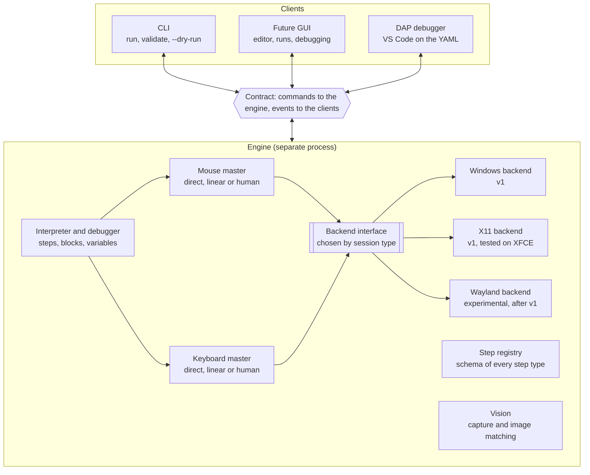
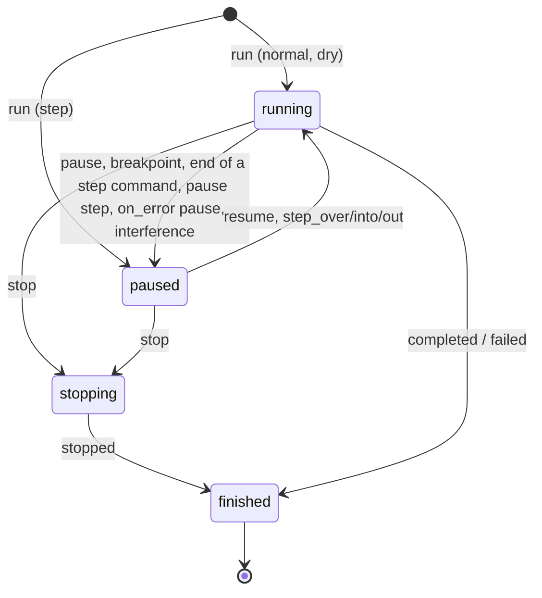

# j5-macro: command and event contract

> The source of truth for the design. Any protocol change lands here first, in the same pull request.

## Goals and design rules

The j5-macro core does not know who is using it: it receives commands and emits events, and everything else (CLI, GUI, debugger) is a client of that contract.

Scope of v1: Windows, and Linux with an X11 session (tested on XFCE). Wayland comes later as an experimental backend.

1. **No UI in the core.** No `print`, `input()` or dialogs: all output is an event.
2. **Everything is serializable.** Commands and events are JSON, with the same schema inside a process and between processes.
3. **The engine runs in its own process.** Clients never share its event loop, so a GUI never freezes and never competes with the engine that drives the mouse.
4. **Whatever a GUI needs is in the contract.** Steps with stable ids, planned trajectories, image-match scores, variables.
5. **Reproducible.** Every run has a seed, recorded in its events.
6. **Safe to abort.** Stopping a macro releases every held key and button, and there is a global emergency key.
7. **Steps describe themselves.** Each step type declares its parameters, types and documentation; the JSON Schema and the GUI forms are generated from that.

## Process and layer architecture



The engine runs in its own process: the CLI, the GUI and the debugger only send commands and receive events, and the input masters reach the system only through the backend interface, chosen by session type.

## Transport and message format

Every message is a JSON object on a single line (JSON Lines), identical over stdio, a local socket or an in-process call.

| Field | Type | Description |
| --- | --- | --- |
| `v` | integer | Schema version; starts at 1 and only increases on incompatible changes |
| `kind` | `command` \| `response` \| `event` | Direction and role of the message |
| `type` | string | Name, e.g. `run` or `step_started` |
| `id` | string | Commands and responses: correlation id chosen by the client |
| `run_id` | string or `null` | Events: the run; `null` for engine events outside any run (`ready`, `log`, `script_changed`) |
| `seq` | integer | Events: gap-free counter, one per run plus one for engine events |
| `ts` | string | UTC time, ISO 8601 with milliseconds; for display only |
| `t_ms` | integer | Events: milliseconds on a monotonic clock since the start of the run or the engine. The reference for timing and replay, since it never jumps when the system clock changes |
| `payload` | object | Content specific to the `type` |

Example event:

```json
{"v":1,"kind":"event","type":"step_started","run_id":"r-20261012-151051-d36f","seq":14,"ts":"2026-10-12T15:10:53.412Z","t_ms":2120,"payload":{"step_id":"open_menu","path":[0],"line":9,"type":"click","params":{"x":120,"y":40,"button":"left","clicks":1,"threshold":0.9,"scale":1.0}}}
```

Rules:

- **Command and response.** The client sends a command with an `id`; the engine answers with `kind: response`, the same `id`, and either `ok: true` with `result` or `ok: false` with `error` (see the codes at the end). Responses come in the order of the commands, except an interactive authoring command's (see "Authoring tools"), which comes when the user finishes.
- **Events are not acknowledged.** The engine emits them in order. If a client sees a gap in `seq`, it fetches the missing ones with `get_events`.
- **Handshake.** The engine emits `ready` when it starts. The client then sends `hello` with the range of versions it understands, and the engine answers with the chosen version and its capabilities: active backend (its name, or `null` without one), available input strategies (`direct`, `linear` and `human` with a backend, none without), registered step types, `vision` (`true` when the vision toolkit and its `vision` extra are installed; capturing the screen may still fail at run time, with `capability_missing`) and `display_scales` (each monitor the backend reports, as `{bbox, scale}` with `bbox` `[x, y, w, h]` on the desktop and the monitor's current display scale; empty without a backend or when it cannot tell; see "Display scale"). Right after `ready`, the engine logs which emergency stop key it watches, or a `warning` with the reason when there is no backend or no stop key, and then a `warning` for each step plugin it skipped (see "Step plugins" below). Any other command before `hello` gets `invalid_state` with `details.reason: hello_required`.
- **No binaries in messages.** Screenshots and crops are saved under the run's directory and events carry the relative path.
- **Compatibility.** Unknown fields are ignored; a client must never fail on a new event or field. Optional fields whose value is `null` are omitted when serializing, so omitted and `null` mean the same.
- **Invalid lines.** A line that is not a valid command cannot be answered (it has no trustworthy `id`): the engine emits an engine `log` event at level `error` and carries on.
- **The client supervises the engine.** If the engine process dies, the client that started it releases the keys and buttons the last `input_state` event reported as held, newest first, with a backend of its own process (`button:<name>` with `button_up`, `char:<c>` with `char_up`, any other entry, a physical key name, with `key_up`), and says so.
- **Ctrl+C.** In a terminal, Ctrl+C reaches every process of the console. The engine ignores SIGINT when serving stdio: the client decides what Ctrl+C means (the CLI sends `stop`), and the engine ends when its stdin closes. On end of input with a run active, the engine stops the run, waits up to 5 s for `run_finished`, and exits with code 0.
- **Channels.** v1: stdio, with the client starting the engine as a subprocess (`python -m j5_macro.engine [--runs-dir DIR] [--stop-key COMBO]`). Later: a Unix socket or a Windows named pipe for a long-lived engine, and WebSocket if a web GUI needs it. Since those channels can inject input, they only accept the same user (socket permissions) and require a token handed over when the engine starts.

## Commands

There are 16 execution and debugging commands; script management commands and the authoring tools have their own sections. Control commands (pause, stepping, variables) only apply to an active run and return `not_running` otherwise.

| Command | Payload | Result and notes |
| --- | --- | --- |
| `hello` | `v_min`, `v_max`, `client` | Chosen `v` and capabilities (backend, input strategies, registered steps, vision, display scales) |
| `list_step_types` | — | The step registry: name, parameters, types, defaults, documentation, JSON Schema and the fields of the step's `result` (see "Step results") |
| `load` | `path` or `source` | `script_id` (`s1`, `s2`, ...), the step tree with its ids and common fields (`as` reported as `{name, secret}`), the declared `params` (name, `type`, `description`, `secret`, `required` and, unless secret, `default`), the embedded `images` (`name`, `format`, `bytes`, `width`, `height` and `scale` when given; never the data), the script's `capture_scale` when given, and `warnings`. On failure, the error code is the first problem's code and `details` holds `errors` (all of them) and `warnings` |
| `validate` | `script_id` | `ok`, `errors` and `warnings`. Re-reads a script loaded from a path, so it reports the file as it is now; never replaces the loaded script |
| `run` | `script_id`, `mode` (`normal`, `step`, `dry`), `params?` (values for the script's declared `params`), `vars?` (overrides for the script's `vars`, for debugging), `seed?`, `input_profile?`, `captures?` (`on_failure` by default: only the last attempt of an image search that fails; or `all`: every attempt), `allow_exec?` (`false` by default: `exec` steps fail with `capability_missing`; see "Running programs"), `display_scale?` (a positive number: the display scale of the whole run, instead of detecting it; see "Display scale"), `strict?` (`false` by default; only with `mode: dry`: what a dry run would only warn about fails the step, see "Dry runs") | `run_id`. Captures are saved in the run's directory (see run history); a run that is not saved keeps none. The engine emits `run_started` before answering. In `step` mode the run starts paused before the first step. If another run is active the answer is `busy`. A missing required param, an undeclared param or var, or a value of the wrong type answers `validation_failed` with `details.param` (or `details.var`) and `details.reason` (`missing`, `unknown` or `type`); every missing param is listed in `details.missing`. A `display_scale` that is not a positive number answers `validation_failed`, and so does `strict: true` with a `mode` other than `dry` (`details.field: strict`) |
| `pause` | `run_id` | Applies at the next atomic action: never cuts a movement or a key sequence in half, but does interrupt waits (`sleep`, `wait_image`), which continue with the remaining time on resume. An `exec` waiting for its program is not interrupted: the program keeps running and the run pauses after the step |
| `resume` | `run_id` | Continues until the next breakpoint or the end |
| `step_over` | `run_id` | Runs the current step completely, blocks included, and pauses at the next step at the same depth or shallower |
| `step_into` | `run_id` | Pauses at the very next step, entering blocks (`loop`, `if`); on a simple step it is the same as `step_over` |
| `step_out` | `run_id` | Finishes the current block and pauses right after it; at the top level it runs to the end or the next breakpoint |
| `stop` | `run_id`, `reason?` (`user` or `interference`) | Aborts immediately, releases keys and buttons, emits `run_finished` with `status: stopped` |
| `set_breakpoints` | `script_id`, `step_ids` | Replaces the client breakpoints of a script; applies to new runs and to the active run of that script. `break: true` steps in the script are added on top and only go away by editing the script. Unknown `script_id` → `script_not_found` |
| `get_state` | `run_id` | `state`, and the current step: `step_id`, `path`, `iterations` (as in step events: the current iteration of each enclosing `loop`, outermost first, 0-based; omitted outside loops), `line`; and the `variables`. The step is the one paused at or, while running, the one being run (absent before the first step). `path` and `iterations` together identify the position inside loops, and give the client the stack of enclosing blocks; the stepping depth is `(len(path) + 1) / 2`. Secret values in `variables` are masked (see "Secrets"), including the results stored with `as: {secret: true}` |
| `set_variable` | `run_id`, `name`, and `value` or `expression` | Only while paused. With `expression` the engine evaluates it over the variables (like `evaluate`) and assigns the result as it is: unlike an `evaluate` answer it is never masked, so `expression: password` copies a secret's real value. Both at once answers `validation_failed`; an invalid expression answers `expression_error` and changes nothing |
| `evaluate` | `run_id`, `expression` | `value` of an expression over the variables; only while paused |
| `get_events` | `run_id?`, `from_seq` | Returns in `result.events` the events with `seq >= from_seq`, without re-emitting them; used after a gap. Omitted or `null` `run_id` means the engine stream, of which the last 1000 events are kept. Run events are kept for the last 20 runs of the engine session |

Design rules:

- **Pause at the next atomic action, stop immediately.** `pause` and the `step_*` commands never leave the cursor or a key half-way, but they do not wait for a `loop` or a long `sleep` to end either: the engine reacts within one action. `stop` interrupts even in the middle of a movement, and the engine releases everything held before answering.
- **One run at a time.** There is one mouse and one keyboard, so `run` while another run is active answers `busy`.
- **One controller.** In v1 only one client may send control commands for a run; other clients, if any, only receive events.

## Events

Events describe everything the engine does, so a debugger or a GUI is built by listening to them. They all carry the common fields (`run_id`, `seq`, `ts`, `t_ms`). Step events add `step_id`, `path` (static position in the tree, see the script format), `iterations` (current iteration of each enclosing `loop`, outermost first; omitted outside loops) and `line`. Loop indices are 0-based.

| Event | When | Payload |
| --- | --- | --- |
| `ready` | When the engine starts, no `run_id` | `v`, `backend`, `capabilities` |
| `script_changed` | A loaded script's file changed on disk, was deleted, or was edited with `edit_script`; no `run_id` | `script_id`, `version` (`null` when deleted), `source` (`disk`, `edit` or `deleted`), `valid`, `errors?` (the validation problems when not valid) |
| `run_started` | First event of a run | `script_id`, `script_name` (the script's `name`), `mode`, `seed` (generated when the client gave none), `backend` (the engine's backend name, `none` without one), `input_profile`, `display_scale` (the run's `display_scale` when given, else the scale detected on the primary monitor when the run starts, else 1), `display_scale_source` (`run`, `detected` or `default`) and `capture_scale` (the script's `capture_scale`, 1 by default) |
| `state_changed` | On every state change | `state` (`running`, `paused`, `stopping`), `reason?` (`breakpoint`, `step`, `user`, `error`, `interference`) |
| `run_finished` | Last event of a run | `status` (`completed`, `stopped`, `failed`), `reason?` (`user`, `interference`), `duration_ms`, `error?`, `warnings` (how many `log` events of the run had level `warning`, in every mode; a client can tell a clean dry run from one that only completed without reading the logs) |
| `step_started` | Before a step runs, before any effect; once per attempt | `step_id`, `type`, `params` with variables already resolved and every declared default filled in (an `x`/`y` `click` also reports `threshold` and `scale`) |
| `step_finished` | When the step completes | `step_id`, `duration_ms` (time spent paused excluded), `result` |
| `step_skipped` | A step was skipped by the client (`step_over` on a step paused after an error or interference) | `step_id`, `reason` (`user`, the only reason in v1; a step an `if` does not run is not skipped, it is simply not started) |
| `step_failed` | Error or timeout in a step | `step_id`, `error` (`code`, `message`, `details.attempt`), `screenshot?` (the capture of a failed image search, relative to the run's directory) |
| `breakpoint_hit` | A breakpoint is reached, before the step runs | `step_id` |
| `branch_taken` | After an `if` is evaluated | `step_id`, `condition`, `value` (boolean), `branch` (`then` or `else`) |
| `loop_iteration` | At the start of each iteration | `step_id`, `index`, `total?` |
| `variable_changed` | A variable changes | `name`, `old` (`null` for a new variable), `new`, `step_id?` (the step that set it, a `loop`'s `for_each` item or a step's `as` result; absent when set by `set_variable`) |
| `image_search` | Each image search attempt, inside the step that searches | `template` (as written in the script: a path, or `#name` for an embedded image), `threshold`, `found`, `best_score` (even when below the threshold), `bbox?` (best location, `[x, y, w, h]` on the desktop, reported even when not found; absent only when the template does not fit the searched area), `region` (the searched rectangle: the `region`, else the window, else the whole desktop), `scale` (the effective template scale: the step's `scale` times `display_scale / capture_scale`), `display_scale` and `capture_scale` (the two scales of that ratio, see "Display scale"), `attempt` (1-based, within the search), `elapsed_ms` (capture and matching of this attempt), `screenshot?` (path relative to the run's directory, as the `captures` policy decides) |
| `input_planned` | An input master finished planning; clicks and drags report each movement they make (none when the pointer is already there), scrolls their notches (no `from`/`to`) | `device` (`mouse` or `keyboard`), `strategy`, `seed` (the plan's own seed: planning again with it gives the same plan), summary (`from`, `to`, `duration_ms` or `chars`, `wpm`), `plan_ref?` (reserved: path, relative to the run's directory, to the JSON with the points or key events; not written yet) |
| `input_executed` | Input finished | `device`, `actual_duration_ms`, `aborted` |
| `input_state` | The set of held keys or buttons changed | `held` (list in press order: physical key names such as `ctrl` or the `a` of `ctrl+a`, layout-independent characters as `char:<c>`, and buttons as `button:<name>`); used by the client to release them if the engine dies |
| `user_interference` | The user moved the mouse during a planned movement (mouse only in v1); emitted before the action's keys and buttons are released | `expected` (the last point the master sent), `actual` (the real pointer), `action` (`pause` or `stop`) |
| `keys_released` | Pending keys or buttons were released | `keys` (in release order), `reason` (`aborted`: an interrupted action; `failsafe`: the corner failsafe; `interference`: user interference; `run_ended`: the end of a run) |
| `log` | Free text, including the script's `log:` step | `level`, `message`, `step_id?` |
| `trigger_fired` | Reserved for the triggers milestone | `trigger_id`, `kind` |

Emission rules:

- **`step_started` comes before acting.** A GUI can highlight the step and show the planned trajectory before the cursor moves.
- **Strict order by `seq`.** `step_started` precedes everything that happens inside the step, and `step_finished` or `step_failed` closes it.
- **Blocks wrap their children.** `if` and `loop` emit `step_started` before their children and `step_finished` after them, with results `{branch}` and `{iterations}`.
- **`as` comes after the result.** A step with `as` emits `step_finished` and then the `variable_changed` that stores its result (for a block, after its children). With `secret: true` the result's strings are secrets before `step_finished` is emitted, so the step's own result is masked too.
- **Heavy details by reference.** Screenshots, crops and point lists are saved under the run's directory and the event only carries the path.
- **A new event breaks nobody.** Clients ignore types they do not know.

## Run states and debugging semantics



A run starts in `running` (normal and dry modes) or `paused` (step mode) and always ends in `finished`. `stop`, or an interference configured to stop, is the only way to interrupt it, and goes through `stopping` to release keys and buttons before closing.

**Stepping.** Depth is the number of nested step lists (the top level is depth 1). A step command given while paused at depth `d`:

- `step_over` pauses at the next step at depth `d` or shallower. Over a `loop` it runs all iterations; over an `if` it runs the chosen branch. On the last step of a loop body, the next step is the first one of the next iteration.
- `step_into` pauses at the very next step, entering blocks (for an `if`, the chosen branch).
- `step_out` pauses at the next step shallower than `d`, finishing the current block including its remaining iterations. At the top level it runs to the end or the next breakpoint.
- Every step command goes `paused → running → paused` with `state_changed` events (reason `step`), so a GUI always knows when the engine is acting. `resume` goes to `running` with reason `user`.

**Breakpoints and pauses.**

- Breakpoints are the client's plus the script's `break: true` steps. The engine emits `breakpoint_hit` and pauses (reason `breakpoint`) before the step runs; after continuing, the step runs without triggering the same breakpoint again. Inside a `loop` a breakpoint fires on every iteration.
- A `pause:` step pauses right after it finishes, with reason `breakpoint`.
- Breakpoints and `pause:` steps also pause runs in `normal` mode. What happens next is the client's choice: the CLI asks for Enter when it runs in a terminal, and otherwise resumes on its own and says so; with `j5 run --step` or `--break` it gives its debugger prompt instead, at every pause.

**Errors.** A step that fails with `on_error: continue` logs the error and moves on. `retry` makes up to 3 attempts in total (each failure emits `step_failed` with `details.attempt`), then behaves like `stop`. `pause` emits `step_failed` and pauses with reason `error`: `resume` retries the step, `step_over` skips it (`step_skipped`, reason `user`), and `step_into` and `step_out` retry it and then pause as stepping says; in a terminal the CLI offers both (Enter retries, `s` and Enter skips and then carries on), and otherwise retries on its own up to twice per step and says so, then stops the run and exits with code 1. `stop` ends the run with `status: failed`.

**Interference.** User interference interrupts the movement: the master emits `user_interference` and releases what the action held (`keys_released`, reason `interference`). The step's `on_error` does not apply. With the profile's `interference: stop` the run logs a `warning`, goes through `stopping` and ends with `status: stopped` and `reason: interference`. With `pause` it pauses with reason `interference`, like `on_error: pause`: `resume` runs the step again (a new attempt, so a new sub-seed, starting from wherever the user left the pointer) and `step_over` skips it (`step_skipped`, reason `user`). The interrupted step emits neither `step_finished` nor `step_failed`. The CLI treats this pause like an `on_error: pause` one.

**Dry runs.** In `dry` mode no input is sent: input steps describe what they would do (`step_finished.result` holds `dry_run: true` and a `description`, plus an info `log`). Each image search (`wait_image`, image targets, `image_visible`) runs once, reports its `image_search` and moves on, found or not, since without clicks the screen never changes and a wait would always fail; the step's result adds `found`, `score`, `bbox` and `center` (and `window`, `window_bbox` for a window search), and the description says where the target was found. A step with `as` stores that dry result, so later steps still validate: an `at` target whose stored result has no `bbox` (the search was not made) is described without failing, and a region placed at such a result, or at one whose image was not found, is not searched, with a warning, as for a missing window. When the search cannot be made (vision not installed, no window), the step logs a warning and goes on, and image conditions evaluate to false with a warning. A missing image file, or a run-time reference to an embedded image the script does not have, still fails with `template_missing`, with or without vision. `exec` never starts anything: it describes the command it would run, and warns when the run does not allow `exec`; a waited-for command reports an empty `stdout` and `stderr` and `exit_code: 0`, and one that is not waited for `pid: null`, so later steps that use its output still validate. `while` loops are capped at 1000 iterations with a warning. Everything else (variables, loops, branches, logs, sleeps) runs as usual.

**Strict dry runs.** A dry run completes even when its targets would not be found, so `run_finished.status` alone does not say that the script is ready to run; `run_finished.warnings` counts its warnings. With `run`'s `strict: true` (`j5 run --dry-run --strict`, `strict` in a DAP launch), what a dry run only warns about because the real run would fail there fails the step instead, with the usual `step_failed`, `on_error` handling and `run_finished` with `status: failed`: an image search that does not find its template fails with `image_not_found` (its capture is saved as in a real run's last attempt); a search that cannot be made fails with the error the real run would get: `capability_missing` (vision not installed, the screen cannot be captured), `window_not_found`, or `validation_failed` for a region placed at a result without a position; an unknown predefined condition fails with `expression_error`; and an `exec` step in a run without `allow_exec` fails with `capability_missing` (`details.capability: exec`), as in a real run. Image conditions still make one search and are false when the image is not found, since that is not a failure, but a condition search that cannot be made fails. Other warnings, such as the `while` cap, stay warnings. `strict` only applies to dry runs: `run` with `strict: true` and another mode answers `validation_failed`.

**Message sequence** of a `step_over` in step mode (abbreviated; → client, ← engine):

```
→ run {script_id: s1, mode: step}
← run_started                              seq 1
← response ok {run_id: r-1}
← state_changed paused (reason: step)      seq 2
→ step_over {run_id: r-1}
← state_changed running (reason: step)     seq 3
← step_started open_menu                   seq 4
← image_search found                       seq 5
← input_planned mouse, human               seq 6
← input_executed mouse                     seq 7
← step_finished open_menu                  seq 8
← state_changed paused (reason: step)      seq 9
```

## Debug Adapter Protocol

`j5 dap` (or `python -m j5_macro.dap`) is a [Debug Adapter Protocol](https://microsoft.github.io/debug-adapter-protocol/) server on stdio (`Content-Length` framed JSON, binary streams), so editors such as VS Code debug scripts with breakpoints on the YAML lines (extension skeleton in `editors/vscode`). It is an ordinary client of the engine: it starts it like the CLI (`J5_ENGINE_CMD` included), one engine and one run per debug session, with a single thread, `j5 run`. Lines and columns follow the client's `linesStartAt1`/`columnsStartAt1`; the engine's are 1-based.

| DAP request | Engine | Notes |
| --- | --- | --- |
| `initialize` | — | Capabilities: `supportsConfigurationDoneRequest`, `supportsEvaluateForHovers`, `supportsSetVariable`, `supportsTerminateRequest`; no restart, step back or exception filters. The `initialized` event follows the response |
| `launch` | starts the engine, `hello`, `load` | Arguments: `program` (the YAML, relative to `cwd`), `stopOnEntry` (`step` mode), `dryRun` (`dry` mode), `noDebug`, `params`, `paramsFromEnv` (param name to environment variable of the adapter), `seed`, `fast` (`direct` mouse and keyboard `input_profile`), `allowExec` (`allow_exec`), `displayScale` (`display_scale`, a positive number), `strict` (`strict`, with `dryRun`); others are ignored. Load errors are sent as `output` events (`path:line: message`) and fail the launch, as do missing required params, a `seed` or `displayScale` of the wrong type, and `strict` without `dryRun` |
| `setBreakpoints` | `set_breakpoints` | Lines become step ids (see below); before `launch` they stay unverified and a `breakpoint` event (`changed`) reports each one after the script loads. Breakpoints in another file are not verified |
| `configurationDone` | `run` | Starts the run once the script is loaded |
| `continue`, `next`, `stepIn`, `stepOut`, `pause` | `resume`, `step_over`, `step_into`, `step_out`, `pause` | |
| `stackTrace` | `get_state` | The current step (`<id> (<type>)`, its line) and its enclosing `loop`/`if` steps, innermost first; loops add `iteration <n> of <total>` (1-based), from `get_state`'s `iterations` when reported, else the latest `loop_iteration`. Paused before the first step, the first step |
| `scopes`, `variables` | `get_state` | One `Variables` scope; values as JSON (secrets arrive as `***` and are shown so); lists and maps expand, with `evaluateName`s such as `data["list"][0]` |
| `setVariable` | `set_variable` | The value is parsed as JSON, else taken as text; an item inside a list or map replaces the whole variable, refused when the variable holds a masked secret |
| `evaluate` (`repl`, `watch`, `hover`) | `evaluate` | Only while paused |
| `terminate` | `stop` | The run ends through `run_finished` |
| `disconnect` | `stop`, then close the engine | Waits up to 5 s for `run_finished` |

| Engine event | DAP event |
| --- | --- |
| `state_changed` `paused` | `stopped` with reason `entry` (the first pause with `stopOnEntry`), `step`, `breakpoint`, `pause` (reason `user`), `exception` (reason `error`, with the failed step's error message as `text`), or `pause` with description `user moved the mouse` (reason `interference`) |
| `state_changed` `running` | `continued` |
| `run_started`, `step_started`, `step_skipped`, `log` (`info`, `debug`) | `output`, category `console`, with the step's source and line when known |
| `step_failed`, `user_interference`, `log` (`warning`, `error`) | `output`, category `stderr` |
| `run_finished` | `output` (with the number of warnings when there were any), then `exited` (`exitCode` 0 completed, 1 failed, 3 stopped) and `terminated` |
| `loop_iteration` | none; feeds the iteration shown in the call stack |

**Breakpoint lines.** A line where a step starts is that step. A blank or comment line counts as the next line with content. A content line inside a step (indented deeper than the step's `-` and not closed by a line at or left of it) is the innermost step containing it, so a breakpoint on `click:` or on an `if`'s `else:` works. Any other line before a step (the header) is the first step after it. A line past the last step has no step and stays unverified. Verified breakpoints report the step's line, which moves the marker there.

**Dry runs and `noDebug`.** `dry` mode cannot start paused, so `dryRun` with `stopOnEntry` adds a breakpoint on the first step and removes it at the entry stop. With `noDebug` no breakpoints are sent and the adapter resumes every pause on its own (breakpoint steps, `pause:` steps); a pause for an error or interference stops the run instead, since nobody can decide.

## Mouse and keyboard masters

There is one master per device, and it decides *how* the mouse moves or the text is typed; the backend only knows how to execute primitives. All human-like behaviour lives in the master and is identical on every operating system.

**Backend selection.** The engine picks one backend at startup and reports it in `ready`, `hello` and `run_started`. `J5_BACKEND` overrides the choice: `auto` (default), `x11`, `windows`, `fake` (records input and touches nothing, for tests and demos) or `none`. With `auto` on Linux, a Wayland session (`XDG_SESSION_TYPE=wayland` or `WAYLAND_DISPLAY` set) gets no backend, even if `DISPLAY` is set, since XWayland only reaches X11 applications: log in with an X11 session instead, or set `J5_BACKEND=x11` explicitly. Otherwise `DISPLAY` selects X11 (it needs the `x11` extra: `pip install j5-macro[x11]`). On Windows, `auto` selects the Windows backend (`SendInput`; it needs no extra, and `windows` explicitly on another platform gets no backend). Without a backend, dry runs still work and input steps fail with `capability_missing` giving the reason.

**Backend interface** (the only part that changes per platform):

| Primitive | Notes |
| --- | --- |
| `pointer_position()` | Real cursor position, the starting point of every movement. Optional: Wayland cannot always report it, and without it there is no interference detection |
| `move_abs(x, y)` or `move_rel(dx, dy)` | The backend declares which it supports; Wayland with uinput is usually relative only |
| `button_down(b)`, `button_up(b)`, `scroll(dx, dy)` | Buttons and wheel |
| `key_down(k)`, `key_up(k)` | Physical keys, for shortcuts and modifiers |
| `char_down(c)`, `char_up(c)` | Press and release a character regardless of the keyboard layout (ñ, accents, dead keys, symbols). Separate calls so the `human` profile controls how long each key is held |
| `screen_bounds()` | The virtual desktop: the bounding box of every screen |
| `display_scale(x, y)` | The display scale (1.0 = 100 %) of the monitor at a desktop point (the nearest monitor when the point is on none), or none when the backend cannot tell. Optional (capability `display_scale`); see "Display scale" |
| `display_scales()` | Every monitor as its rectangle on the desktop and its display scale, for `ready` and `hello`. Optional, with `display_scale` |
| `find_window(title)` | Client area (without decorations), in desktop coordinates, of the topmost visible window whose title contains `title` (case-sensitive); for window-relative coordinates |
| `list_windows()` | Every visible top-level window with a non-empty title, topmost first, as its title and client area in desktop coordinates; for `list_windows` and for telling which window a point or a rectangle is in (see "Authoring tools"). Part of the `windows` capability |
| `watch_hotkey(keys, callback)` | Calls back whenever a combination (modifiers plus exactly one other key) is pressed, whatever the lock keys and even when another application has the focus; for the emergency stop. Raises if another program already owns the combination: the engine then warns and relies on the corner failsafe |
| `close()` | Releases anything still held, then the display connection and any temporary state, such as key remaps |
| `capabilities` | Which of the above exist (`pointer_position`, `move_abs`, `move_rel`, `char_input`, `screen_capture`, `windows`, `hotkey`, `display_scale`); the master adapts. `screen_capture` means the backend captures the screen itself; it is reserved for backends that must (Wayland), and is `false` on X11 and Windows because vision captures with `mss` on its own (see "Images") |

Physical keys are named in lowercase: modifiers `ctrl`, `shift`, `alt`, `super`; named keys `enter`, `tab`, `escape`, `backspace`, `delete`, `insert`, `space`, arrows `up`/`down`/`left`/`right`, `home`, `end`, `pageup`, `pagedown`, `capslock`, `menu`, `printscreen`, `f1` to `f24`; and single printable ASCII characters. The input layer resolves aliases in scripts (`esc`, `return`, `control`, `cmd`, `win`, `del`, `pgup`...) before calling the backend.

**Plan, then execute.** Every input action goes through three phases:

1. **Plan.** A pure, seeded function produces the timed points (`t_ms`, `x`, `y`) or key events (`t_ms`, `key`, `down` or `up`). It does not touch the system, so it is testable without a display. `input_planned` is emitted.
2. **Execute.** The plan is replayed against a monotonic clock: each planned point or key event is sent at its own deadline (`t_ms` after the start of the action), not after a fixed sleep, so delays never accumulate and the movement lasts what was planned. A point whose deadline has already passed (the system was busy) is sent at once; none is skipped.
3. **Close.** `input_executed` is emitted with the actual duration.

**Strategies:**

| Strategy | Mouse | Keyboard |
| --- | --- | --- |
| `direct` | Jumps to the target | Types the whole text at once |
| `linear` | Straight interpolation at constant speed | Fixed interval between keys |
| `human` | Curve with random deviations (Bézier or WindMouse), bell-shaped speed, Gaussian target inside the matched area, occasional overshoot and correction, micro-jitter | Log-normal intervals whose mean matches the WPM, longer pauses after spaces, punctuation and `enter`/`tab`, rare thinking pauses between words, log-normal hold times with slight rollover (at most two keys down; `enter`, `tab` and `backspace` never overlap), optional typos |

**Input profile parameters:**

| Device | Parameter | Meaning |
| --- | --- | --- |
| Mouse | `strategy`, `speed` | Strategy and speed multiplier (1.0 = normal) |
| Mouse | `path` | Path shape for `human`: `windmouse` (default; gravity and wind, slightly erratic) or `bezier` (smooth curves). Both are implemented in j5-macro as pure seeded functions; a shared timing layer adds the rest: a duration from Fitts' law (`a + b·log2(D/W + 1)`, `W` the target's smaller side, divided by `speed`, with slight noise), a minimum-jerk speed curve peaking slightly before the middle, a point every ~8 ms, overshoot and jitter. Points stay inside the desktop and, except the landing, clear of its corners so the failsafe never fires on a planned point |
| Mouse | `overshoot`, `jitter` | Overshoot probability (0 to 1; only movements over 100 px: aim a few percent past the landing, at most 40 px, pause 30–100 ms, then correct) and amplitude in pixels of smoothed sideways jitter that fades out at both ends |
| Mouse | `interference`, `tolerance` | Action on interference (`pause`, `stop` or `off`) and allowed deviation in pixels (20 by default) |
| Keyboard | `strategy`, `wpm` | Strategy and speed in words per minute |
| Keyboard | `variance`, `typos` | Spread of the intervals (log-normal sigma; `0` is fully regular, without pauses), and typos (`false` by default): about 3% of ASCII letters hit a neighbouring QWERTY key, noticed at once or one or two characters later, then erased with `backspace` and retyped |
Each step's effective profile is the defaults, then the script's `input`, the run's `input_profile`, the step's `input` and, last, step parameters such as `type`'s `keyboard`; an invalid profile fails the step with `validation_failed`.

The seed is not a profile parameter: it belongs to the whole run and comes only from `run`'s `seed` (`j5 run --seed`), else the engine generates one. A `seed` in any profile layer is an unknown field (`validation_failed`, with a message pointing to the run's seed). There is no per-step seed because each step attempt already gets its own sub-seed derived from the run seed (see "Per-action seeds" below); a seed set on one step would either break that scheme or need rules for combining the two.

**Safety and reproducibility:**

- **Held state.** The master tracks which keys and buttons are held and emits `input_state` on every change. On `stop`, or on an error, it releases them all and emits `keys_released`.
- **Backends with relative movement only.** If the backend can neither move absolutely nor report the pointer, the first movement of a session pushes the pointer to the top-left corner of the desktop so later movements start from a known place.
- **If the engine dies.** The client that started it releases whatever the last `input_state` reported as held, so an engine crash never leaves Shift or Ctrl stuck.
- **Interference detection, mouse only in v1.** Before each point of a movement after the first (every strategy) the master reads the real pointer position once and compares it with the last point it sent; a distance beyond `tolerance` pixels is user interference (see "Interference" under run states). The same read serves the corner failsafe, which wins when both apply. It requires `pointer_position`: with `interference` other than `off` on a backend without it, the steps that move the pointer (`click`, `move`, `drag`) fail with `capability_missing` (`details.capability: pointer_position`) before sending anything. The keyboard is left out because on X11 injected keys are hard to tell apart from the user's.
- **Emergency stop.** A global hotkey, `ctrl+alt+shift+q` by default (engine option `--stop-key`, else env `J5_STOP_KEY`; key names and aliases as above, joined with `+`), stops the active run with reason `user` after a `warning` `log` in that run. It needs the backend's `hotkey` capability; without it the engine logs a warning at startup. As a fallback, moving the cursor into a corner of the virtual desktop (within 2 pixels) while the run is moving it stops the run too: masters check the real pointer position between points, release what they hold and raise `EmergencyStop`, and the interpreter stops the run with reason `user` and a `warning` `log`. On Wayland global hotkeys depend on the compositor, which is why the fallback matters.
- **Per-action seeds.** Each attempt of a step gets a random generator seeded with a sub-seed derived (the first 64 bits of the SHA-256 of a canonical JSON encoding) from `seed`, `step_id`, `iterations` and the attempt number (1 for the first attempt; a retry with `on_error: retry` or `pause`, or after interference, is a new attempt), so every iteration of a `loop` and every retry moves differently. The step's random choices (duration variances included) come from that generator, and each plan draws its own seed from it, reported in `input_planned`. The same seed, start point and target give the same plan, and a whole run with the same seed sends the same input if the screen behaves the same; if the cursor position or the matched image location changes, the plan changes even with the same seed.
- **Typos never change the result.** With `typos` on, an automated test checks that the planned key events, corrections included, produce the original text. A correction never erases past an `enter` or `tab`, nor runs past the end of the text. It cannot check the target application (autocomplete may interfere), which is why `typos` is off by default.
- **Fast mode.** `run` accepts an `input_profile` with `direct` strategies to debug without waiting.

## Script format and step registry

A script is declarative YAML: every step is data with a type, parameters and a stable id, so a GUI can read it, show it and rewrite it without losing comments (parsed with `ruamel.yaml`).

```yaml
version: 1
name: Save report
input:
  mouse:    {strategy: human, speed: 1.0}
  keyboard: {strategy: human, wpm: 55}
capture_scale: 1.25     # the templates and pixel offsets were taken at 125 %
params:
  customer: {description: Name to type in the form}
  password: {secret: true}
vars:
  filename: october_report
steps:
  - id: open_menu
    click: {image: "#file_menu", threshold: 0.9}
    as: menu
  - click: {at: "${menu}", offset: [0, 1.5h]}   # 1.5 menu heights below its centre
  - id: wait_dialog
    wait_image: {image: img/save_dialog.png, timeout: 10s}
    on_error: stop
  - type: {text: "${filename}", keyboard: {strategy: direct}}
  - id: confirm
    break: true
    key: {press: enter}
  - loop:
      times: 3
      do:
        - if:
            when: {image_visible: img/error.png}
            then:
              - click: {image: img/retry.png}
              - sleep: 2s
images:
  file_menu:
    png: |
      iVBORw0KGgoAAAANSUhEUgAAADAAAAAwCAIAAADYYG7QAAAAkUlEQVR42u3XoQ2FQBBF0a0Ai0SC
      oC9KQNIEBVAEFlr47rcDDcwVKwgJczdPbmaOetkt/34Icy1NHDjdvIdZpyNMoSNIkKB0oPb8haEF
      T98XJEhQPtC4jWGot6joaAEVKRWvIEGC8oFq30k0CIuucr4gQYLygajoaDEVKYHoI1pqm1eQIEGf
      BdGgtyJIkKB0oBvc2aEmmX2YaQAAAABJRU5ErkJggg==
```

**Format rules:**

- **One type per step.** A step is a mapping with one step-type key and optional common fields: `id`, `break`, `timeout`, `on_error` (`stop`, `continue`, `retry` or `pause`), `input` to override the input strategy for that step, and `as` to keep the step's result in a variable. The type's value is a mapping of parameters, a scalar for the type's shorthand parameter (`sleep: 2s`, `log: hello`), or nothing.
- **Params.** `params` declares the values a script takes from outside, so the same script can type different text on every run. Each entry maps a name (an identifier, not also in `vars`) to `{type?, description?, default?, secret?}`, or to nothing for a required string. `type` is `string` (the default), `integer`, `number` or `boolean`. A param without `default` is required. When the run starts, params become variables like `vars`, so steps use them as `${customer}`. Values arrive with `run` and must match the type; a string is converted for the other types only when it is exactly an integer, a number, or `true`/`false`. A string param is taken verbatim: no YAML or expression parsing, so `#`, quotes, leading zeros and line breaks survive. Secret params (`secret: true`) cannot have a default (a secret must not live in the script file); see "Secrets".
- **Secrets.** The values of secret params, and the results stored with `as: {secret: true}`, never leave the engine: every run event (on the wire and in `events.jsonl`) and the `get_state` and `evaluate` answers have each occurrence of a secret value replaced with `***`, whatever carried it (a `step_started` parameter, a `log` message, an error message, a variable built by concatenation). A numeric value equal to a secret's text is masked too, except in the top-level integer fields of events and of the `get_state` answer that only say where or how long (`path`, `iterations`, `line`, `index`, `total`, `duration_ms`), so a short numeric secret never breaks a position. Only values are masked, never mapping keys: keys are names (payload fields, variable names, result fields, and the keys of mappings in user data alike), so a secret must not be used as a key. A secret of at least 4 characters is masked wherever its text appears, inside longer strings included; a shorter one (such as `x` or a 3-digit PIN) is masked only where a string, or a number's text, is exactly that secret, since replacing every occurrence would garble unrelated output (`"backend": "x11"`). Each short secret is reported once with a `warning` `log` that names it but never shows it: for a secret param right after `run_started` (`secret param 'pin' has fewer than 4 characters: ...`), and for a result stored with `as: {secret: true}` just before the step's `step_finished` (so `step_finished` and the `variable_changed` of `as` stay adjacent), with the step's `step_id` and the variable's name, when any of its strings (or their stripped forms) is short. Only the exact text is masked: a value transformed by an expression (`upper(password)`) is not recognised, so scripts should use secrets as they are. `type` never reports the text it types, only how many characters (so a secret's length is visible); with `typos` on, mistyped characters are not reported either. Values are masked when the run starts sending events, so a param given with the wrong type is not repeated in the error either. A result stored with `as: {secret: true}` becomes a secret of the run when its step finishes, before `step_finished` is emitted: every string in it (a string result itself, or each string inside a mapping or list, at any depth; keys, numbers and booleans are not) is masked from then on, in later events, `get_state` and `evaluate` answers and `run.json`, and so is each such string without its leading and trailing whitespace, so `strip(token.stdout)` is masked too. Strings that are empty or only whitespace are not registered. Earlier events are not rewritten. Masking protects logs and history, not the screen: the target application shows what is typed unless its field hides it.
- **Stable ids.** Ids match `[A-Za-z_][A-Za-z0-9_-]*` and are unique in the script. A missing `id` is generated from the type and position: the n-th step of a type, counting steps that have explicit ids, gets `<type>_n` (a clash with an explicit id adds a suffix, `<type>_n_2`), with a warning. Adding an id to one step therefore never renames the others. Saving through `edit_script` writes the ids, so breakpoints and history survive reordering.
- **Blocks.** `if` (`then` and `else`) and `loop` (`times`, `while` or `for_each`, with `as`) contain step lists. `path` alternates the position in a list and the block slot of the parent step: `[3, 1, 0]` is the first step of the second block (`else`) of the fourth step. Slots are numbered in the order the step type declares them (`if`: `then` 0, `else` 1; `loop`: `do` 0).
- **Results and `as`.** Every step reports a `result` in `step_finished`; its fields are part of the step type's contract (see "Step results"). The common field `as` keeps that result in a run variable: `as: NAME`, or `as: {name: NAME, secret: true}` to treat the result as a secret (see "Secrets"). The name follows the rules of a variable name: an identifier (letters, digits and `_`, not starting with a digit, and not a Python keyword). The variable is written when the step succeeds, after its `step_finished`, with a `variable_changed` event carrying the step's id; a step that fails (including with `on_error: continue`), is skipped or is interrupted writes nothing, and a block step (`if`, `loop`) writes its result after its children. In dry runs the dry result is stored. Like `set`, `as` may replace any variable, a param's included.
- **Conditions and expressions.** `when` and `while` take an expression or a predefined condition: `{image_visible: img/x.png}`, or `{image_visible: {image, threshold?, scale?, region?, window?}}`, makes one search (one `image_search`, never a capture under `on_failure`, since not finding the image is not a failure) and is true when the image is found. Expressions support literals (`true`, `false`, `null` included), variables, lists and mappings, indexing, reading a mapping's key as an attribute (`label.bbox` is `label["bbox"]`; only mappings have attributes, and a missing key is an `expression_error`), `+ - * / // %`, comparisons (chainable) and `in`, `and`/`or`/`not`, `a if c else b`, and calls to whitelisted functions (`len`, `str`, `int`, `float`, `bool`, `round`, `min`, `max`, `abs`, `lower`, `upper`, `strip`, `contains`, `startswith`, `endswith`). There is no Python `eval`; method calls (`name.upper()`), attributes of anything but a mapping, `**`, lambdas and comprehensions are rejected, and length, nesting and result sizes are capped.
- **Interpolation.** String parameters may contain `${expression}`. Only a string that is exactly one `${...}`, with no other character (not even whitespace or a line break), keeps the value's type (`x: "${pos_x}"` is an integer); in any other string values are rendered as text (`null` as empty, booleans as `true`/`false`) and the rest is kept as written, so `"${body}\n"` ends with a line break and `" ${n}"` is text with a leading space. `$${` is a literal `${`. Parameters of type expression or condition are evaluated, never interpolated. Interpolated values are type-checked again before the step runs.
- **Coordinates.** `x`/`y` are physical pixels on the virtual desktop, which spans every screen and may be negative. With `window: {title: ...}`, coordinates and `region` are relative to the top-left corner of the client area (the window's content, without the title bar and borders the window manager draws) of the first visible window whose title contains `title`, looked up when the step runs, so they match what the application draws whatever the theme or window manager, and so they survive the window being moved; no such window fails with `window_not_found`, and a backend without the `windows` capability with `capability_missing`. `offset: [dx, dy]` is added to the resulting point (`click`, `move`, and each `drag` point); see "Offsets" for its units. `drag` points (`from`, `to`) take their own `window` and `offset`, and may be `{image: ...}` or `{at: ...}` targets too. An `image` target (`click`, `move`, `drag`) is searched once, or until the step's common `timeout` when it is set, and fails with `image_not_found` if it is not there; the action aims at the centre of the match plus `offset`. Without an offset the match is the target area the `human` strategy lands in (a `human` click whose pointer is already inside it clicks there without moving, as a person would; `move` always moves); with one, the mouse aims at the exact point. Full-desktop and `region` searches need no backend; `window` searches need one with the `windows` capability. On Windows the engine declares per-monitor DPI awareness (v2 where available) when it starts, before any window, pointer or capture call, so the system never scales coordinates: positions, window rectangles and captures are physical pixels on every monitor, whatever its scale.
- **Stored positions and `at`.** Image results (`wait_image`, and the image targets of `click`, `move` and `drag`) say where the match is: `bbox` (`[x, y, w, h]` on the desktop) and `center` (`[x, y]`, the point an image target aims at) and, when the search had a `window`, `window` (the title it was given) and `window_bbox` (the match relative to that window's client area when it was found). `click`, `move` and `drag`'s `from` and `to` accept `at: <a stored result>` (usually `at: "${label}"`) instead of `image` or `x`/`y`, plus the usual `offset`. The engine resolves it when the step runs: a result with `window` looks the window up again by title (`window_not_found` if it is gone) and places `window_bbox` in its current client area, so the action follows a window that moved; a result without `window` uses the desktop `bbox`. The action aims at that area like at an image target's match: without `offset` the `human` strategy lands anywhere inside it; with one, at its centre plus `offset`. `at` excludes `image`, `x`/`y` and the step's (or point's) `window`, since the result knows its own window; `region` and `scale` only apply to `image` targets. A stored result is a mapping with `bbox` (`[x, y, w, h]`, positive size), and with `window` (a non-empty title) only together with `window_bbox`; anything else, a result with `found: false`, or one without `bbox` outside dry runs fails with `validation_failed` (`details.param: at`). The step's result reports the area it used (`bbox`, `center`, `window`, `window_bbox`), so it can be stored and used in turn. Items can be read in expressions too (`label.center[0]`), but they are desktop coordinates from when the result was stored: use them without `window`, and they do not follow a window that moves.
- **Regions next to a stored result.** `region` also takes `{at: <stored result>, offset?: [dx, dy], size?: [w, h]}`: a rectangle of `size` (by default the stored area's own size) centred on the stored area's centre plus `offset`, resolved like an `at` target (following its window) and always on the desktop, never relative to the step's `window`. `{at: "${label}", offset: [0, 40]}` searches an area the size of the label, 40 pixels below it. `offset` and `size` take the units of "Offsets", relative to the stored area: `{at: "${label}", offset: [0, 1h], size: [3w, 1h]}` is three label widths wide, one label height below it. A `size` must be positive.
- **Offsets.** Each item of an `offset` (and of an anchored region's `size`) is a number of pixels, or a string with a number followed by `w` or `h` (`0.5w`, `-2h`, `1.5h`; no spaces): that multiple of the width or height of the target's area, which is the match for an `image` target and the stored area for an `at` target or a region placed `at` a result. Either unit fits either axis (`[1h, 0]` moves right by one height). `x`/`y` targets have no area, so `w` and `h` there fail with `validation_failed` (`details.param`: `offset`, or `from.offset`/`to.offset` for `drag`), when the script loads for a literal and when the step runs for an interpolated one. Pixel items of a target with an area are scaled by the display scale ratio (see "Display scale"); `w`/`h` items are not, since the area already has the size found on the screen, and neither are the offsets of `x`/`y` targets. Results are rounded to whole pixels. An offset that is `[0, 0]` once resolved counts as no offset.
- **Display scale.** The same application at 150 % on one machine and 100 % on another draws everything 1.5 times larger, so templates and distances measured on one miss on the other. j5 knows two scales (1.0 = 100 %, 1.5 = 150 %):
  - The *display scale* is that of the display the run acts on now. The run's `display_scale` (`j5 run --display-scale 1.5`, `displayScale` in a DAP launch) sets it for the whole run and every monitor. Otherwise the backend detects it (`display_scale(x, y)`, per monitor) at the point that matters: for an image search, the centre of the searched area (the `region`, else the window's client area; a search of the whole desktop uses the primary monitor, the one at (0, 0)); for an offset or a region placed `at` a result, the centre of the area it is relative to. On Windows it is the monitor's effective DPI (`GetDpiForMonitor`) divided by 96. On X11 it is `Xft.dpi` from the X resource database (the root window's `RESOURCE_MANAGER`, as `xrdb -query` shows it) divided by 96, else the engine's `GDK_SCALE` environment variable, else 1, for every monitor. Without a backend, with one that cannot tell, or when the detection fails, it is 1. `run_started` reports the run's value and where it came from, `ready` and `hello` each monitor's.
  - The *capture scale* is the display scale the script's templates and pixel distances were taken at. The script's top-level `capture_scale` (a positive number, 1 by default) sets it for the whole script; an embedded image's `scale` replaces it for that template.
  - **Effects.** Every image search resizes its template by `display_scale / capture_scale` (the template's capture scale), times the step's own `scale`, which keeps its meaning and multiplies on top; `image_search` reports the effective `scale` and both scales. The pixel items of an `offset` (and of an anchored region's `size`) are multiplied by `display_scale / capture_scale`: an image target's with its template's capture scale and the display scale its search used, so the offset follows the template; an `at` target's and an anchored region's with the script's `capture_scale` and the display scale at the stored area's centre. Absolute positions are not touched: `x`/`y` (and their `offset`), `region: [x, y, w, h]` and the stored `bbox` of a result are pixels where they are. With both scales at 1, nothing changes.
  - **Migrating.** A script whose templates were captured at a scale other than 100 % declares it with `capture_scale` (or `scale` per embedded image); a step `scale` set by hand for one machine should go, or it multiplies on top. `j5 run --display-scale 1` (with `capture_scale` at 1) turns the adjustment off.
- **Embedded images.** The optional top-level `images` section carries templates inside the script, so a script that searches the screen can be shared as one file. It maps names (matching `[A-Za-z_][A-Za-z0-9_-]*`) to entries `{png, scale?}`: `png` is the base64 of the original PNG file (lossless, so transparency still works as a mask; line breaks and spaces are ignored; other formats, such as `webp`, may be added later as other keys), and `scale` is the display scale the template was captured at (a positive number, 1.5 for 150 %): its capture scale, replacing the script's `capture_scale` for that image (see "Display scale"). It is reported by `load` and `get_script`. Any `image` parameter (`click`, `move`, `wait_image`, the targets of `drag`, `image_visible`, and a plugin step's `image`) refers to an entry with `"#name"`, quoted because a bare `#` starts a YAML comment; any other value is a path. Loading checks every entry and fails with `validation_failed` (`details.image`: the entry's name, with the entry's line) when it is not valid base64 of a readable PNG, or when the decoded data is over 1 MiB (1,048,576 bytes) per image or 8 MiB for all the images of the script. Without the `vision` extra, the PNG signature and the image size in its header are checked without decoding the pixels; with it, the image is decoded as a search would. A literal `#name` that is not in `images` fails to load with `validation_failed` naming the step and the parameter (`details.param`, e.g. `from.image` or `when.image_visible`, and `details.image`); a reference built by interpolation (`"${icon}"`) is resolved when the step runs, and an unknown name then fails with `template_missing`. Embedded templates are decoded once per run. Events and errors show the reference as written (`#save_button`) and omit `details.path`; the image data is never copied to events, captures or `run.json`. A script loaded from `source` with only embedded images does not depend on the engine's working directory. Saving through `edit_script` writes each `png` as a literal block (`|`) wrapped at 76 columns, so diffs stay line-based.
- **Images.** Paths relative to the script file's directory (the engine's current directory for a script loaded from `source`), or `#name` references to the script's `images` (see above), `threshold` (0.9 by default), an optional search `region` (`[x, y, w, h]`, relative to the step's `window` when given, else absolute; without a region the window, else the whole desktop, is searched), and `scale` (1 by default), a further factor the template is resized by, on top of the display scale ratio (see "Display scale"). A missing or unreadable file fails with `template_missing`; a missing file is checked first, so it is reported as such even where vision is not installed or the screen cannot be captured. Searches need the `vision` extra (`pip install j5-macro[vision]`); without it, or when the screen cannot be captured, they fail with `capability_missing`. A wait retries every 0.25 s; `pause` suspends it and paused time does not count towards its timeout, and `stop` ends it at once. Matching uses normalized cross-correlation: `best_score` is in [0, 1], and `found` means `best_score >= threshold`. A PNG's transparent pixels (alpha below 128) are ignored, so a cut-out icon matches on any background; a template with no variation in its visible pixels (a single flat colour) never matches, so templates need some texture or an edge. `scale` must be greater than 0. A region is clipped to the virtual desktop; a region entirely outside it fails with `validation_failed` (`details.param: region`).
- **Durations.** Written with a unit (`2s`, `500ms`, `1.5m`, `1h`) and an optional variance (`2s±20%` or `2s+-20%`) for less mechanical pauses. A bare number means seconds. The common `timeout` field applies to image searches: it replaces `wait_image`'s `timeout`, and makes `click`, `move` and `drag` wait up to that long for their image targets (they search once otherwise). It also replaces `exec`'s `timeout`. Other steps ignore it.

**v1 step types:**

| Step | Main parameters |
| --- | --- |
| `click` | `image`, `x`/`y` or `at`, `window?`, `button`, `clicks`, `offset?`, `threshold`, `scale`, `region?` |
| `move` | `image`, `x`/`y` or `at`, `window?`, `offset?`, `threshold`, `scale`, `region?` |
| `drag` | `from`, `to` (each `{x, y, window?, offset?}`, `{image, threshold?, scale?, region?, window?, offset?}` or `{at, offset?}`), `button` |
| `scroll` | `dx`, `dy` |
| `type` | `text`, `keyboard?` |
| `key` | `press` (e.g. `ctrl+s`), `hold?` |
| `wait_image` | `image`, `timeout` (10 s by default), `threshold`, `region?`, `window?`, `scale` |
| `sleep` | Duration, with optional variance |
| `if` | `when` (expression or condition), `then`, `else?` |
| `loop` | `times`, `while` or `for_each` (with `as`), and `do` |
| `set` | `name`, and `value` or `expr` |
| `log` | `message`, `level` |
| `pause` | `message`; pauses the run until `resume`, like a breakpoint written in the script |
| `exec` | `command`, `shell`, `wait`, `timeout?`, `cwd?`, `env?`, `check`; runs a program (see "Running programs") |

**Running programs.** `exec` starts a program, for example to launch an application or read a value from a command. Its parameters:

- `command` (required): a list of strings, run directly without a shell (the first item is the program, looked up in `PATH`), or a string split like a command line and also run without a shell (POSIX `shlex` rules on Linux; on Windows the string goes to the program unchanged, which splits it by the usual Windows rules). With `shell: true` it must be a string, run by the system shell (`/bin/sh -c` on Linux, `%COMSPEC% /c` on Windows).
- `wait` (`false` by default): without it the program is started detached and the step finishes at once with `{pid}`; the program outlives the run (and the engine). With it the step waits for the program to exit and its result is `{exit_code, stdout, stderr}`: standard output and error as text (decoded with the system's preferred encoding, invalid bytes replaced, `\r\n` turned into `\n`), each keeping its first 64 KiB, plus `truncated: true` when either was cut. Output is read for up to 1 s more after the program exits, so a child it left running in the background, still holding its output open, never keeps the step waiting. Standard input is always empty, and a detached program's output is discarded, since the engine's own standard streams carry the protocol.
- `timeout` (a duration, none by default; the step's common `timeout` replaces it): with `wait`, the program and its children are killed after this long and the step fails with `exec_failed` (`details.reason: timeout`). Ignored without `wait`.
- `cwd`: the working directory, relative to the script file's directory; by default that directory itself (the engine's current directory for a script loaded from `source`).
- `env`: a mapping of extra environment variables, added to the engine's environment. Values are strings, numbers or booleans (written as text, booleans as `true`/`false`).
- `check` (`true` by default): with `wait`, a non-zero exit code fails the step with `exec_failed` (`details.reason: exit_code`, `details.exit_code`, `stdout`, `stderr`). With `check: false` the step finishes with the exit code in its result.

Rules:

- **Opt-in per run.** Running programs is not allowed unless the run says so: `run`'s `allow_exec: true` (`j5 run --allow-exec`, `allowExec` in a DAP launch). Otherwise an `exec` step fails with `capability_missing` (`details.capability: exec`) before starting anything. Loading and validating a script with `exec` steps needs no opt-in.
- **Dry runs** never start anything: the step's result has `dry_run: true` and a `description` of the command, its directory and whether it would wait, plus an info `log`, and stands in for the output: `exit_code: 0` and empty `stdout` and `stderr` with `wait`, `pid: null` without. A run without `allow_exec` adds a warning that the real run would fail; a strict dry run fails the step with `capability_missing` instead (see "Strict dry runs").
- **Stop and pause.** `stop` kills a waited-for program together with its children (on Linux the program runs in its own session and the whole process group is killed; on Windows the process tree is killed) and ends the step at once. `pause` does not suspend the program: the step goes on waiting and the run pauses after it. Detached programs are never killed by the run.
- **Detaching.** On Linux a detached program starts in a new session (`setsid`); on Windows with `DETACHED_PROCESS` and `CREATE_NEW_PROCESS_GROUP`. A waited-for program on Windows gets `CREATE_NO_WINDOW` and its own process group.
- **Failures.** A program that does not exist or cannot be started (not executable, a `cwd` that does not exist) fails with `exec_failed` (`details.reason: start`, `details.command`, and the system's message). A `command` that is empty or cannot be split (an unclosed quote) fails with `validation_failed` (`details.param: command`).
- **Keeping the output.** `as` keeps the result for later steps; for a value that must stay secret, such as a token, use `as: {name: token, secret: true}`, so `stdout` (and its stripped form) is masked from the step's own `step_finished` on, and type it with `"${token.stdout}"` or `"${strip(token.stdout)}"`.
- **Secrets.** Arguments, environment values, the output and error details are masked in events like everything else (see "Secrets"), but the program itself receives the real values. Pass secrets through `env` rather than in `command`: other users of the machine can read a process's arguments, while its environment is visible only to the same user and administrators.
- **Opening a file or URL.** There is no separate `open` step: `exec: {command: [xdg-open, report.pdf]}` on Linux, `exec: {command: [cmd, /c, start, "", report.pdf]}` on Windows (`start` takes the first quoted argument as a window title, hence the `""`).

**Step results** (`step_finished.result`, and what `as` stores). `?` marks fields that are only present in some cases; `bbox`, `window_bbox` and `window_area` are `[x, y, w, h]`, and points and `center` are `[x, y]`:

| Step | Result |
| --- | --- |
| `click` | `x`, `y` (the point clicked), `button`, `clicks`; an image or `at` target adds `bbox`, `center`, `window?` and `window_bbox?` (the area aimed at), and an image target `image` and `score`; an `x`/`y` target with `window` adds `window` (the title) and `window_area` (the client area used) |
| `move` | `x`, `y`, and the same target fields as `click` |
| `drag` | `from`, `to` (the points), `button`, and each point's target fields prefixed with `from_` or `to_` (`from_bbox`, `to_window`...) |
| `scroll` | `dx`, `dy` |
| `type` | `chars` (never the text) |
| `key` | `press`, `hold?` (seconds) |
| `wait_image` | `found`, `score`, `bbox`, `center`, `window?`, `window_bbox?` |
| `sleep` | `seconds` (the sampled duration) |
| `if` | `branch` |
| `loop` | `iterations` |
| `set` | `name`, `value` |
| `log` | `level`, `message` |
| `pause` | `message` |
| `exec` | `exit_code`, `stdout`, `stderr` and `truncated?` with `wait`; `pid` without (`null` in dry runs) |

In dry runs input steps and `exec` report `dry_run: true` and a `description` instead (`exec` also its stand-in output, see "Running programs"), plus `found`, `score`, `bbox`, `center`, `window?` and `window_bbox?` when an image was searched (an `at` target reports the stored area). Each step type declares its result fields in the registry (name, type, whether always present, documentation): `list_step_types` reports them as `result`, and the JSON Schema describes them as `$defs/<type>_result` (`$defs/click_result`).

**Key combinations** (`key` steps and the stop key) are written as modifiers then one key, joined by `+`, case-insensitive: `ctrl+shift+s`, `alt+f4`, `super+e`. A final single ASCII character is the physical key that types it on a US layout. The `+` and `-` keys are written `plus` and `minus` (`ctrl+plus`). Aliases: `esc`, `return`, `control`/`ctl`, `cmd`/`win`/`meta`, `option`, `del`, `ins`, `pgup`, `pgdn`. To type text, including non-ASCII characters, use `type`, where `\n` and `\r` press Enter (`\r\n` presses it once), `\t` Tab and `\b` Backspace; other control characters (U+0000 to U+001F and U+007F to U+009F) are rejected before any input is sent, in every mode: literal text when the script is loaded, interpolated text after interpolation, with `validation_failed`, `details.param: text`, and the first offending character's `details.index` (0-based, in the text after interpolation) and `details.code_point` (`U+0007`). The message names the index and code point, never the text, which may be a secret. Some keymaps lack `f13` to `f24`; using one then fails with `validation_failed`.

**Step registry.** Each type is registered with its name, its parameter schema (name, type, required, default, documentation), its result fields, its cross-parameter checks and the function that executes it. Every parameter that has an effective default declares it in the schema (e.g. `threshold` 0.9 and `scale` 1 on every step with an `image`), so every client sees the value the executor uses; loading fills declared defaults in, so cross-parameter checks treat a default as not written (`scale` 1 is accepted on an `x`/`y` target, another `scale` is not). Parameters without a default (`offset`, `region`, `window`, `hold`, ...) mean "none" when absent. The image targets nested in `drag`'s `from` and `to`, and `image_visible`, use the same defaults. From that single registry come:

- the validation of `load` and `validate`,
- a JSON Schema for editor completion and validation (`j5 schema`, e.g. with the VS Code YAML extension),
- the answer to `list_step_types`,
- the parameter forms of the future GUI.

Adding a step (including a third-party one, registered as a plugin through the `j5_macro.steps` entry point group) means registering it; neither the interpreter nor the GUI changes.

**Step plugins.** Third-party packages add step types through the `j5_macro.steps` entry point group. Each entry point resolves to a callable that receives the registry and registers its step types. The engine process loads every installed plugin at startup, after the built-ins, in order of entry point name; so does `j5 schema`, which builds the registry without an engine. Plugin steps are then like any other: they are validated, listed by `list_step_types` and `capabilities.step_types`, described in the JSON Schema and run. Rules:

- A plugin step is an action step with an executor (control steps with blocks stay built-in), named with letters, digits and `_` only, and not after a common step field (`id`, `break`, `timeout`, `on_error`, `input`, `as`). It may declare its result fields like the built-ins; a plugin that declares none still reports a result, which `as` stores as it is.
- Names already taken win: a plugin that registers a built-in name, or the name of a plugin loaded before it, is skipped.
- A plugin is loaded entirely or not at all. One that cannot be imported, is not callable, raises while registering, or registers a step that breaks the rules is skipped, along with every step it registered, and never stops the engine: the engine logs a `warning` naming the entry point and the error right after `ready` (`j5 schema` writes it to standard error). A script using a skipped plugin's steps fails to load with `unknown_step_type`.

## Script management

No client parses or rewrites YAML: it asks the engine for structured edits by `step_id`, so formatting, comments and validation live in one place, whatever language the GUI is written in.

| Command | Payload | Result and notes |
| --- | --- | --- |
| `list_scripts` | `root?` | Scripts under `root` (the engine's working directory by default; relative roots resolve against it), searched recursively for `*.yaml` and `*.yml` in path order, skipping hidden directories and stopping after 1000 such files: `path` (absolute), `name` (the script's `name`, else the file stem), `modified` (UTC, ISO 8601) and `valid`. Files that are not scripts (no top-level `steps`) are left out; a file that is not valid YAML is listed (`valid: false`) when a line starts with `steps:`. A `root` that is not a directory answers `validation_failed` with `details.reason: no_directory` |
| `create_script` | `path`, `name` | Writes a new script (`version: 1`, `name`, `steps: []`; UTF-8 with `\n` line ends) and loads it: `script_id` and `version`. A relative `path` resolves against the engine's working directory. An existing file is never overwritten: `validation_failed` with `details.reason: exists`; a missing parent directory answers `validation_failed` with `details.reason: no_directory` |
| `get_script` | `script_id` | `version`, `source` (the current YAML text, `images` included), `name`, `path` (`null` for a script loaded from `source`), `steps` (the step tree with ids, parameters and lines), `params`, `images` (as in `load`), `capture_scale` (when given), `valid` and `errors`. While the current text is invalid, `name`, `steps`, `params`, `images` and `capture_scale` are those of the last valid version, the one the engine keeps |
| `edit_script` | `script_id`, `base_version`, `edits` | Applies the edits in order, validates and saves; answers the new `version`, `valid` and `errors` (the problems of the resulting script). The base is the file as it is when the command arrives (re-read, even if the watcher has not noticed a change yet; `script_not_found` if it cannot be read), or the current text of a script loaded from `source`, which is edited in memory only. If it changed since `base_version`, answers `conflict` (`details.version`: the current one) and changes nothing. An edit that cannot apply (unknown step id, impossible position, a block moved into itself) answers `validation_failed` with `details.edit` (its index) and changes nothing; a current text that is not valid YAML answers `parse_error`. Edits are applied one at a time; when the text does not change, nothing is written and no event is emitted |
| `list_runs` | `script_id?`, `limit?` | Saved runs, newest first (by `started`): `run_id`, `script_name`, `script_path`, `mode`, `status` (`null` if it never finished; also for the active run, which is listed), `started`, `duration_ms`. `script_id` keeps the runs of that loaded script's file (by path, from any engine session); for a script loaded from `source`, which has no path, the runs of that `script_id` in this engine session. Unknown `script_id` → `script_not_found`. `limit` (default 20, not negative) caps the list. A run directory whose `run.json` is missing or unreadable is left out with an engine `log` warning; it never fails the command |
| `get_run` | `run_id`, `from_seq?` | A run from the history: its `run.json` fields as `run` (only `run_id` when that file is missing or unreadable), its `events` (from `from_seq`, 1 by default) and `captures` (the files under `captures/`, as paths relative to the run's directory with `/`, sorted). For the active run, what is saved so far. An unfinished last line of `events.jsonl` (being written, or cut by a crash) is ignored; other unreadable lines are skipped with an engine `log` warning. Unknown `run_id` → `not_running` |
| `delete_run` | `run_id` | Deletes the run's directory. The active run cannot be deleted (`invalid_state`, `details.reason: active`). Unknown `run_id` → `not_running` |

Edit kinds inside `edits`:

| Edit | Fields | Effect |
| --- | --- | --- |
| `insert` | `step`, `to` | Adds a step at a position. `step` is the step as written in YAML (`{"click": {"x": 1}, "on_error": "continue"}`), with exactly one registered step type; the steps of its blocks are steps too. The engine assigns each missing `id` (`<type>_<n>`, `n` one more than the steps of that type, skipping used ids); a given `id` must be valid and unused |
| `update` | `step_id`, `params`, `common?` | Replaces the given parameters of a step (`null` removes one); `common` changes `break`, `timeout`, `on_error`, `input` or `as` the same way. Blocks are not parameters (they change through `insert`, `move` and `delete`). A step in its short form (`sleep: 2s`) keeps it while the shorthand parameter is all it has, and becomes a mapping otherwise |
| `move` | `step_id`, `to` | Moves a step, also across blocks; `index` is its position in the list once it has been taken out. Moving it right after itself changes nothing; into itself or its own blocks cannot apply |
| `delete` | `step_id` | Deletes a step and, for a block, its content |
| `set_meta` | `name?`, `input?`, `params?`, `vars?`, `images?`, `capture_scale?` | Changes the script header: each given key replaces that section (`capture_scale`, a positive number, like `name`; it cannot be removed this way) (entries whose value does not change keep their formatting; for `images`, an entry whose base64 differs only in line breaks and spaces is unchanged); an empty mapping removes `input`, `params`, `vars` or `images`; omitted or `null` leaves it as it is. A new `images` section is added at the end of the file, after `steps`, and every `png` it writes is a literal block wrapped at 76 columns |

A position (`to`) is either `{after_step_id}`, right after that step in the same list, or `{parent_step_id?, block?, index?}`: the list of steps at the top level when `parent_step_id` is absent, else the `block` (`then`, `else` or `do`) of that step, at `index` (from 0, at most the length of the list; the end of the list by default). A missing `else` is created when a step is put in it; a missing `then` or `do` is not, and a block the step type does not have (`do` of an `if`) cannot apply.

Rules:

- **The file is preserved.** Every edit keeps the comments and formatting of the rest of the YAML: untouched lines stay byte for byte, and an end-of-line comment keeps its column. The comment lines right above a step belong to it and move or go away with it. New content follows the file's indentation (detected from its first block list and nested mapping, else 2 spaces with `- ` indented by 2): new steps are block mappings with `id` first, and a new mapping or list whose values are all scalars is written in flow style (`{x: 1, y: 2}`). Files are written as UTF-8 with `\n` line ends, atomically (a temporary file and a rename).
- **Versions.** A script's `version` is the first 16 hex digits of the SHA-256 of its text (UTF-8), so it changes exactly when the content changes, whoever changes it.
- **The engine watches files.** Every loaded script with a path is checked about twice a second (scripts loaded from `source` are not watched). When the content changes, the engine re-reads it and emits `script_changed` (`source: disk`); `edit_script` emits it too (`source: edit`), and its own writes never produce a `disk` event as well. Only a change of `version` counts: touching a file or rewriting the same content emits nothing. A valid new version replaces the loaded one; an invalid one is kept with its errors, and `run` answers `validation_failed` until the script is fixed. A deleted file emits `source: deleted` once and the script stays loaded as it was; if the file comes back, `source: disk` is emitted again, even with the same content.
- **Ids are written.** Saving through `edit_script` writes every step's id into the file, so generated ids become stable. A step without an `id` gets the one the loader generated for it, so ids, breakpoints and history stay valid; an invalid `id` is left as it is (and still reported).
- **Editing does not affect what is running.** A run keeps the version it loaded; changes apply to the next run.
- **Packing.** `j5 pack` and `j5 unpack` are client-side tools built on the same structured editing (comments and formatting survive, and no id is added): `pack` embeds every image file the script references literally, rewriting those parameters to `#name` (names from the file stems, made valid and unique; identical files share one entry), and `unpack` writes the entries back to PNG files and the references back to paths.

**Run history.** Each run is saved in `<runs dir>/<run_id>/`: `events.jsonl` (one event per line, appended as emitted) and `run.json` (`run_id`, `script_id`, `script_name`, `script_path`, `mode`, `seed`, `started`, and on completion `finished`, `status`, `reason`, `duration_ms`, `error`), and `captures/` with the screen captures of image searches, named `<n>-<step_id>-<attempt>.png` (`n` counts the run's captures from `0001`; `attempt` is the search attempt). Events reference these files by their path relative to the run's directory, with `/` separators. A capture that cannot be saved only logs a warning. Embedded image data is never copied into the run's directory: `run.json` and the events only name templates as written. The runs dir is the engine's `--runs-dir` option, else `J5_RUNS_DIR`, else the platform state directory plus `j5-macro/runs` (`$XDG_STATE_HOME` or `~/.local/state` on Linux, `~/Library/Application Support` on macOS, `%LOCALAPPDATA%` on Windows). When a run starts, older runs are deleted so the newest 20 remain. A persistence failure never affects a run; it becomes an engine `log` warning. Secret values are masked in `run.json` (its `error`) as in the events. `list_runs`, `get_run` and `delete_run` read this directory, so they also see the runs of earlier engine sessions; an engine embedded without a runs directory saves nothing, so its `list_runs` answers no runs and `get_run` and `delete_run` answer `not_running`. Their `run_id` must have the run id's exact shape (`r-YYYYMMDD-HHMMSS-xxxx`, ASCII digits and lowercase hex), else they answer `validation_failed` with `details.field: run_id`, so a request never reaches outside the runs directory.

## Authoring tools

Writing a script is mostly text, except for the parts that need the screen: capturing a template, finding the coordinates of a point inside a window, and checking that a template matches before running the script. These commands live in the engine, so every client gets them (the CLI's `j5 capture`, `j5 pick`, `j5 find`, `j5 screenshot` and `j5 windows`, editors, agents). They need no run and send no input, but they read the screen: like image searches they need the `vision` extra and a display (`capability_missing`, the message says which), except `list_windows`, which only needs the backend. Rectangles are `[x, y, w, h]` and points `[x, y]`, in physical pixels of the virtual desktop. A `window` payload is `{title}`, as in steps: the topmost visible window whose title contains `title` (`window_not_found` when there is none, `capability_missing` without a backend with the `windows` capability); values relative to it are relative to its client area, and results name it by its full title, which a step's `window: {title}` matches.

| Command | Payload | Result and notes |
| --- | --- | --- |
| `list_windows` | — | `windows`: every visible top-level window with a title, topmost first, as `{title, bbox}` (`bbox`: its client area on the desktop). Needs a backend with the `windows` capability; vision is not needed |
| `screenshot` | `path?`, `window?`, `region?` | Saves a PNG of the whole virtual desktop, of `window`'s client area, or of `region` (relative to `window` when given, else on the desktop; clipped to the desktop, and `validation_failed` with `details.field: region` when nothing is left). `path` is relative to the engine's working directory and an existing file is replaced; without it the engine writes a new file, `j5-macro/screenshot-<UTC time>.png` in the system's temporary directory. Result: `path` (absolute), `bbox` (the rectangle captured), `window` and `window_bbox` (`bbox` relative to the window) with `window`, and `display_scale` (detected at the centre of `bbox`; see "Display scale") |
| `capture_region` | `bbox?`, `window?`, `path?`, `script_id?`, `name?`, `overwrite?`, `padding?`, `transparent?` | Saves a template: interactively without `bbox` (the user drags a rectangle on the overlay), else the given `bbox` (relative to `window` when given). Exactly one destination: `path`, a PNG file (relative to the engine's working directory; its directory must exist, else `validation_failed` with `details.reason: no_directory`), or `script_id` with `name`, an entry of that loaded script's `images` (see "Capturing" below). Result: `path` (absolute) or `image_name` and `version` (the script's new version), `bbox` (the rectangle saved, padding included), `window` and `window_bbox` when the rectangle lies in a window, `display_scale`, `scale` when an embedded entry got one, and `warnings` |
| `pick_point` | `window?` | Interactive only: the user clicks a point on the overlay. Result: `x`, `y` (on the desktop), `display_scale` and, when the point is in a window (the given `window`, else the topmost window whose client area contains it), `window` (its title), `window_area` (its client area) and `window_point` (the point relative to it) |
| `find_image` | `image`, `script_id?`, `threshold?`, `scale?`, `region?`, `window?`, `display_scale?`, `show?`, `show_ms?` | One search, exactly as a step makes it (see "Images" and "Display scale"), without a run and without an `image_search` event. `image` is a path, relative to the directory of the script `script_id` when given (as a step resolves it), else to the engine's working directory, or `#name`, an embedded image of the script `script_id` (`validation_failed` with `details.field: image` without one). `threshold` (0.9), `scale` (1), `region` and `window` as in a step; the template's capture scale is that of the script (its `capture_scale`, or the entry's `scale`), 1 without a script; `display_scale` (a positive number) replaces the detected one, like `run`'s. Result: `found`, `score` (the best, even below the threshold), `bbox` and `center` of the best location (absent only when the template does not fit the searched area), `window` and `window_bbox` with `window`, `region` (the searched rectangle), `scale` (the effective one), `display_scale`, `capture_scale` and `elapsed_ms`. With `show: true` the overlay highlights the best location, green when found and red with the score when not, for `show_ms` milliseconds (3000 by default; a key or a click closes it sooner), and the engine answers when it closes. Errors as in steps: `template_missing`, `window_not_found`, `validation_failed` (`details.field`) |

**The overlay.** `capture_region` without `bbox`, `pick_point` and `find_image` with `show` are interactive. The engine captures the whole virtual desktop once (every monitor, in physical pixels; on Windows the engine is per-monitor DPI aware) and shows that still image full-screen above every window, drawn by the engine process itself with tkinter, so what the user selects is exactly what is saved. A magnifier next to the pointer shows the pixels around it enlarged, with the pointer's desktop coordinates. Dragging with the left button selects a rectangle (a click without dragging is ignored); for `pick_point`, a left click picks the point. Escape or the right button cancels: the command answers `invalid_state` with `details.reason: cancelled`. Rules:

- **One at a time.** An interactive command while another overlay is open answers `busy` with `details.reason: overlay`, and while a run is active `busy` with `details.run_id`; `run` while an overlay is open answers `busy` with `details.reason: overlay`. The non-interactive forms work at any time, during a run too.
- **The engine keeps serving.** The answer to an interactive command comes when the user finishes, so the answers to commands sent meanwhile may arrive before it (responses are matched by `id`). End of input closes the overlay, which then answers `cancelled`.
- **No tkinter, no overlay.** Without tkinter (a Python built without it), interactive commands answer `capability_missing` with `details.capability: overlay`; the non-interactive forms still work.

**Capturing** (`capture_region`):

- **Where it goes.** A file is written as PNG (atomically: a temporary file and a rename). An embedded image goes through the same structured editing as `edit_script` (comments and formatting kept, no step id written, `script_changed` with `source: edit`; a script loaded from `source` is edited in memory): the entry is `{png, scale?}`, its `png` a literal block wrapped at 76 columns. An existing file or entry answers `validation_failed` with `details.reason: exists` unless `overwrite: true`; a `name` that is not a valid entry name, or a PNG over the embedded size limits (1 MiB per image, 8 MiB per script), answers `validation_failed` (`details.field: name`, or `details.reason: too_large`) and changes nothing.
- **The rectangle.** `bbox` needs a positive size; it is clipped to the virtual desktop, and one entirely outside it answers `validation_failed` with `details.field: bbox`. `padding` (pixels, 0 or more, 0 by default) grows the rectangle on every side before clipping. The rectangle lies in a window when it fits inside the client area of the given `window`, else of the topmost window that contains it whole (asked with `list_windows`, before the overlay opens; nothing is reported without a backend with the `windows` capability).
- **Transparent background.** With `transparent: true`, every pixel equal to the most frequent colour of the rectangle's border (its outermost rows and columns) becomes fully transparent, so the template matches an icon on any background (transparent pixels are ignored by the matcher). When no pixel would stay opaque, the command answers `validation_failed` with `details.reason: transparent`.
- **Warnings.** `warnings` lists `{code, message}`: `flat` when every visible pixel has the same colour, since such a template never matches.
- **Display scale.** `display_scale` is the display scale detected at the centre of the rectangle (1 when the backend cannot tell). When embedding, an entry whose display scale differs from the script's `capture_scale` (1 by default) gets `scale` set to it, so the script finds it at any scale; the result reports it as `scale`. A file cannot carry its scale (see "Open decisions"), so clients show a hint when `display_scale` is not 1.

## Errors and open decisions

Every error, in a response or in an event, has the shape `{code, message, step_id?, line?, details?}`; the `code` is stable and the `message` is for people.

| Code | When |
| --- | --- |
| `parse_error` | The YAML is invalid; includes line and `details.column` |
| `validation_failed` | A parameter is missing or has the wrong type, an id is duplicated, or a message is malformed; includes the field path |
| `unknown_step_type` | The step type is not in the registry |
| `script_not_found` | The `script_id` does not exist or the file cannot be opened |
| `not_running` | A control command without an active run, or for an unknown or finished run; `get_run` or `delete_run` for a run that is not in the history |
| `invalid_state` | The command is not allowed in the current state (e.g. `set_variable` while running). `details.reason` adds `hello_required` before the handshake, `not_implemented` for contract commands the engine does not implement yet and `cancelled` for an authoring overlay the user closed with Escape |
| `busy` | `run` while another run is active (`details.run_id`) or while an authoring overlay is open (`details.reason: overlay`); an interactive authoring command while a run is active (`details.run_id`) or another overlay is open (`details.reason: overlay`) |
| `conflict` | The script changed since the `base_version` sent with `edit_script` |
| `template_missing` | A step's (or `find_image`'s) image file does not exist or is not a readable image, or a reference resolved at run time names no entry of the script's `images`; `details.template` (as written) and `details.path` (resolved; omitted for embedded images) |
| `image_not_found` | `wait_image` or an image-based step ran out of time; `details.best_score`, `threshold`, `template` and `attempts` |
| `window_not_found` | No visible window matches a step's `window`; `details.title` |
| `expression_error` | An expression or an interpolation failed; `details` has the `expression` and, when known, the `column` |
| `backend_unavailable` | No backend fits the current session (e.g. Wayland without support) |
| `capability_missing` | The backend lacks something a step or profile needs, e.g. `pointer_position` for interference detection or `windows` for window-relative coordinates; or there is no backend at all (the message gives the engine's reason), or vision is not installed or cannot capture the screen (the message says which); or an `exec` step in a run without `allow_exec` (`details.capability: exec`); or an authoring overlay without tkinter (`details.capability: overlay`) |
| `exec_failed` | An `exec` program could not be started, ran past its `timeout`, or (with `check`) exited with a non-zero code; `details.command` (as resolved) and `details.reason`: `start`, `timeout` (with `details.timeout` in seconds) or `exit_code` (with `details.exit_code`, `stdout` and `stderr`) |
| `input_denied` | The system refused input or capture for lack of permissions (on Windows, input to a window of a program running as administrator, or while the secure desktop shows) |
| `internal_error` | Unexpected engine failure; `details.traceback` holds the trace |

**Decisions already made:** the engine runs in its own process; Python 3.11 or later; scripts in YAML; v1 targets Windows and Linux with X11; one active run at a time.

**Open decisions**, each with the recommendation to close it:

| Decision | Recommendation |
| --- | --- |
| A `python:` step as an escape hatch | Not in v1. It breaks visual editing and runs arbitrary code; third-party steps come in as registered plugins. External programs run through `exec`, which needs the run's `allow_exec` opt-in |
| Several clients at once | One controller plus read-only observers, after v1 |
| Keyboard interference | Out of v1: on X11 injected keys are hard to tell apart from the user's. Windows can do it and may get it earlier |
| Triggers (time, image, window) | Out of v1; the `trigger_fired` event is reserved |
| Templates that record their own capture scale | Not in v1: the capture scale comes from `capture_scale` and an embedded image's `scale`. A PNG `pHYs` chunk (its pixels per metre), or a sidecar file, could carry it later |
| Wayland | Experimental backend after v1, on libei or wdotool, behind the same backend interface. Without a reliable `pointer_position`, interference detection is disabled |
