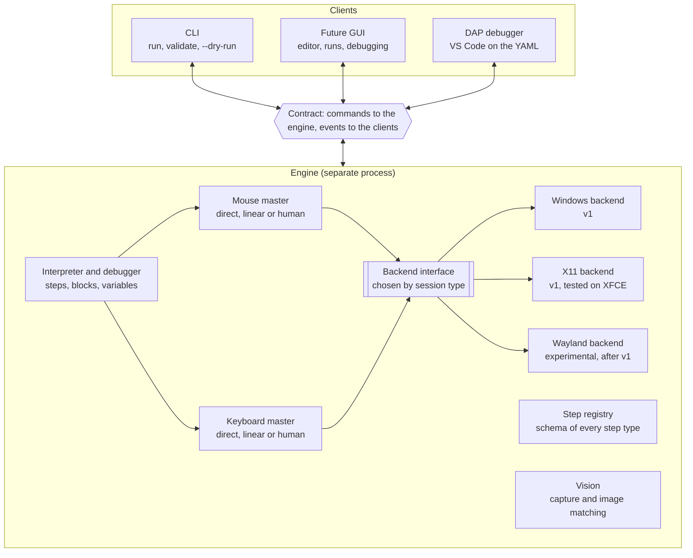
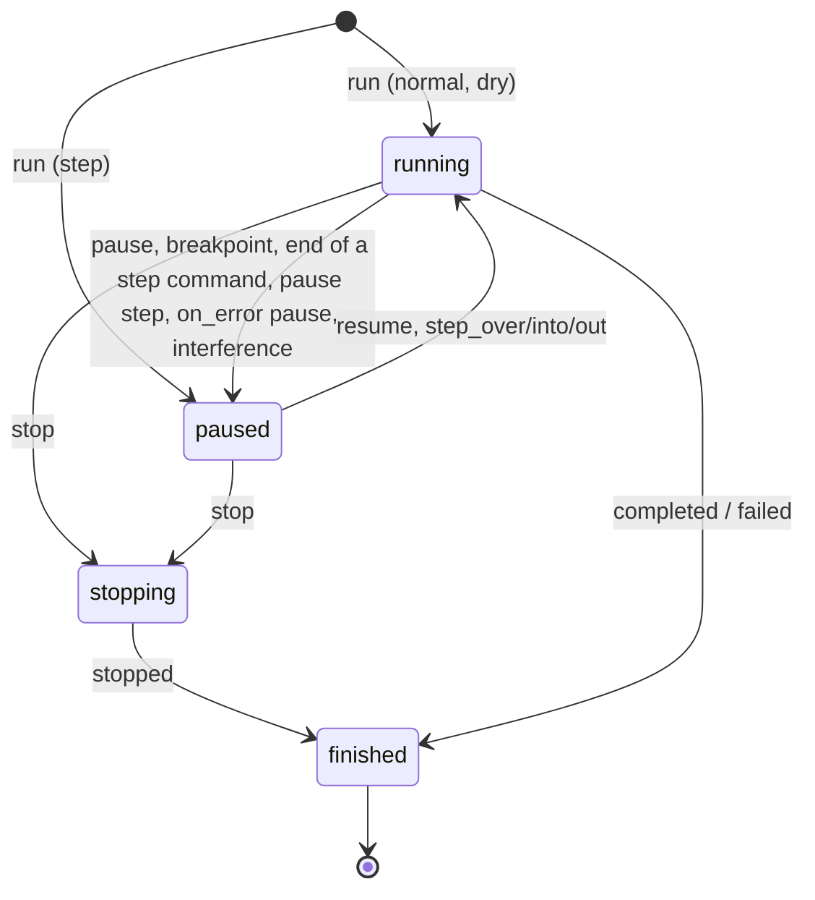

# j5-macro: command and event contract

> The source of truth for the design. Any protocol change lands here first, in the same pull request.

## Goals and design rules

The j5-macro core does not know who is using it: it receives commands and emits events, and everything else (CLI, GUI, debugger) is a client of that contract.

Scope of v1: Windows, and Linux with an X11 session (tested on XFCE). Wayland comes later as an experimental backend.

1. **No UI in the core.** No `print`, `input()` or dialogs: all output is an event.
2. **Everything is serializable.** Commands and events are JSON, with the same schema inside a process and between processes.
3. **The engine runs in its own process.** Clients never share its event loop, so a GUI never freezes and never competes with the engine that drives the mouse.
4. **Whatever a GUI needs is in the contract.** Steps with stable ids, planned trajectories, image-match scores, variables.
5. **Reproducible.** Every run has a seed, recorded in its events.
6. **Safe to abort.** Stopping a macro releases every held key and button, and there is a global emergency key.
7. **Steps describe themselves.** Each step type declares its parameters, types and documentation; the JSON Schema and the GUI forms are generated from that.

## Process and layer architecture



The engine runs in its own process: the CLI, the GUI and the debugger only send commands and receive events, and the input masters reach the system only through the backend interface, chosen by session type.

## Transport and message format

Every message is a JSON object on a single line (JSON Lines), identical over stdio, a local socket or an in-process call.

| Field | Type | Description |
| --- | --- | --- |
| `v` | integer | Schema version; starts at 1 and only increases on incompatible changes |
| `kind` | `command` \| `response` \| `event` | Direction and role of the message |
| `type` | string | Name, e.g. `run` or `step_started` |
| `id` | string | Commands and responses: correlation id chosen by the client |
| `run_id` | string or `null` | Events: the run; `null` for engine events outside any run (`ready`, `log`, `script_changed`) |
| `seq` | integer | Events: gap-free counter, one per run plus one for engine events |
| `ts` | string | UTC time, ISO 8601 with milliseconds; for display only |
| `t_ms` | integer | Events: milliseconds on a monotonic clock since the start of the run or the engine. The reference for timing and replay, since it never jumps when the system clock changes |
| `payload` | object | Content specific to the `type` |

Example event:

```json
{"v":1,"kind":"event","type":"step_started","run_id":"r-20261012-151051-d36f","seq":14,"ts":"2026-10-12T15:10:53.412Z","t_ms":2120,"payload":{"step_id":"open_menu","path":[0],"line":9,"type":"click","params":{"x":120,"y":40}}}
```

Rules:

- **Command and response.** The client sends a command with an `id`; the engine answers with `kind: response`, the same `id`, and either `ok: true` with `result` or `ok: false` with `error` (see the codes at the end).
- **Events are not acknowledged.** The engine emits them in order. If a client sees a gap in `seq`, it fetches the missing ones with `get_events`.
- **Handshake.** The engine emits `ready` when it starts. The client then sends `hello` with the range of versions it understands, and the engine answers with the chosen version and its capabilities: active backend (its name, or `null` without one), available input strategies (`direct`, `linear` and `human` with a backend, none without) and registered step types. Right after `ready`, the engine logs which emergency stop key it watches, or a `warning` with the reason when there is no backend or no stop key. Any other command before `hello` gets `invalid_state` with `details.reason: hello_required`.
- **No binaries in messages.** Screenshots and crops are saved under the run's directory and events carry the relative path.
- **Compatibility.** Unknown fields are ignored; a client must never fail on a new event or field. Optional fields whose value is `null` are omitted when serializing, so omitted and `null` mean the same.
- **Invalid lines.** A line that is not a valid command cannot be answered (it has no trustworthy `id`): the engine emits an engine `log` event at level `error` and carries on.
- **The client supervises the engine.** If the engine process dies, the client that started it releases the keys and buttons the last `input_state` event reported as held, newest first, with a backend of its own process (`button:<name>` with `button_up`, a single character with `char_up`, any other key name with `key_up`), and says so.
- **Ctrl+C.** In a terminal, Ctrl+C reaches every process of the console. The engine ignores SIGINT when serving stdio: the client decides what Ctrl+C means (the CLI sends `stop`), and the engine ends when its stdin closes. On end of input with a run active, the engine stops the run, waits up to 5 s for `run_finished`, and exits with code 0.
- **Channels.** v1: stdio, with the client starting the engine as a subprocess (`python -m j5_macro.engine [--runs-dir DIR] [--stop-key COMBO]`). Later: a Unix socket or a Windows named pipe for a long-lived engine, and WebSocket if a web GUI needs it. Since those channels can inject input, they only accept the same user (socket permissions) and require a token handed over when the engine starts.

## Commands

There are 16 execution and debugging commands; script management commands have their own section. Control commands (pause, stepping, variables) only apply to an active run and return `not_running` otherwise.

| Command | Payload | Result and notes |
| --- | --- | --- |
| `hello` | `v_min`, `v_max`, `client` | Chosen `v` and capabilities (backend, input strategies, registered steps) |
| `list_step_types` | — | The step registry: name, parameters, types, defaults, documentation and JSON Schema |
| `load` | `path` or `source` | `script_id` (`s1`, `s2`, ...), the step tree with its ids, and `warnings`. On failure, the error code is the first problem's code and `details` holds `errors` (all of them) and `warnings` |
| `validate` | `script_id` | `ok`, `errors` and `warnings`. Re-reads a script loaded from a path, so it reports the file as it is now; never replaces the loaded script |
| `run` | `script_id`, `mode` (`normal`, `step`, `dry`), `vars?`, `seed?`, `input_profile?`, `captures?` (`on_failure` by default, or `all`) | `run_id`. The engine emits `run_started` before answering. In `step` mode the run starts paused before the first step. If another run is active the answer is `busy` |
| `pause` | `run_id` | Applies at the next atomic action: never cuts a movement or a key sequence in half, but does interrupt waits (`sleep`, `wait_image`), which continue with the remaining time on resume |
| `resume` | `run_id` | Continues until the next breakpoint or the end |
| `step_over` | `run_id` | Runs the current step completely, blocks included, and pauses at the next step at the same depth or shallower |
| `step_into` | `run_id` | Pauses at the very next step, entering blocks (`loop`, `if`); on a simple step it is the same as `step_over` |
| `step_out` | `run_id` | Finishes the current block and pauses right after it; at the top level it runs to the end or the next breakpoint |
| `stop` | `run_id`, `reason?` (`user` or `interference`) | Aborts immediately, releases keys and buttons, emits `run_finished` with `status: stopped` |
| `set_breakpoints` | `script_id`, `step_ids` | Replaces the client breakpoints of a script; applies to new runs and to the active run of that script. `break: true` steps in the script are added on top and only go away by editing the script. Unknown `script_id` → `script_not_found` |
| `get_state` | `run_id` | State, current step, its path, line and the variables |
| `set_variable` | `run_id`, `name`, `value` | Only while paused |
| `evaluate` | `run_id`, `expression` | `value` of an expression over the variables; only while paused |
| `get_events` | `run_id?`, `from_seq` | Returns in `result.events` the events with `seq >= from_seq`, without re-emitting them; used after a gap. Omitted or `null` `run_id` means the engine stream, of which the last 1000 events are kept. Run events are kept for the last 20 runs of the engine session |

Design rules:

- **Pause at the next atomic action, stop immediately.** `pause` and the `step_*` commands never leave the cursor or a key half-way, but they do not wait for a `loop` or a long `sleep` to end either: the engine reacts within one action. `stop` interrupts even in the middle of a movement, and the engine releases everything held before answering.
- **One run at a time.** There is one mouse and one keyboard, so `run` while another run is active answers `busy`.
- **One controller.** In v1 only one client may send control commands for a run; other clients, if any, only receive events.

## Events

Events describe everything the engine does, so a debugger or a GUI is built by listening to them. They all carry the common fields (`run_id`, `seq`, `ts`, `t_ms`). Step events add `step_id`, `path` (static position in the tree, see the script format), `iterations` (current iteration of each enclosing `loop`, outermost first; omitted outside loops) and `line`. Loop indices are 0-based.

| Event | When | Payload |
| --- | --- | --- |
| `ready` | When the engine starts, no `run_id` | `v`, `backend`, `capabilities` |
| `script_changed` | A script changed on disk or through `edit_script`, no `run_id` | `script_id`, `version`, `source` (`disk` or `edit`) |
| `run_started` | First event of a run | `script_id`, `mode`, `seed` (generated when the client gave none), `backend` (the engine's backend name, `none` without one), `input_profile` |
| `state_changed` | On every state change | `state` (`running`, `paused`, `stopping`), `reason?` (`breakpoint`, `step`, `user`, `error`, `interference`) |
| `run_finished` | Last event of a run | `status` (`completed`, `stopped`, `failed`), `reason?` (`user`, `interference`), `duration_ms`, `error?` |
| `step_started` | Before a step runs, before any effect; once per attempt | `step_id`, `type`, `params` with variables already resolved |
| `step_finished` | When the step completes | `step_id`, `duration_ms` (time spent paused excluded), `result` |
| `step_skipped` | A step was skipped | `step_id`, `reason` (`user`) |
| `step_failed` | Error or timeout in a step | `step_id`, `error` (`code`, `message`, `details.attempt`), `screenshot?` |
| `breakpoint_hit` | A breakpoint is reached, before the step runs | `step_id` |
| `branch_taken` | After an `if` is evaluated | `step_id`, `condition`, `value` (boolean), `branch` (`then` or `else`) |
| `loop_iteration` | At the start of each iteration | `step_id`, `index`, `total?` |
| `variable_changed` | A variable changes | `name`, `old` (`null` for a new variable), `new`, `step_id?` (absent when set by `set_variable`) |
| `image_search` | Each image search attempt | `template`, `threshold`, `found`, `best_score`, `bbox?`, `region`, `attempt`, `elapsed_ms`, `screenshot?` (path; by default only on the last failed attempt) |
| `input_planned` | An input master finished planning | `device` (`mouse` or `keyboard`), `strategy`, `seed`, summary (`from`, `to`, `duration_ms` or `chars`, `wpm`), `plan_ref?` (path to the JSON with the points or key events, once runs have a directory for artifacts) |
| `input_executed` | Input finished | `device`, `actual_duration_ms`, `aborted` |
| `input_state` | The set of held keys or buttons changed | `held` (list in press order: key names, single characters, and buttons as `button:<name>`); used by the client to release them if the engine dies |
| `user_interference` | The user moved the mouse during a planned movement (mouse only in v1) | `expected`, `actual`, `action` (`pause` or `stop`) |
| `keys_released` | Pending keys or buttons were released | `keys`, `reason` |
| `log` | Free text, including the script's `log:` step | `level`, `message`, `step_id?` |
| `trigger_fired` | Reserved for the triggers milestone | `trigger_id`, `kind` |

Emission rules:

- **`step_started` comes before acting.** A GUI can highlight the step and show the planned trajectory before the cursor moves.
- **Strict order by `seq`.** `step_started` precedes everything that happens inside the step, and `step_finished` or `step_failed` closes it.
- **Blocks wrap their children.** `if` and `loop` emit `step_started` before their children and `step_finished` after them, with results `{branch}` and `{iterations}`.
- **Heavy details by reference.** Screenshots, crops and point lists are saved under the run's directory and the event only carries the path.
- **A new event breaks nobody.** Clients ignore types they do not know.

## Run states and debugging semantics



A run starts in `running` (normal and dry modes) or `paused` (step mode) and always ends in `finished`. `stop`, or an interference configured to stop, is the only way to interrupt it, and goes through `stopping` to release keys and buttons before closing.

**Stepping.** Depth is the number of nested step lists (the top level is depth 1). A step command given while paused at depth `d`:

- `step_over` pauses at the next step at depth `d` or shallower. Over a `loop` it runs all iterations; over an `if` it runs the chosen branch. On the last step of a loop body, the next step is the first one of the next iteration.
- `step_into` pauses at the very next step, entering blocks (for an `if`, the chosen branch).
- `step_out` pauses at the next step shallower than `d`, finishing the current block including its remaining iterations. At the top level it runs to the end or the next breakpoint.
- Every step command goes `paused → running → paused` with `state_changed` events (reason `step`), so a GUI always knows when the engine is acting. `resume` goes to `running` with reason `user`.

**Breakpoints and pauses.**

- Breakpoints are the client's plus the script's `break: true` steps. The engine emits `breakpoint_hit` and pauses (reason `breakpoint`) before the step runs; after continuing, the step runs without triggering the same breakpoint again. Inside a `loop` a breakpoint fires on every iteration.
- A `pause:` step pauses right after it finishes, with reason `breakpoint`.
- Breakpoints and `pause:` steps also pause runs in `normal` mode. What happens next is the client's choice: the CLI asks for Enter when it runs in a terminal, and otherwise resumes on its own and says so.

**Errors.** A step that fails with `on_error: continue` logs the error and moves on. `retry` makes up to 3 attempts in total (each failure emits `step_failed` with `details.attempt`), then behaves like `stop`. `pause` emits `step_failed` and pauses with reason `error`: `resume` retries the step, `step_over` skips it (`step_skipped`, reason `user`). `stop` ends the run with `status: failed`.

**Interference.** User interference leads to `paused` or `stopping`, depending on the input profile; in the second case the run ends with `status: stopped` and `reason: interference`.

**Dry runs.** In `dry` mode no input is sent: input steps describe what they would do (`step_finished.result` holds `dry_run: true` and a `description`, plus an info `log`). Each image search runs once, reports and moves on, since without clicks the screen never changes and a wait would always fail; image conditions evaluate to false with a warning. `while` loops are capped at 1000 iterations with a warning. Everything else (variables, loops, branches, logs, sleeps) runs as usual.

**Message sequence** of a `step_over` in step mode (abbreviated; → client, ← engine):

```
→ run {script_id: s1, mode: step}
← run_started                              seq 1
← response ok {run_id: r-1}
← state_changed paused (reason: step)      seq 2
→ step_over {run_id: r-1}
← state_changed running (reason: step)     seq 3
← step_started open_menu                   seq 4
← image_search found                       seq 5
← input_planned mouse, human               seq 6
← input_executed mouse                     seq 7
← step_finished open_menu                  seq 8
← state_changed paused (reason: step)      seq 9
```

## Mouse and keyboard masters

There is one master per device, and it decides *how* the mouse moves or the text is typed; the backend only knows how to execute primitives. All human-like behaviour lives in the master and is identical on every operating system.

**Backend interface** (the only part that changes per platform):

| Primitive | Notes |
| --- | --- |
| `pointer_position()` | Real cursor position, the starting point of every movement. Optional: Wayland cannot always report it, and without it there is no interference detection |
| `move_abs(x, y)` or `move_rel(dx, dy)` | The backend declares which it supports; Wayland with uinput is usually relative only |
| `button_down(b)`, `button_up(b)`, `scroll(dx, dy)` | Buttons and wheel |
| `key_down(k)`, `key_up(k)` | Physical keys, for shortcuts and modifiers |
| `char_down(c)`, `char_up(c)` | Press and release a character regardless of the keyboard layout (ñ, accents, dead keys, symbols). Separate calls so the `human` profile controls how long each key is held |
| `screen_bounds()` | The virtual desktop: the bounding box of every screen |
| `find_window(title)` | Frame of the first visible window whose title contains `title`; for window-relative coordinates |
| `watch_hotkey(keys, callback)` | Calls back whenever a key combination is pressed, even when another application has the focus; for the emergency stop |
| `close()` | Releases the display connection and any temporary state, such as key remaps |
| `capabilities` | Which of the above exist (`pointer_position`, `move_abs`, `move_rel`, `char_input`, `screen_capture`, `windows`, `hotkey`); the master adapts |

Physical keys are named in lowercase: modifiers `ctrl`, `shift`, `alt`, `super`; named keys `enter`, `tab`, `escape`, `backspace`, `delete`, `insert`, `space`, arrows `up`/`down`/`left`/`right`, `home`, `end`, `pageup`, `pagedown`, `capslock`, `menu`, `printscreen`, `f1` to `f24`; and single printable ASCII characters. The input layer resolves aliases in scripts (`esc`, `return`, `control`, `cmd`, `win`, `del`, `pgup`...) before calling the backend.

**Plan, then execute.** Every input action goes through three phases:

1. **Plan.** A pure, seeded function produces the timed points (`t_ms`, `x`, `y`) or key events (`t_ms`, `key`, `down` or `up`). It does not touch the system, so it is testable without a display. `input_planned` is emitted.
2. **Execute.** The plan is replayed against a monotonic clock: the position is computed from the elapsed time, not from fixed sleeps, so errors never accumulate and the movement lasts what was planned.
3. **Close.** `input_executed` is emitted with the actual duration.

**Strategies:**

| Strategy | Mouse | Keyboard |
| --- | --- | --- |
| `direct` | Jumps to the target | Types the whole text at once |
| `linear` | Straight interpolation at constant speed | Fixed interval between keys |
| `human` | Curve with random deviations (Bézier or WindMouse), bell-shaped speed, Gaussian target inside the matched area, occasional overshoot and correction, micro-jitter | Log-normal intervals from the WPM, longer pauses after spaces and punctuation, variable hold time with slight overlap |

**Input profile parameters:**

| Device | Parameter | Meaning |
| --- | --- | --- |
| Mouse | `strategy`, `speed` | Strategy and speed multiplier (1.0 = normal) |
| Mouse | `path` | Path shape for `human`: `windmouse` (default; gravity and wind, slightly erratic) or `bezier` (smooth curves). Both are implemented in j5-macro as pure seeded functions; a shared timing layer adds the speed curve, overshoot and jitter |
| Mouse | `overshoot`, `jitter` | Overshoot probability (0 to 1) and jitter amplitude in pixels |
| Mouse | `interference`, `tolerance` | Action on interference (`pause`, `stop` or `off`) and allowed deviation in pixels (20 by default) |
| Keyboard | `strategy`, `wpm` | Strategy and speed in words per minute |
| Keyboard | `variance`, `typos` | Spread of the intervals, and typos with corrections (`false` by default) |
| Both | `seed` | Base seed of the run |

Each step's effective profile is the defaults, then the script's `input`, the run's `input_profile`, the step's `input` and, last, step parameters such as `type`'s `keyboard`; an invalid profile fails the step with `validation_failed`.

**Safety and reproducibility:**

- **Held state.** The master tracks which keys and buttons are held and emits `input_state` on every change. On `stop`, or on an error, it releases them all and emits `keys_released`.
- **If the engine dies.** The client that started it releases whatever the last `input_state` reported as held, so an engine crash never leaves Shift or Ctrl stuck.
- **Interference detection, mouse only in v1.** During a movement the real position is compared with the planned one; beyond the tolerance, `user_interference` is emitted. It requires `pointer_position`. The keyboard is left out because on X11 injected keys are hard to tell apart from the user's.
- **Emergency stop.** A global hotkey, `ctrl+alt+shift+q` by default (engine option `--stop-key`, else env `J5_STOP_KEY`; key names and aliases as above, joined with `+`), stops the active run with reason `user` after a `warning` `log` in that run. It needs the backend's `hotkey` capability; without it the engine logs a warning at startup. As a fallback, moving the cursor into a corner of the virtual desktop (within 2 pixels) while the run is moving it stops the run too: masters check the real pointer position between points, release what they hold and raise `EmergencyStop`, and the interpreter stops the run with reason `user` and a `warning` `log`. On Wayland global hotkeys depend on the compositor, which is why the fallback matters.
- **Per-action seeds.** Each plan, and each step's random choices, use a sub-seed derived (SHA-256) from `seed`, `step_id`, `iterations` and the attempt number, so every iteration of a `loop` moves differently. The same seed, start point and target give the same plan; if the cursor position or the matched image location changes, the plan changes even with the same seed.
- **Typos never change the result.** With `typos` on, an automated test checks that the planned key events, corrections included, produce the original text. It cannot check the target application (autocomplete may interfere), which is why `typos` is off by default.
- **Fast mode.** `run` accepts an `input_profile` with `direct` strategies to debug without waiting.

## Script format and step registry

A script is declarative YAML: every step is data with a type, parameters and a stable id, so a GUI can read it, show it and rewrite it without losing comments (parsed with `ruamel.yaml`).

```yaml
version: 1
name: Save report
input:
  mouse:    {strategy: human, speed: 1.0}
  keyboard: {strategy: human, wpm: 55}
vars:
  filename: october_report
steps:
  - id: open_menu
    click: {image: img/file_menu.png, threshold: 0.9}
  - id: wait_dialog
    wait_image: {image: img/save_dialog.png, timeout: 10s}
    on_error: stop
  - type: {text: "${filename}", keyboard: {strategy: direct}}
  - id: confirm
    break: true
    key: {press: enter}
  - loop:
      times: 3
      do:
        - if:
            when: {image_visible: img/error.png}
            then:
              - click: {image: img/retry.png}
              - sleep: 2s
```

**Format rules:**

- **One type per step.** A step is a mapping with one step-type key and optional common fields: `id`, `break`, `timeout`, `on_error` (`stop`, `continue`, `retry` or `pause`) and `input` to override the input strategy for that step. The type's value is a mapping of parameters, a scalar for the type's shorthand parameter (`sleep: 2s`, `log: hello`), or nothing.
- **Stable ids.** Ids match `[A-Za-z_][A-Za-z0-9_-]*` and are unique in the script. A missing `id` is generated from the type and position: the n-th step of a type, counting steps that have explicit ids, gets `<type>_n` (a clash with an explicit id adds a suffix, `<type>_n_2`), with a warning. Adding an id to one step therefore never renames the others. Saving through `edit_script` writes the ids, so breakpoints and history survive reordering.
- **Blocks.** `if` (`then` and `else`) and `loop` (`times`, `while` or `for_each`, with `as`) contain step lists. `path` alternates the position in a list and the block slot of the parent step: `[3, 1, 0]` is the first step of the second block (`else`) of the fourth step. Slots are numbered in the order the step type declares them (`if`: `then` 0, `else` 1; `loop`: `do` 0).
- **Conditions and expressions.** `when` and `while` take an expression or a predefined condition such as `image_visible` (available from milestone M3). Expressions support literals (`true`, `false`, `null` included), variables, lists and mappings, indexing, `+ - * / // %`, comparisons (chainable) and `in`, `and`/`or`/`not`, `a if c else b`, and calls to whitelisted functions (`len`, `str`, `int`, `float`, `bool`, `round`, `min`, `max`, `abs`, `lower`, `upper`, `strip`, `contains`, `startswith`, `endswith`). There is no Python `eval`; attribute access, `**`, lambdas and comprehensions are rejected, and length, nesting and result sizes are capped.
- **Interpolation.** String parameters may contain `${expression}`. A string that is a single `${...}` keeps the value's type (`x: "${pos_x}"` is an integer); otherwise values are rendered as text (`null` as empty, booleans as `true`/`false`). `$${` is a literal `${`. Parameters of type expression or condition are evaluated, never interpolated. Interpolated values are type-checked again before the step runs.
- **Coordinates.** `x`/`y` are physical pixels on the virtual desktop, which spans every screen and may be negative. With `window: {title: ...}`, coordinates and `region` are relative to the top-left corner of the frame of the first visible window whose title contains `title`, looked up when the step runs, so they survive the window being moved; no such window fails with `window_not_found`, and a backend without the `windows` capability with `capability_missing`. `offset: [dx, dy]` is added to the resulting point. `drag` points (`from`, `to`) take their own `window`. Until vision lands (M3), `image` targets fail with `capability_missing` outside dry runs. On Windows the engine declares per-monitor DPI awareness so the system never scales coordinates.
- **Images.** Paths relative to the script, `threshold` (0.9 by default), an optional search `region`, and `scale` to compensate templates captured at another scaling.
- **Durations.** Written with a unit (`2s`, `500ms`, `1.5m`, `1h`) and an optional variance (`2s±20%` or `2s+-20%`) for less mechanical pauses. A bare number means seconds. The common `timeout` field applies to waiting steps from milestone M3.

**v1 step types:**

| Step | Main parameters |
| --- | --- |
| `click` | `image` or `x`/`y`, `window?`, `button`, `clicks`, `offset`, `threshold` |
| `move` | `image` or `x`/`y`, `window?` |
| `drag` | `from`, `to`, `button` |
| `scroll` | `dx`, `dy` |
| `type` | `text`, `keyboard?` |
| `key` | `press` (e.g. `ctrl+s`), `hold?` |
| `wait_image` | `image`, `timeout`, `threshold`, `region?`, `window?` |
| `sleep` | Duration, with optional variance |
| `if` | `when` (expression or condition), `then`, `else?` |
| `loop` | `times`, `while` or `for_each` (with `as`), and `do` |
| `set` | `name`, and `value` or `expr` |
| `log` | `message`, `level` |
| `pause` | `message`; pauses the run until `resume`, like a breakpoint written in the script |

**Step registry.** Each type is registered with its name, its parameter schema (name, type, required, default, documentation), its cross-parameter checks and the function that executes it. From that single registry come:

- the validation of `load` and `validate`,
- a JSON Schema for editor completion and validation (`j5 schema`, e.g. with the VS Code YAML extension),
- the answer to `list_step_types`,
- the parameter forms of the future GUI.

Adding a step (including a third-party one, registered as a plugin through the `j5_macro.steps` entry point group) means registering it; neither the interpreter nor the GUI changes.

## Script management

No client parses or rewrites YAML: it asks the engine for structured edits by `step_id`, so formatting, comments and validation live in one place, whatever language the GUI is written in.

| Command | Payload | Result and notes |
| --- | --- | --- |
| `list_scripts` | `root?` | Scripts in the working folder: path, name, modification time and whether they validate |
| `create_script` | `path`, `name` | `script_id` of an empty script |
| `get_script` | `script_id` | Step tree with ids, parameters and lines, the YAML text and its `version` |
| `edit_script` | `script_id`, `base_version`, `edits` | Applies the edits in order, validates and saves; answers the new `version` and validation errors. If the file changed since `base_version`, answers `conflict` and changes nothing |
| `list_runs` | `script_id?`, `limit?` | Saved runs: `run_id`, final status, date and duration |
| `get_run` | `run_id`, `from_seq?` | Events and screenshot paths of a past run, to review it later |
| `delete_run` | `run_id` | Deletes the run's directory |

Edit kinds inside `edits`:

| Edit | Fields | Effect |
| --- | --- | --- |
| `insert` | `after_step_id` or `parent_path`, `step` | Adds a step; the engine assigns its `id` |
| `update` | `step_id`, `params` | Changes a step's parameters |
| `move` | `step_id`, `to` | Moves a step, also across blocks |
| `delete` | `step_id` | Deletes a step and, for a block, its content |
| `set_meta` | `name?`, `input?`, `vars?` | Changes the script header |

Rules:

- **The file is preserved.** Every edit keeps the comments and formatting of the rest of the YAML.
- **The engine watches files.** If a script is edited in a text editor, the engine emits `script_changed` and the GUI reloads.
- **Editing does not affect what is running.** A run keeps the version it loaded; changes apply to the next run.

**Run history.** Each run is saved in `<runs dir>/<run_id>/`: `events.jsonl` (one event per line, appended as emitted) and `run.json` (`run_id`, `script_id`, `script_name`, `script_path`, `mode`, `seed`, `started`, and on completion `finished`, `status`, `reason`, `duration_ms`, `error`). The runs dir is the engine's `--runs-dir` option, else `J5_RUNS_DIR`, else the platform state directory plus `j5-macro/runs` (`$XDG_STATE_HOME` or `~/.local/state` on Linux, `~/Library/Application Support` on macOS, `%LOCALAPPDATA%` on Windows). When a run starts, older runs are deleted so the newest 20 remain. A persistence failure never affects a run; it becomes an engine `log` warning.

## Errors and open decisions

Every error, in a response or in an event, has the shape `{code, message, step_id?, line?, details?}`; the `code` is stable and the `message` is for people.

| Code | When |
| --- | --- |
| `parse_error` | The YAML is invalid; includes line and `details.column` |
| `validation_failed` | A parameter is missing or has the wrong type, an id is duplicated, or a message is malformed; includes the field path |
| `unknown_step_type` | The step type is not in the registry |
| `script_not_found` | The `script_id` does not exist or the file cannot be opened |
| `not_running` | A control command without an active run, or for an unknown or finished run |
| `invalid_state` | The command is not allowed in the current state (e.g. `set_variable` while running). `details.reason` adds `hello_required` before the handshake and `not_implemented` for contract commands the engine does not implement yet |
| `busy` | `run` while another run is active (`details.run_id`) |
| `conflict` | The script changed since the `base_version` sent with `edit_script` |
| `template_missing` | A step's image file does not exist |
| `image_not_found` | `wait_image` or an image-based step ran out of time; includes `best_score` |
| `window_not_found` | No visible window matches a step's `window`; `details.title` |
| `expression_error` | An expression or an interpolation failed; `details` has the `expression` and, when known, the `column` |
| `backend_unavailable` | No backend fits the current session (e.g. Wayland without support) |
| `capability_missing` | The backend lacks something a step or profile needs, e.g. `pointer_position` for interference detection or `windows` for window-relative coordinates; or there is no backend at all (the message gives the engine's reason), or an `image` target before vision (M3) |
| `input_denied` | The system refused input or capture for lack of permissions |
| `internal_error` | Unexpected engine failure; `details.traceback` holds the trace |

**Decisions already made:** the engine runs in its own process; Python 3.11 or later; scripts in YAML; v1 targets Windows and Linux with X11; one active run at a time.

**Open decisions**, each with the recommendation to close it:

| Decision | Recommendation |
| --- | --- |
| A `python:` step as an escape hatch | Not in v1. It breaks visual editing and runs arbitrary code; third-party steps come in as registered plugins |
| Several clients at once | One controller plus read-only observers, after v1 |
| Keyboard interference | Out of v1: on X11 injected keys are hard to tell apart from the user's. Windows can do it and may get it earlier |
| Triggers (time, image, window) | Out of v1; the `trigger_fired` event is reserved |
| Wayland | Experimental backend after v1, on libei or wdotool, behind the same backend interface. Without a reliable `pointer_position`, interference detection is disabled |
