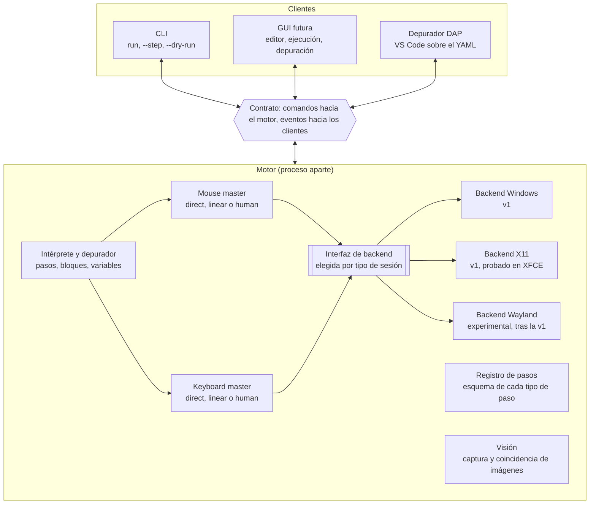
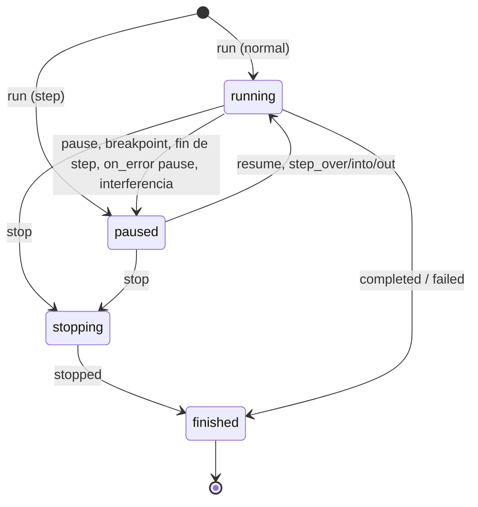

# j5-macro: contrato de comandos y eventos

> Fuente de verdad del diseño. Cualquier cambio de protocolo se refleja aquí primero.

## Objetivo y reglas de diseño

El núcleo de j5-macro no sabe quién lo usa: recibe comandos, emite eventos, y todo lo demás (CLI, GUI, depurador) es un cliente de ese contrato.

Este documento fija el contrato antes de escribir código. Alcance de la v1: Windows y Linux con sesión X11, probado en XFCE. Wayland queda como backend experimental posterior.

1. **Sin UI en el núcleo.** Nada de `print`, `input()` ni diálogos: toda salida es un evento.
2. **Todo es serializable.** Comandos y eventos son JSON, con el mismo esquema dentro de un proceso y entre procesos.
3. **El motor corre en un proceso aparte.** Los clientes nunca comparten su bucle de eventos, así una GUI no se congela ni compite con el motor que controla el mouse.
4. **Lo que una GUI necesite, está en el contrato.** Pasos con id estable, trayectorias planificadas, puntaje de las coincidencias de imagen, variables.
5. **Reproducible.** Cada ejecución lleva una semilla, que queda registrada en los eventos.
6. **Seguro al abortar.** Detener la macro libera todas las teclas y botones presionados, y existe una tecla global de emergencia.
7. **Los pasos se describen a sí mismos.** Cada tipo de paso declara parámetros, tipos y documentación; de ahí salen el JSON Schema y los formularios de la GUI.

## Arquitectura de procesos y capas



El motor corre en su propio proceso: CLI, GUI y depurador solo envían comandos y reciben eventos, y los masters de entrada llegan al sistema únicamente por la interfaz de backend, que se elige según el tipo de sesión.

## Transporte y formato de mensajes

Cada mensaje es un objeto JSON en una sola línea (JSON-lines), idéntico por stdio, socket local o llamada en proceso.

| Campo | Tipo | Descripción |
| --- | --- | --- |
| `v` | entero | Versión del esquema; empieza en 1 y sube solo con cambios incompatibles |
| `kind` | `command` \| `response` \| `event` | Dirección y rol del mensaje |
| `type` | texto | Nombre, por ejemplo `run` o `step_started` |
| `id` | texto | Comandos y respuestas: id de correlación elegido por el cliente |
| `run_id` | texto o `null` | Eventos: identifica la ejecución; `null` en eventos del motor fuera de una ejecución (`ready`, `log`, `script_changed`) |
| `seq` | entero | Eventos: contador sin saltos, uno por ejecución y otro para los eventos del motor |
| `ts` | texto | Hora UTC en ISO 8601 con milisegundos; solo para mostrar |
| `t_ms` | entero | Eventos: milisegundos de reloj monotónico desde el inicio de la ejecución o del motor. Es la referencia para medir y reproducir, porque no salta si cambia la hora del sistema |
| `payload` | objeto | Contenido específico del `type` |

Ejemplo de evento:

```json
{"v":1,"kind":"event","type":"step_started","run_id":"r-20261012-0001","seq":14,"ts":"2026-10-12T10:15:03.412Z","t_ms":5120,"payload":{"step_id":"abrir_menu","path":[0,2],"line":12}}
```

Reglas:

- **Comando y respuesta.** El cliente envía un comando con `id`; el motor responde con `kind: response`, el mismo `id` y `ok: true` con `result`, o `ok: false` con `error` (ver códigos al final).
- **Eventos sin acuse.** El motor los emite en orden. Si el cliente nota un salto en `seq`, pide los faltantes con `get_events`.
- **Saludo inicial.** El motor emite `ready` al arrancar. Luego el cliente envía `hello` con el rango de versiones que entiende, y el motor responde con la versión elegida y sus capacidades: backend activo, estrategias de entrada disponibles y tipos de paso registrados.
- **Sin binarios en los mensajes.** Capturas y recortes se guardan en `runs/<run_id>/` y el evento lleva la ruta relativa.
- **Compatibilidad.** Los campos desconocidos se ignoran. Un cliente nunca debe fallar por un evento o campo nuevo.
- **El cliente supervisa al motor.** Si el proceso del motor muere, el cliente que lo lanzó suelta las teclas y botones que el último evento `input_state` reportaba retenidos, y lo informa.
- **Canales.** v1: stdio, con el cliente lanzando el motor como subproceso. Después: socket Unix o *named pipe* en Windows para un motor persistente, y WebSocket si hace falta una GUI web. Como esos canales permiten inyectar entrada, solo aceptan al mismo usuario (permisos del socket) y exigen un token entregado al lanzar el motor.

## Comandos

Hay 16 comandos de ejecución y depuración; los de gestión de scripts están en su propia sección. Los de control (pausa, pasos, variables) solo valen con una ejecución activa y devuelven `not_running` si no la hay.

| Comando | Payload | Resultado y notas |
| --- | --- | --- |
| `hello` | `v_min`, `v_max`, `client` | `v` elegida y capacidades (backend, estrategias de entrada, pasos registrados) |
| `list_step_types` | — | Registro de pasos: nombre, parámetros, tipos, valores por defecto, documentación y JSON Schema |
| `load` | `path` o `source` | `script_id` y el árbol de pasos con sus ids; `warnings` si hay ids generados |
| `validate` | `script_id` | `ok` y lista de errores con `step_id`, `line`, `code`, `message` |
| `run` | `script_id`, `mode` (`normal`, `step`, `dry`), `vars?`, `seed?`, `input_profile?`, `captures?` (`on_failure` por defecto, o `all`) | `run_id`. En `step` arranca pausada antes del primer paso. Si ya hay otra ejecución activa responde `busy` |
| `pause` | `run_id` | Se aplica en la siguiente acción atómica: nunca corta un movimiento ni una secuencia de teclas, pero sí interrumpe esperas (`sleep`, `wait_image`), que siguen con el tiempo restante al reanudar |
| `resume` | `run_id` | Continúa hasta el siguiente breakpoint o el final |
| `step_over` | `run_id` | Ejecuta el paso actual completo, bloques incluidos, y pausa en el siguiente del mismo nivel |
| `step_into` | `run_id` | Entra al primer paso del bloque (`loop`, `if`); en un paso simple equivale a `step_over` |
| `step_out` | `run_id` | Termina el bloque actual y pausa justo después |
| `stop` | `run_id`, `reason?` | Aborta de inmediato, libera teclas y botones, emite `run_finished` con `status: stopped` |
| `set_breakpoints` | `script_id`, `step_ids` | Reemplaza los breakpoints puestos por clientes; vale para ejecuciones nuevas y en curso. Los `break: true` del script se suman y solo se quitan editando el script |
| `get_state` | `run_id` | Estado, paso actual, ruta de bloques anidados y variables |
| `set_variable` | `run_id`, `name`, `value` | Solo en pausa |
| `evaluate` | `run_id`, `expression` | Valor de una expresión sobre las variables; solo en pausa |
| `get_events` | `run_id`, `from_seq` | Reenvía eventos desde `from_seq`; se usa al detectar un salto |

Reglas de diseño:

- **Pausa en la siguiente acción atómica, parada inmediata.** `pause` y los `step_*` nunca dejan el cursor o una tecla a medias, pero tampoco esperan a que termine un `loop` o un `sleep` largo: el motor responde en lo que dura una acción. `stop` interrumpe incluso a mitad de un movimiento, y el motor libera todo lo presionado antes de responder.
- **Una ejecución a la vez.** Hay un solo mouse y un solo teclado, así que `run` con otra ejecución activa responde `busy`.
- **Un solo controlador.** En la v1 solo un cliente puede enviar comandos de control sobre una ejecución; los demás clientes, si los hay, solo reciben eventos.

## Eventos

Los eventos describen todo lo que hace el motor, así que un depurador o una GUI se construyen solo escuchándolos. Todos llevan los campos comunes (`run_id`, `seq`, `ts`, `t_ms`); los de paso agregan `step_id`, `path` (posición en el árbol de bloques, con el índice de vuelta de cada `loop`) y `line`.

| Evento | Cuándo | Payload |
| --- | --- | --- |
| `ready` | Al arrancar el motor, sin `run_id` | `v`, `backend`, `capabilities` |
| `script_changed` | Un script cambió en disco o por `edit_script`, sin `run_id` | `script_id`, `version`, `source` (`disk` o `edit`) |
| `run_started` | Al iniciar | `script_id`, `mode`, `seed`, `backend`, `input_profile` |
| `state_changed` | Cada cambio de estado | `state` (`running`, `paused`, `stopping`), `reason` (`breakpoint`, `step`, `user`, `error`, `interference`) |
| `run_finished` | Al terminar | `status` (`completed`, `stopped`, `failed`), `reason?` (`user`, `interference`), `duration_ms`, `error?` |
| `step_started` | Antes de ejecutar un paso, antes de cualquier efecto | `step_id`, `type`, `params` ya resueltos con las variables |
| `step_finished` | Al completar el paso | `step_id`, `duration_ms`, `result` |
| `step_skipped` | Paso omitido por el usuario o por una condición | `step_id`, `reason` |
| `step_failed` | Error o *timeout* en un paso | `step_id`, `error` (`code`, `message`), `screenshot?` |
| `breakpoint_hit` | Se alcanza un breakpoint | `step_id` |
| `branch_taken` | Después de evaluar un `if` | `step_id`, `condition`, `value`, `branch` (`then` o `else`) |
| `loop_iteration` | Al empezar cada vuelta | `step_id`, `index`, `total?` |
| `variable_changed` | Una variable cambia | `name`, `old`, `new`, `step_id` |
| `image_search` | Cada intento de búsqueda de imagen | `template`, `threshold`, `found`, `best_score`, `bbox?`, `region`, `attempt`, `elapsed_ms`, `screenshot?` (ruta; por defecto solo en el último intento fallido) |
| `input_planned` | El master de entrada terminó de planificar | `device` (`mouse` o `keyboard`), `strategy`, `seed`, resumen (`from`, `to`, `duration_ms` o `chars`, `wpm`), `plan_ref` (ruta al JSON con los puntos o las pulsaciones) |
| `input_executed` | Terminó de ejecutarse | `device`, `actual_duration_ms`, `aborted` |
| `input_state` | Cambia el conjunto de teclas o botones retenidos | `held` (lista); el cliente lo usa para soltarlos si el motor muere |
| `user_interference` | El usuario movió el mouse durante un movimiento planificado (solo mouse en la v1) | `expected`, `actual`, `action` (`pause` o `stop`) |
| `keys_released` | Se soltaron teclas o botones pendientes | `keys`, `reason` |
| `log` | Mensaje libre, incluido el paso `log:` del script | `level`, `message`, `step_id?` |
| `trigger_fired` | Reservado para la etapa de disparadores | `trigger_id`, `kind` |

Reglas de emisión:

- **`step_started` sale antes de actuar.** La GUI puede resaltar el paso y mostrar la trayectoria planificada antes de que el cursor se mueva.
- **Orden estricto por `seq`.** `step_started` precede a todo lo que ocurra dentro del paso y `step_finished` o `step_failed` lo cierra.
- **Detalles pesados por referencia.** Capturas, recortes y listas de puntos se guardan en `runs/<run_id>/` y el evento solo lleva la ruta.
- **Un evento nuevo no rompe a nadie.** Los clientes ignoran los tipos que no conocen.

## Estados y semántica de la depuración



Una ejecución nace en `running` (modo normal) o en `paused` (modo paso a paso) y siempre termina en `finished`; `stop` (o una interferencia configurada para detener) es el único camino que interrumpe, y pasa por `stopping` para soltar teclas y botones antes de cerrar.

**Semántica de los pasos con bloques anidados:**

- `step_over` sobre un `loop` ejecuta todas sus vueltas y pausa en el paso que sigue al bloque; sobre un `if`, ejecuta la rama elegida completa.
- `step_into` sobre un `loop` o un `if` pausa en el primer paso del bloque (en un `if`, de la rama elegida).
- `step_out` termina el bloque actual, incluidas las vueltas que queden, y pausa justo después.
- Todos los `step_*` pasan por `running` y vuelven a `paused`, así una GUI siempre sabe cuándo el motor está actuando.
- Un breakpoint dentro de un `loop` se dispara en cada vuelta.
- Un paso que falla con `on_error: continue` o `retry` no cambia el estado; con `pause` pasa a `paused` para inspeccionar y reintentar; con `stop`, la ejecución pasa a `finished` con `status: failed`.
- Una interferencia del usuario lleva a `paused` o a `stopping` según el perfil; en el segundo caso termina con `status: stopped` y `reason: interference`.
- En modo `dry` no se envía entrada y cada búsqueda de imagen se hace una sola vez: informa el resultado y sigue, porque sin clics la pantalla no cambia y una espera fallaría siempre.

**Secuencia de mensajes** de un `step_over` desde el modo paso a paso (notación abreviada; → cliente, ← motor):

```
→ run {script_id: s1, mode: step}
← response ok {run_id: r-1}
← run_started                              seq 1
← state_changed paused (reason: step)      seq 2
→ step_over {run_id: r-1}
← state_changed running (reason: step)     seq 3
← step_started abrir_menu                  seq 4
← image_search found                       seq 5
← input_planned mouse, human               seq 6
← input_executed mouse                     seq 7
← step_finished abrir_menu                 seq 8
← state_changed paused (reason: step)      seq 9
```

## Masters de mouse y teclado

Hay un solo master por dispositivo, y él decide *cómo* se mueve el mouse o se escribe; el backend solo sabe ejecutar primitivas. Toda la conducta "humana" vive en el master y es idéntica en cualquier sistema operativo.

**Interfaz del backend** (lo único que cambia por plataforma):

| Primitiva | Notas |
| --- | --- |
| `pointer_position()` | Posición real del cursor, punto de partida de cada movimiento. Opcional: en Wayland no siempre se puede leer, y sin ella no hay detección de interferencia |
| `move_abs(x, y)` o `move_rel(dx, dy)` | El backend declara cuál soporta; en Wayland con uinput suele ser solo relativo |
| `button_down(b)`, `button_up(b)`, `scroll(dx, dy)` | Botones y rueda |
| `key_down(k)`, `key_up(k)` | Teclas físicas; sirven para atajos y modificadores |
| `char_down(c)`, `char_up(c)` | Presiona y suelta un carácter sin depender de la distribución del teclado (ñ, tildes, teclas muertas, símbolos). Van separados para que el perfil `human` controle cuánto dura cada pulsación |
| `capabilities` | Qué de lo anterior existe; el master se adapta |

**Planificar y luego ejecutar.** Cada acción de entrada pasa por tres fases:

1. **Plan.** Una función pura y con semilla produce la lista de puntos con tiempos (`t_ms`, `x`, `y`) o de pulsaciones (`t_ms`, `key`, `down` o `up`). No toca el sistema, así que se prueba sin pantalla. Se emite `input_planned`.
2. **Ejecución.** Se recorre el plan con reloj monotónico: la posición se calcula según el tiempo transcurrido, no con pausas fijas, para que el error no se acumule y el movimiento dure lo planificado.
3. **Cierre.** Se emite `input_executed` con la duración real.

**Estrategias:**

| Estrategia | Mouse | Teclado |
| --- | --- | --- |
| `direct` | Salta al destino | Escribe todo el texto de una vez |
| `linear` | Interpolación recta a velocidad constante | Intervalo fijo entre teclas |
| `human` | Curva con desviaciones al azar (Bézier o WindMouse), velocidad en campana, destino gaussiano dentro del objetivo, sobrepaso ocasional con corrección, microtemblor | Intervalos log-normales según WPM, pausas más largas tras espacios y puntuación, duración de pulsación variable con leve solapamiento |

**Parámetros del perfil de entrada:**

| Dispositivo | Parámetro | Significado |
| --- | --- | --- |
| Mouse | `strategy`, `speed` | Estrategia y multiplicador de velocidad (1.0 = normal) |
| Mouse | `overshoot`, `jitter` | Probabilidad de sobrepasar (0 a 1) y amplitud del temblor en píxeles |
| Mouse | `interference`, `tolerance` | Acción ante interferencia (`pause`, `stop` u `off`) y desviación permitida en píxeles (20 por defecto) |
| Teclado | `strategy`, `wpm` | Estrategia y velocidad en palabras por minuto |
| Teclado | `variance`, `typos` | Dispersión de los intervalos y errores con corrección (`false` por defecto) |
| Ambos | `seed` | Semilla base de la ejecución |

**Seguridad y reproducibilidad:**

- **Estado retenido.** El master anota qué teclas y botones están presionados y emite `input_state` en cada cambio. Con `stop`, o ante un error, los suelta todos y emite `keys_released`.
- **Si el motor muere.** El cliente que lo lanzó suelta lo que el último `input_state` reportaba retenido; así un fallo del motor no deja un Shift o un Ctrl pegado.
- **Detección de interferencia, solo mouse en la v1.** Durante el movimiento se compara la posición real con la del plan; si se desvía más que la tolerancia, se emite `user_interference`. Requiere `pointer_position`. El teclado queda fuera porque en X11 no se distinguen bien las teclas inyectadas de las del usuario.
- **Parada de emergencia.** Tecla global configurable, y como respaldo llevar el cursor a una esquina de la pantalla. En Wayland la captura global de teclas depende del compositor, por eso el respaldo importa.
- **Semilla por acción.** Cada plan usa una subsemilla derivada de `seed`, `step_id`, el `path` con los índices de vuelta y el número de intento, así cada vuelta de un `loop` produce un recorrido distinto. Con la misma semilla, el mismo punto de partida y el mismo destino, el plan es idéntico; si cambia la posición del cursor o dónde se encontró la imagen, el plan cambia aunque la semilla sea la misma.
- **Los errores de tipeo no cambian el resultado.** Si `typos` está activo, una prueba automática verifica que las pulsaciones del plan, correcciones incluidas, produzcan el texto original. No puede verificar la aplicación de destino (un autocompletado puede alterar el resultado), por eso `typos` va desactivado por defecto.
- **Modo rápido.** `run` acepta `input_profile` con `direct` para depurar sin esperas.

## Formato de script y registro de pasos

El script es YAML declarativo: cada paso es un dato con tipo, parámetros e id estable, y por eso una GUI puede leerlo, mostrarlo y reescribirlo sin perder comentarios (se parsea con `ruamel.yaml`).

```yaml
version: 1
name: Guardar informe
input:
  mouse:    {strategy: human, speed: 1.0}
  keyboard: {strategy: human, wpm: 55}
vars:
  nombre: informe_octubre
steps:
  - id: abrir_menu
    click: {image: img/menu_archivo.png, threshold: 0.9}
  - id: esperar_dialogo
    wait_image: {image: img/dialogo_guardar.png, timeout: 10s}
    on_error: stop
  - type: {text: "${nombre}", keyboard: {strategy: direct}}
  - id: confirmar
    break: true
    key: {press: enter}
  - loop:
      times: 3
      do:
        - if:
            when: {image_visible: img/error.png}
            then:
              - click: {image: img/reintentar.png}
              - sleep: 2s
```

**Reglas del formato:**

- **Un tipo por paso.** Cada paso es un mapa con una clave de tipo y campos comunes opcionales: `id`, `break`, `timeout`, `on_error` (`stop`, `continue`, `retry` o `pause`) e `input` para cambiar la estrategia solo en ese paso.
- **Ids estables.** Si falta `id`, `load` genera uno desde el tipo y la posición (`click_3`) y avisa con un *warning*. Al guardar con `edit_script`, el motor escribe los ids, para que los breakpoints y el historial no se rompan al reordenar.
- **Bloques.** `if` (`then` y `else`) y `loop` (`times`, `while`, `for_each`) contienen listas de pasos. El campo `path` de los eventos es la ruta de índices hasta el paso.
- **Condiciones y expresiones.** `when` y `while` aceptan una expresión (comparaciones, aritmética, `and`, `or`, `not`, sin `eval` de Python) o una condición predefinida como `image_visible`. La interpolación usa `${nombre}`.
- **Coordenadas.** `x`/`y` son píxeles físicos del escritorio virtual, que abarca todas las pantallas y puede tener valores negativos. Con `window: {title: ...}`, las coordenadas y la `region` pasan a ser relativas a esa ventana y sobreviven a que la muevas. En Windows el motor se declara consciente del DPI por monitor, para que el sistema no escale las coordenadas.
- **Imágenes.** Rutas relativas al script, `threshold` (0.9 por defecto), `region` de búsqueda opcional y `scale` para compensar plantillas capturadas con otro escalado.
- **Duraciones.** Se escriben con unidad (`2s`, `500ms`) y admiten variación (`2s±20%`) para pausas menos mecánicas.

**Tipos de paso de la v1:**

| Paso | Parámetros principales |
| --- | --- |
| `click` | `image` o `x`/`y`, `window?`, `button`, `clicks`, `offset`, `threshold` |
| `move` | `image` o `x`/`y`, `window?` |
| `drag` | `from`, `to`, `button` |
| `scroll` | `dx`, `dy` |
| `type` | `text`, `keyboard?` |
| `key` | `press` (por ejemplo `ctrl+s`), `hold?` |
| `wait_image` | `image`, `timeout`, `threshold`, `region?`, `window?` |
| `sleep` | Duración, con variación opcional |
| `if` | `when` (expresión o condición), `then`, `else?` |
| `loop` | `times`, `while` o `for_each`, y `do` |
| `set` | Variable y valor |
| `log` | `message`, `level` |
| `pause` | `message`; detiene la ejecución hasta `resume`, como un breakpoint escrito en el script |

**Registro de pasos.** Cada tipo se registra con su nombre, el esquema de sus parámetros (nombre, tipo, obligatorio, valor por defecto, documentación) y la función que lo ejecuta. De ese único registro salen:

- la validación de `validate`,
- un JSON Schema para autocompletar y validar en editores como VS Code,
- la respuesta de `list_step_types`,
- los formularios de parámetros de la GUI futura.

Agregar un paso nuevo (o uno de un tercero, como plugin) es registrarlo; ni el intérprete ni la GUI cambian.

## Gestión de scripts

Ningún cliente parsea ni reescribe el YAML: le pide al motor ediciones estructuradas por `step_id`, y así el formato, los comentarios y la validación viven en un solo lugar, sea cual sea el lenguaje de la GUI.

| Comando | Payload | Resultado y notas |
| --- | --- | --- |
| `list_scripts` | `root?` | Scripts de la carpeta de trabajo: ruta, nombre, fecha de cambio y si validan |
| `create_script` | `path`, `name` | `script_id` de un script vacío |
| `get_script` | `script_id` | Árbol de pasos con ids, parámetros y líneas, el texto YAML y su `version` |
| `edit_script` | `script_id`, `base_version`, `edits` | Aplica las ediciones en orden, valida y guarda; responde la `version` nueva y los errores de validación. Si el archivo cambió desde `base_version`, responde `conflict` y no toca nada |
| `list_runs` | `script_id?`, `limit?` | Ejecuciones guardadas: `run_id`, estado final, fecha y duración |
| `get_run` | `run_id`, `from_seq?` | Eventos y rutas de capturas de una ejecución pasada, para revisarla después |
| `delete_run` | `run_id` | Borra la carpeta de la ejecución |

Tipos de edición dentro de `edits`:

| Edición | Campos | Efecto |
| --- | --- | --- |
| `insert` | `after_step_id` o `parent_path`, `step` | Agrega un paso; el motor le asigna el `id` |
| `update` | `step_id`, `params` | Cambia parámetros de un paso |
| `move` | `step_id`, `to` | Mueve un paso, también entre bloques |
| `delete` | `step_id` | Borra un paso y, si es un bloque, su contenido |
| `set_meta` | `name?`, `input?`, `vars?` | Cambia la cabecera del script |

Reglas:

- **Se conserva el archivo.** Cada edición mantiene los comentarios y el formato del resto del YAML.
- **El motor vigila los archivos.** Si alguien edita un script en un editor de texto, el motor emite `script_changed` y la GUI recarga.
- **Editar no afecta lo que corre.** Una ejecución en curso sigue con la versión que cargó; los cambios valen para la siguiente.

## Errores y decisiones abiertas

Todo error, en una respuesta o en un evento, tiene la forma `{code, message, step_id?, line?, details?}`; el `code` es estable y el `message` es solo para personas.

| Código | Cuándo |
| --- | --- |
| `parse_error` | El YAML es inválido; incluye línea y columna |
| `validation_failed` | Un parámetro falta, tiene tipo incorrecto o un `id` está duplicado |
| `unknown_step_type` | El tipo de paso no está en el registro |
| `script_not_found` | El `script_id` no existe o el archivo no se puede abrir |
| `not_running` | Comando de control sin una ejecución activa |
| `invalid_state` | Comando no permitido en el estado actual (por ejemplo `set_variable` con la ejecución en marcha) |
| `busy` | `run` con otra ejecución activa |
| `conflict` | El script cambió desde la `base_version` que trae `edit_script` |
| `template_missing` | El archivo de imagen de un paso no existe |
| `image_not_found` | `wait_image` o `click` con imagen agotó su `timeout`; incluye `best_score` |
| `expression_error` | Una expresión o interpolación falló |
| `backend_unavailable` | No hay backend para la sesión actual (por ejemplo Wayland sin soporte) |
| `capability_missing` | El backend no ofrece algo que el paso o el perfil necesitan, por ejemplo `pointer_position` para detectar interferencia |
| `input_denied` | El sistema rechazó la entrada o la captura por falta de permisos |
| `internal_error` | Fallo inesperado del motor; incluye traza en `details` |

**Supuestos ya tomados:** motor en proceso aparte (acordado), Python 3.11 o superior, scripts en YAML, v1 en Windows y Linux con X11, una sola ejecución activa a la vez.

**Decisiones abiertas**, cada una con la recomendación para cerrarla:

| Decisión | Recomendación |
| --- | --- |
| Paso `python:` como válvula de escape | No en la v1. Rompe la edición visual y ejecuta código arbitrario; los pasos de terceros entran como plugins registrados |
| Varios clientes a la vez | Un controlador y observadores de solo lectura, pero después de la v1 |
| Historial de ejecuciones | Carpeta `runs/<run_id>/` con `events.jsonl` y capturas, conservando las últimas 20; `list_runs` y `get_run` las exponen |
| Interferencia del teclado | Fuera de la v1: en X11 no se distinguen bien las teclas inyectadas de las del usuario. En Windows sí es posible y puede llegar antes |
| Disparadores (hora, imagen, ventana) | Fuera de la v1; el evento `trigger_fired` queda reservado |
| Wayland | Backend experimental posterior, sobre libei o wdotool, detrás de la misma interfaz de backend. Sin `pointer_position` fiable, la detección de interferencia queda desactivada |
