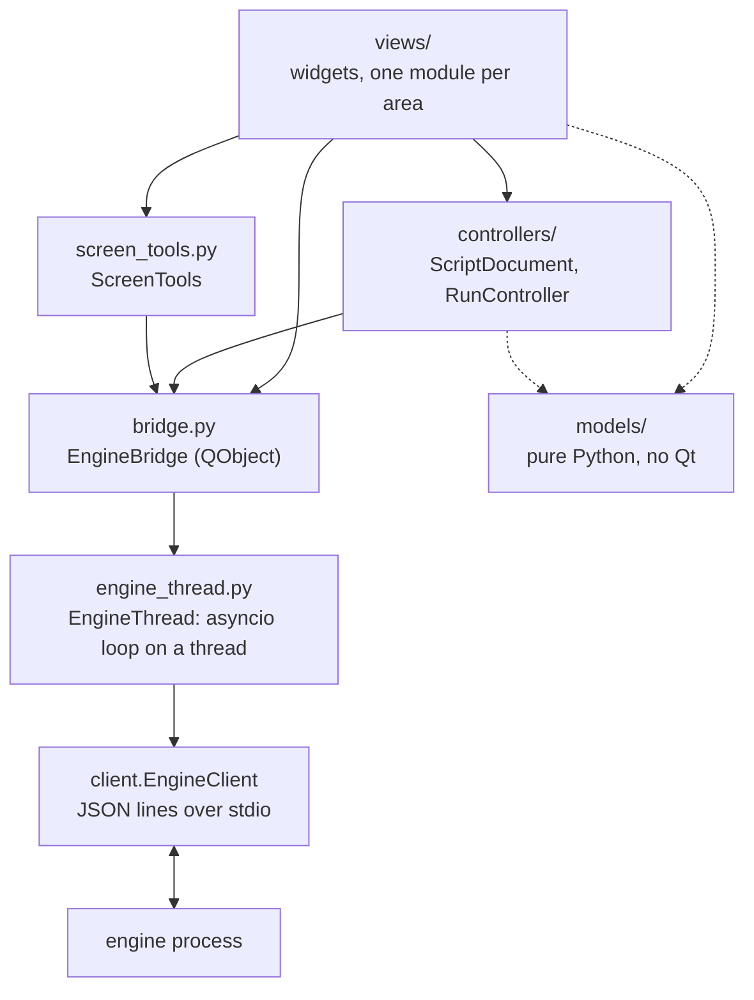

# The GUI package (`j5_macro.gui`)

For contributors. The user guide is [docs/gui.md](../../../docs/gui.md); the protocol the
GUI speaks is [docs/contract.md](../../../docs/contract.md), the source of truth. The GUI
is one more client of the engine, like the CLI and the DAP adapter: it starts
`python -m j5_macro.engine` (or `J5_ENGINE_CMD`) as a child process and only sends
commands and receives events. It never parses or writes YAML, never touches the mouse or
keyboard and never searches the screen itself: the engine does all of that.

PySide6 is optional (the `gui` extra). `j5_macro.gui` itself (`__init__.py`) imports no
Qt, so `j5 gui` can say how to install it; neither do `models/` and `engine_thread.py`.

## Layers



| Module | Holds | Qt |
| --- | --- | --- |
| `models/` | View models built from engine results and events: `StepItem` trees (`steps.py`), `ScriptState` and `ScriptEntry` (`script.py`), `EngineInfo` (`engine_info.py`), `RunLog` and `format_event` (`run_log.py`), `RunSummary` (`runs.py`), `RunDetail`, `SearchFailure` and the history rows (`history.py`), the screen tools' targets, edits, names and error messages (`screen.py`). Frozen dataclasses and plain functions, unit tested without a display | None |
| `engine_thread.py` | `EngineThread`: the existing asyncio `EngineClient` on an event loop in a daemon thread (`j5-gui-engine`). `call()` returns a `concurrent.futures.Future`; events and the engine's death reach callbacks **on that thread**. Releases held keys when the engine dies (`cli.release`) | None |
| `bridge.py` | `EngineBridge`: owns the `EngineThread` and turns its futures and callbacks into callbacks and signals **on the GUI thread** | QtCore |
| `controllers/` | Shared state, as QObjects without widgets: `ScriptDocument` (the open script) and `RunController` (the active run, the breakpoints) | QtCore |
| `screen_tools.py` | `ScreenTools`: `capture_region`, `pick_point`, `find_image`, `screenshot`, `list_windows`, `get_image`; `while_hidden` and the `hider` that hides the windows during overlays | QtCore |
| `context.py` | `AppContext`: the bridge, the document, the run controller and the screen tools, handed to every panel | QtCore |
| `views/` | The widgets (below) | QtWidgets |
| `app.py` | `run_gui(target, engine_cmd)`: the `QApplication`, the context, the main window | QtWidgets |

## The bridge and the threading rules

```python
ctx.bridge.call("list_runs", {"script_id": sid, "limit": 20},
                on_result=lambda result: ...,   # GUI thread, later
                on_error=lambda exc: ...)       # GUI thread, later
ctx.bridge.event_received.connect(self.on_event)  # every Event, GUI thread, in order
```

1. **Only the GUI thread touches widgets and controllers.** Everything that comes from
   the engine thread is posted through a queued signal (`EngineBridge._deliver`), so
   `on_result`, `on_error`, `event_received`, `engine_started`, `engine_failed`,
   `engine_died` and `running_changed` all run on the GUI thread.
2. **Never block the GUI thread on the engine.** No `future.result()` on the GUI thread:
   pass callbacks. `call()` returns the future only for tests and the rare caller that
   wants to cancel or inspect it.
3. **Callbacks never run inside `call()`**, not even for a future that is already done:
   the code after `call()` always runs first.
4. **Commands wait for the handshake.** `call()` right after `start()` is fine; the
   command is sent once `hello` is done. Before `start()` (or after the engine died or
   was shut down) the future fails with `ClientClosed`.
5. **Errors.** `on_error` gets the exception: `EngineError` (the engine answered
   `ok: false`; `exc.code` and `exc.error.details` as in the contract), `ClientError`
   (closed, dead), `TimeoutError`. `engine_thread.describe_error(exc)` makes a message
   for people. Without `on_error`, failures are only logged.
6. **Timeouts.** Requests time out after 30 s by default. Interactive authoring commands
   (`capture_region` without `bbox`, `pick_point`, `find_image` with `show`) answer when
   the user finishes: pass `timeout=None` (`ScreenTools` does).
7. **Events are in `seq` order per stream** (the client fills gaps with `get_events`).
   Run events have a `run_id`; engine events (`ready`, `log`, `script_changed`) have
   `run_id` None. Ignore event types you do not know.
8. **Engine death.** When the engine exits unexpectedly, the GUI releases whatever the
   last `input_state` reported as held, then `engine_died(message)` and
   `running_changed(False)` fire; the `EngineBanner` offers a restart. `restart()`
   starts a new engine; script ids belong to the engine, so `ScriptDocument` loads its
   file again on `engine_started`, and `RunController` forgets the run.
9. **Restarts and late answers.** After `shutdown()` or `restart()`, results and events
   of the old engine are dropped (a generation counter); `on_error` still runs.
10. **Panels may be created after the engine started:** read the current state
   (`ctx.bridge.info`, `ctx.document.state`, `ctx.run.breakpoints`) in the constructor,
   then connect to the signals.

## Shared state

`ScriptDocument` (controllers/document.py):

| Member | Meaning |
| --- | --- |
| `open(path)`, `reopen()`, `reload()`, `close()` | `load` then `get_script`; `reload` re-reads it |
| `edit(edits, on_result=, on_error=)` | `edit_script` against the version shown (`base_version`); the reload comes with `script_changed`; a `conflict` reloads, then reaches `on_error` |
| `state` / `state_changed(ScriptState or None)` | The `get_script` result as a `ScriptState`, after every load and reload |
| `script_id`, `path` | The engine's id; the file asked for (kept while it fails to load) |
| `load_failed(message, errors)`, `notice(message)` | `load` refused the file (errors with `line`); passing messages |

`RunController` (controllers/run.py):

| Member | Meaning |
| --- | --- |
| `start(mode, **options)`, `stop()` | `run` (`normal`, `dry`, `step`; options as `run`'s payload, `None` left out) and `stop` |
| `active` / `active_changed(bool)`, `run_id`, `log` (`RunLog`) | The active run |
| `run_started(run_id)`, `event_logged(LogLine)`, `state_changed(state)`, `current_step_changed(step_id or None)`, `run_finished(payload)`, `error(message)` | What happened |
| `breakpoints`, `set_breakpoints(ids)`, `toggle_breakpoint(id)`, `breakpoints_changed(frozenset)` | The client breakpoints of the open script (kept locally; not sent to the engine yet) |

## The main window and its areas

`views/main_window.py` only lays out the panels, builds the menus (File, Run, Tools, Engine)
and shows messages in the status bar. Each area is its own module and gets the
`AppContext`:

| Area | Module | Class | Today |
| --- | --- | --- | --- |
| Left | `views/script_list.py` | `ScriptListPanel` | `list_scripts` of a folder, open, `create_script` |
| Center | `views/editor.py` | `EditorPanel` | Title, problems, and three parts: |
| | `views/step_tree.py` | `StepTreeView` | Read-only tree (ids, types, `then`/`else` rows), breakpoint gutter (column 0), current step highlight |
| | `views/step_form.py` | `StepFormPanel` | The selected step's parameters, read-only |
| | `views/yaml_view.py` | `YamlView` | `get_script`'s `source`, read-only; highlights the selected step's line |
| Bottom tab | `views/run_panel.py` | `RunPanel` | Run, Dry run (+ Strict), Stop, state, stop key, log of events |
| Bottom tab | `views/history_panel.py` | `HistoryPanel` | `list_runs` of the open script; the selected run (`get_run`): events, captures, `FailureView` (the failing search's capture next to its template); `delete_run`, open folder |
| Bottom tab | `views/step_tools.py` | `StepToolsPanel` | The field tools of the selected step (also the Tools menu), until the step forms use them |
| Dialogs | `views/screen_dialogs.py` | `ImageFieldTools`, `PointFieldTools`, `CaptureDialog`, `TestResultDialog`, `WindowChooser`, `TopLevelHider` | The screen tools as reusable widgets (see "Field tools") |
| | `views/template_preview.py` | `ImageView`, `TemplatePreview` | An image over a checkerboard with marks; a template from a file or `get_image` |
| Top | `views/engine_banner.py` | `EngineBanner` | Engine failed or died, Restart |
| Status bar | `views/main_window.py` | `MainWindow.engine_label` | Backend, vision, stop key (`hello`) |

## Extension points

Work on the next features stays inside these modules, so it can go on in parallel:

- **Script editor**: `views/editor.py`, `views/step_tree.py`, `views/step_form.py`
  (and new modules under `views/`, e.g. a step palette or a header form), plus
  `ScriptDocument.edit` and new models under `models/` (e.g. the step registry from
  `list_step_types`). Every change goes through `edit_script`; the view refreshes on
  `state_changed`, never by itself. Saving as a single file (`j5 pack`'s logic,
  `cli/bundle.py`) belongs here too.
- **Run and debugging**: `controllers/run.py` (pause, resume, `step_*`,
  `set_breakpoints` when `breakpoints_changed`, `get_state`, `set_variable`,
  `evaluate`, the params prompt) and `views/run_panel.py` (controls, variables, the
  on-error and interference pauses with retry/skip). The step tree already shows the
  breakpoints and the current step from the controller's signals.
- **History and screen tools**: `views/history_panel.py`, `views/screen_dialogs.py`,
  `views/template_preview.py`, `views/step_tools.py`, `screen_tools.py`,
  `models/history.py` and `models/screen.py`. Image and coordinate fields of the step
  forms plug in the field tools below.

Shared files (`context.py`, `views/main_window.py`, `controllers/document.py`) should
only get small, additive changes: a new service in `AppContext`, a menu entry, a signal.

## Field tools

The screen tools are self-contained widgets (`views/screen_dialogs.py`) that any form
embeds next to its field. They only need the `AppContext` and callables to read and
write the field; they never edit the script themselves, so the form decides how a value
is written (usually an `update` edit through `ctx.document.edit`).

```python
from j5_macro.gui.views.screen_dialogs import ImageFieldTools, PointFieldTools

image_tools = ImageFieldTools(
    ctx,
    get_value=lambda: form.value("image"),          # "img/save.png", "#save" or None
    set_value=lambda value: form.set("image", value),
    get_search=lambda: form.values(),               # window: {title}, region, threshold, scale
    step_id=lambda: form.step_id)                   # names new templates (str or callable)
image_tools.refresh()                               # after the field's value changes

point_tools = PointFieldTools(
    ctx,
    get_point=lambda: form.values(),                # x, y, window, image (as in the step)
    set_point=lambda values: form.update(values))   # x, y, window ({title} or None),
                                                    # image/at None when replaced
```

| Component | Contract |
| --- | --- |
| `ImageFieldTools(ctx, get_value, set_value, *, get_search=None, step_id=None, preview=True)` | **Capture…** opens a `CaptureDialog` (embed as `#name` or save a file next to the script; padding, transparent, replace) and calls `set_value("#name")` or `set_value("img/x.png")` (relative to the script) once the document shows the script's new version, so an edit made in `set_value` does not conflict. **Test** runs `find_image` with `get_value()` and `get_search()` (the step's other parameters, in the step's own shape) and opens a `TestResultDialog`; `tested(TestResult)` fires. `preview` is a `TemplatePreview`; call `refresh()` when the value changes. Whether a new image replaces the step's `x`/`y`/`at` is the form's choice: `models.screen.image_values(target, value)` gives those parameters |
| `PointFieldTools(ctx, get_point, set_point)` | **Pick…** runs `pick_point` and calls `set_point(models.screen.pick_values(result, ...))`: `x`/`y` relative to the window the point is in plus `window: {title}` (or desktop coordinates with `window: None` when **Relative to its window** is cleared), `image: None` when the target had an image, `at: None`. **Window…** opens a `WindowChooser` (`list_windows`) and calls `set_point({"window": {"title": t}})`. `picked(values)` fires |
| `TemplatePreview(ctx)` | `show_template(value)` shows a file (relative to the open script) or an embedded `#name` (`get_image`), with its size and scale; `script_id`, `script_path` and `use_document=False` for another script |
| `ImageView` | `set_image(QImage)`, `set_marks([Mark(rect, color, label)])` in image pixels; scaled to fit, checkerboard behind |

Both tool widgets show what happened (and errors, with install hints for a missing
`vision` extra or tkinter) in their `message` label and emit `message_changed(str)`;
Escape on the overlay is quiet, and `busy` (a run is active) says so. Their dialogs are
modeless: `TopLevelHider` (installed by the main window as `ctx.screen.hider`) hides
every top-level window while an overlay is open or a Test looks at the screen, and
shows them again afterwards (after a short delay for the window manager; none on the
`offscreen` platform). Without a hider (a bare `AppContext`), nothing is hidden.

## Tests

`tests/gui/` (see its `conftest.py`): `test_models.py` and `test_engine_thread.py` need no
Qt; the others need the `gui-test` extra (PySide6 and pytest-qt) and are skipped
without it. They run on Qt's `offscreen` platform against a real engine with the fake
input backend (`J5_BACKEND=fake`), a temporary runs directory and a folder of test
scripts. Copy their pattern:

```python
pytest.importorskip("PySide6")
pytest.importorskip("pytestqt")

def test_something(qtbot, window, scripts):
    window.open_target(str(scripts / "quick.yaml"))
    wait_for(qtbot, lambda: window.ctx.document.state is not None)
    with qtbot.waitSignal(window.ctx.run.run_finished, timeout=WAIT) as finished:
        window.run_panel.start("dry")
    assert finished.args[0]["status"] == "completed"
```

Avoid modal dialogs in code paths the tests drive (keep the dialog in a small method
and the work in another, as `ScriptListPanel.ask_new_script` and `create_script` do).
To look at the window, render it offscreen: `window.grab().save("window.png")`.
