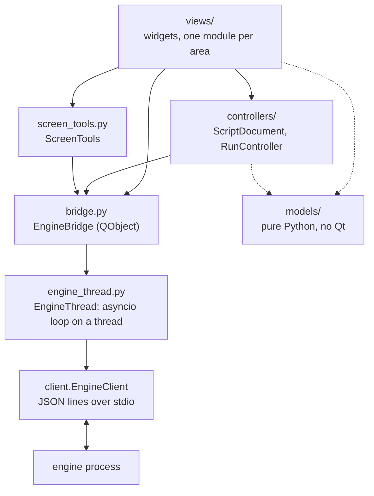

# The GUI package (`j5_macro.gui`)

For contributors. The user guide is [docs/gui.md](../../../docs/gui.md); the protocol the
GUI speaks is [docs/contract.md](../../../docs/contract.md), the source of truth. The GUI
is one more client of the engine, like the CLI and the DAP adapter: it starts
`python -m j5_macro.engine` (or `J5_ENGINE_CMD`) as a child process and only sends
commands and receives events. It never parses or writes YAML, never touches the mouse or
keyboard and never searches the screen itself: the engine does all of that.

PySide6 is optional (the `gui` extra). `j5_macro.gui` itself (`__init__.py`) imports no
Qt, so `j5 gui` can say how to install it; neither do `models/` and `engine_thread.py`.

## Layers



| Module | Holds | Qt |
| --- | --- | --- |
| `models/` | View models built from engine results and events: `StepItem` trees (`steps.py`), `ScriptState` and `ScriptEntry` (`script.py`), `EngineInfo` (`engine_info.py`), `RunLog`, `format_event` and the log filter (`run_log.py`), `RunSummary` (`runs.py`), and for running and debugging: `ParamSpec` and the params prompt's conversion (`params.py`), `RunKind`, `RunOptions` and the `run` payload (`run_options.py`), `debug_actions` and `PauseInfo` (`debugger.py`), `VariableRow` and `set_variable` payloads (`variables.py`). `RunDetail`, `SearchFailure` and the history rows (`history.py`), the screen tools' targets, edits, names and error messages (`screen.py`), and for the editor: the step registry and the palette (`registry.py`), field kinds and value parsing (`fields.py`), the edits behind every editor action (`edits.py`) and the header's values (`header.py`). Frozen dataclasses and plain functions, unit tested without a display | None |
| `engine_thread.py` | `EngineThread`: the existing asyncio `EngineClient` on an event loop in a daemon thread (`j5-gui-engine`). `call()` returns a `concurrent.futures.Future`; events and the engine's death reach callbacks **on that thread**. Releases held keys when the engine dies (`cli.release`) | None |
| `bridge.py` | `EngineBridge`: owns the `EngineThread` and turns its futures and callbacks into callbacks and signals **on the GUI thread** | QtCore |
| `controllers/` | Shared state, as QObjects without widgets: `ScriptDocument` (the open script), `RunController` (the active run, debugging, the breakpoints) and `EditQueue` (the editor's edits, one at a time) | QtCore |
| `screen_tools.py` | `ScreenTools`: `capture_region`, `pick_point`, `find_image`, `screenshot`, `list_windows`, `get_image`; `while_hidden` and the `hider` that hides the windows during overlays | QtCore |
| `context.py` | `AppContext`: the bridge, the document, the run controller and the screen tools, handed to every panel | QtCore |
| `views/` | The widgets (below) | QtWidgets |
| `app.py` | `run_gui(target, engine_cmd)`: the `QApplication`, the context, the main window | QtWidgets |

## The bridge and the threading rules

```python
ctx.bridge.call("list_runs", {"script_id": sid, "limit": 20},
                on_result=lambda result: ...,   # GUI thread, later
                on_error=lambda exc: ...)       # GUI thread, later
ctx.bridge.event_received.connect(self.on_event)  # every Event, GUI thread, in order
```

1. **Only the GUI thread touches widgets and controllers.** Everything that comes from
   the engine thread is posted through a queued signal (`EngineBridge._deliver`), so
   `on_result`, `on_error`, `event_received`, `engine_started`, `engine_failed`,
   `engine_died` and `running_changed` all run on the GUI thread.
2. **Never block the GUI thread on the engine.** No `future.result()` on the GUI thread:
   pass callbacks. `call()` returns the future only for tests and the rare caller that
   wants to cancel or inspect it.
3. **Callbacks never run inside `call()`**, not even for a future that is already done:
   the code after `call()` always runs first.
4. **Commands wait for the handshake.** `call()` right after `start()` is fine; the
   command is sent once `hello` is done. Before `start()` (or after the engine died or
   was shut down) the future fails with `ClientClosed`.
5. **Errors.** `on_error` gets the exception: `EngineError` (the engine answered
   `ok: false`; `exc.code` and `exc.error.details` as in the contract), `ClientError`
   (closed, dead), `TimeoutError`. `engine_thread.describe_error(exc)` makes a message
   for people. Without `on_error`, failures are only logged.
6. **Timeouts.** Requests time out after 30 s by default. Interactive authoring commands
   (`capture_region` without `bbox`, `pick_point`, `find_image` with `show`) answer when
   the user finishes: pass `timeout=None` (`ScreenTools` does).
7. **Events are in `seq` order per stream** (the client fills gaps with `get_events`).
   Run events have a `run_id`; engine events (`ready`, `log`, `script_changed`) have
   `run_id` None. Ignore event types you do not know.
8. **Engine death.** When the engine exits unexpectedly, the GUI releases whatever the
   last `input_state` reported as held, then `engine_died(message)` and
   `running_changed(False)` fire; the `EngineBanner` offers a restart. `restart()`
   starts a new engine; script ids belong to the engine, so `ScriptDocument` loads its
   file again on `engine_started`, and `RunController` forgets the run.
9. **Restarts and late answers.** After `shutdown()` or `restart()`, results and events
   of the old engine are dropped (a generation counter); `on_error` still runs.
10. **Panels may be created after the engine started:** read the current state
   (`ctx.bridge.info`, `ctx.document.state`, `ctx.run.breakpoints`) in the constructor,
   then connect to the signals.

## Shared state

`ScriptDocument` (controllers/document.py):

| Member | Meaning |
| --- | --- |
| `open(path)`, `reopen()`, `reload()`, `close()` | `load` then `get_script`; `reload` re-reads it |
| `edit(edits, on_result=, on_error=)` | `edit_script` against the version shown (`base_version`); the reload comes with `script_changed`; a `conflict` reloads, then reaches `on_error` |
| `state` / `state_changed(ScriptState or None)` | The `get_script` result as a `ScriptState`, after every load and reload |
| `script_id`, `path` | The engine's id; the file asked for (kept while it fails to load) |
| `load_failed(message, errors)`, `notice(message)` | `load` refused the file (errors with `line`); passing messages |

`RunController` (controllers/run.py):

| Member | Meaning |
| --- | --- |
| `start(kind, params=, options=, **extra)`, `stop()` | `run` and `stop`. `kind` is `normal`, `dry`, `debug` (mode `step`) or `debug_dry` (mode `dry` with a breakpoint on the first step until the first pause), or `step`; `options` a `RunOptions`; `extra` other `run` fields (`None` left out). Nothing given is kept, so secret params only pass through |
| `pause_run()`, `resume()`, `step_over()`, `step_into()`, `step_out()` | The control commands; ignored when they do not apply (see `actions`) or while one is in flight |
| `retry()`, `skip(carry_on=None)` | For an error or interference pause: `resume`, and `step_over` (then `resume` at the next pause, unless the run was started to debug) |
| `refresh_state()`, `variables` / `variables_changed(dict or None)` | `get_state`, sent at every pause; the variables (secrets masked) |
| `set_variable(name, text, expression=, on_done=)`, `evaluate(expression, on_result, on_error)` | `set_variable` (a value, JSON else text, or an expression; then `get_state` again) and `evaluate`, only while paused |
| `active` / `active_changed(bool)`, `run_id`, `kind`, `state`, `log` (`RunLog`) | The active run; `state` adds `starting` (requested, no `run_started` yet) to `RunLog.state` |
| `pause` / `paused(PauseInfo or None)` | Why and where the run is paused (again when `get_state` says where) |
| `actions` / `actions_changed(DebugActions)` | Which controls apply now (`models/debugger.py`) |
| `run_started(run_id)`, `event_logged(LogLine)`, `state_changed(state)`, `current_step_changed(step_id or None)`, `run_finished(payload)`, `error(message)` | What happened. The current step comes from `step_started`, `breakpoint_hit` and `get_state` |
| `breakpoints`, `set_breakpoints(ids)`, `toggle_breakpoint(id)`, `breakpoints_changed(frozenset)` | The client breakpoints of the open script, kept per script file for the session and sent with `set_breakpoints` when they change, when the script loads and when a new engine starts |
| `runs_dir`, `capture_path(relative)` | Where the engine saves runs (from `--runs-dir`, `J5_RUNS_DIR` or the default, `AppContext.create` works it out) and a capture of the active run there |
| `remembered_params(script)`, `remember_params(texts, script)` | The non-secret param texts of the last run of a script, for the session |
| `confirm_real_input`, `set_confirm_real_input(bool)`, `use_settings(QSettings)` | Whether views confirm runs that send real input; `app.py` keeps it in `QSettings` |

## The main window and its areas

`views/main_window.py` only lays out the panels, builds the menus (File, Run, Tools, Engine)
and shows messages in the status bar. Each area is its own module and gets the
`AppContext`:

| Area | Module | Class | Today |
| --- | --- | --- | --- |
| Left | `views/script_list.py` | `ScriptListPanel` | `list_scripts` of a folder, open, `create_script` |
| Center | `views/editor.py` | `EditorPanel` | Title, problems, the toolbar (delete, duplicate, up, down), pack and unpack, and: |
| | `views/palette.py` | `StepPalette` | The step types of `list_step_types` by group; inserts or drags a type |
| | `views/step_tree.py` | `StepTreeView` | The steps, a row per block slot (`then`, `else`, `do`), drag and drop (emits `step_dropped`/`type_dropped` with a `Target`), problem marks, breakpoint gutter (column 0), current step highlight (`set_paused` for the stronger paused one) |
| | `views/step_form.py` | `StepFormPanel` | The selected step's form, generated from the registry; debounced `update` edits |
| | `views/fields.py` | `Field` and friends | The field widgets, and the field tools hook (below) |
| | `views/header_form.py` | `ScriptHeaderPanel` | The Script tab: name, capture scale, params, vars, images, input profile (`set_meta` and the image edits) |
| | `views/yaml_view.py` | `YamlView` | `get_script`'s `source`, read-only; highlights the selected step's line, `line_clicked` selects a step |
| Bottom tab | `views/run_panel.py` | `RunPanel` | Run, Dry run (+ Strict), Debug, Options…, the debug toolbar (`run_actions`, with their shortcuts, also in the Run menu), state, stop key, the log with its filter and summary; `request(kind)` (dialogs, then the run) and `start(kind)` (no dialog) |
| | `views/params_dialog.py` | `RunDialog` | The params prompt and the run options; `try_accept()`, `outcome()` |
| | `views/pause_view.py` | `PauseView` | Why the run is paused; the error, the failure capture and Retry / Skip / Stop |
| | `views/variables.py` | `VariablesPanel` | `get_state`'s variables, Set (value or expression), Evaluate |
| Bottom tab | `views/history_panel.py` | `HistoryPanel` | `list_runs` of the open script; the selected run (`get_run`): events, captures, `FailureView` (the failing search's capture next to its template); `delete_run`, open folder |
| Dialogs | `views/screen_dialogs.py` | `ImageFieldTools`, `PointFieldTools`, `CaptureDialog`, `TestResultDialog`, `WindowChooser`, `TopLevelHider` | The screen tools as reusable widgets (see "Field tools") |
| | `views/template_preview.py` | `ImageView`, `TemplatePreview` | An image over a checkerboard with marks; a template from a file or `get_image` |
| Top | `views/engine_banner.py` | `EngineBanner` | Engine failed or died, Restart |
| Status bar | `views/main_window.py` | `MainWindow.engine_label` | Backend, vision, stop key (`hello`) |

## The script editor

The editor never changes what it shows by itself: every action builds `edit_script`
edits with the pure functions of `models/edits.py` (positions, `move_up`, `drop_edit`,
`duplicate_edit`...) and sends them through `EditorPanel.queue`, an `EditQueue`. The
queue sends one `edit_script` at a time and waits until the document shows the version
it produced before sending the next, so edits made in a row never conflict; a
`conflict` (the file changed meanwhile) waits for the reload. The views refresh on
`state_changed`, and the editor reselects what it inserted, moved or renamed.

- **Registry.** `EditorPanel.registry` (`models/registry.py`) comes from
  `list_step_types` when the engine starts. It gives the palette, the block slots of the
  tree, the forms, and `new_step(type)`, the parameters of a new step (chosen so the
  script stays valid).
- **Forms.** `StepFormPanel` builds a `Field` per parameter, chosen by
  `models.fields.field_kind`, plus a `TargetField` for the `image`/`x`/`y`/`at` target of
  `click` and `move`. A field edits one or more parameters (`keys`); `load(params)`,
  `values()` (a `Parsed`: the values or the problem), `changes()` (only what differs
  from what was loaded) and `edited(now)`. Values are checked as typed; changes go out
  `DEBOUNCE_MS` after typing stops, at once for choices. While the script is invalid the
  engine reports its last valid version, so the form keeps what was typed and only shows
  the problems (`get_script`'s `errors`, by `step_id` and `details.param`/`field`).
- **Packing.** "Save as self-contained file" and "Unpack images to files" call
  `j5_macro.script.bundle` (the code behind `j5 pack` and `j5 unpack`) in the GUI
  process, after the pending edits are saved (`EditQueue.when_idle`).

## Extension points

Work on the next features stays inside these modules, so it can go on in parallel:

- **Script editor**: `views/editor.py`, `views/palette.py`, `views/step_tree.py`,
  `views/step_form.py`, `views/fields.py`, `views/header_form.py`,
  `controllers/edit_queue.py` and `models/registry.py`, `fields.py`, `edits.py`,
  `header.py` (see "The script editor" above). Every change goes through
  `edit_script`; the view refreshes on `state_changed`, never by itself.
- **Run and debugging**: `controllers/run.py` and the views it drives
  (`views/run_panel.py`, `params_dialog.py`, `pause_view.py`, `variables.py`), with
  their pure logic in `models/params.py`, `run_options.py`, `debugger.py`,
  `variables.py` and `run_log.py`. The step tree shows the breakpoints and the current
  step from the controller's signals (wired in `editor.py` and `main_window.py`).
- **History and screen tools**: `views/history_panel.py`, `views/screen_dialogs.py`,
  `views/template_preview.py`, `screen_tools.py`,
  `models/history.py` and `models/screen.py`. Image and coordinate fields of the step
  forms plug in the field tools below.

Shared files (`context.py`, `views/main_window.py`, `controllers/document.py`) should
only get small, additive changes: a new service in `AppContext`, a menu entry, a signal.

## Field tools

The screen tools (Capture, Test, Pick, Window) sit next to the fields they fill. Two
layers: a hook in the forms, and the widgets that plug into it.

### The hook (`views/fields.py`)

Image, point, region and window fields call every factory registered with
`register_field_tools(factory)` (it returns a function that unregisters it) when they
are built, and show the widgets the factory returns below the field (a window field: on
its line). A widget with a `refresh()` method has it called whenever the field's value
changes. A factory gets a `FieldContext`:

| Member | Meaning |
| --- | --- |
| `kind` | `image`, `point`, `region` or `window` |
| `param` | The parameter as the engine names it: `image`, `x/y`, `region`, `window`, `from.image`, `to.x/y`, `when.image_visible`... |
| `get_value()` | The field's value: a path or `#name` (None when empty); `{x, y, window}` (plus `image` or `at` when the target aims at one); `[x, y, w, h]` or `{at, offset?, size?}`; `{title}` or None |
| `set_value(value)` | Show a value in the field and save it, as if the user typed it. An image makes a target an image target; a point (`x`, `y`, `window`, `image: None`, `at: None`, as `pick_values` gives it) a position target; `{window}` alone only sets the window |
| `search()` | For an image: how the step searches for it (`window`, `region`, `threshold`, `scale`, the ones set) |
| `ctx` | The `AppContext` |
| `step_id`, `step_type` | The step being edited |
| `window()` | The window the field is relative to (the step's or the target's `window`), or None |
| `step_params()` | The step's parameters as the form shows them now |

`views/screen_fields.py` is the factory the application installs
(`install_screen_tools()`, from `MainWindow`, before the editor builds its forms):
`ImageFieldTools` for image fields, `PointFieldTools` for points (its Window… button
hidden: the window field has its own) and a `WindowButton` (a `WindowChooser`) for
windows. `EditorPanel.image_tools()`, `point_tools()`, `window_buttons()` find them in
the selected step's form, and `screen_tool(name)` runs the Tools menu entries on the
first one.

A capture that embeds an image changes the script (a new version) before the tools set
the field: `ImageFieldTools` waits until the document shows that version
(`when_document_at`), the form is not rebuilt when only the embedded images change, and
the field's edit goes through the `EditQueue`, based on that version.

### The widgets (`views/screen_dialogs.py`)


The screen tools are self-contained widgets (`views/screen_dialogs.py`) that any form
embeds next to its field. They only need the `AppContext` and callables to read and
write the field; they never edit the script themselves, so the form decides how a value
is written (usually an `update` edit through `ctx.document.edit`).

```python
from j5_macro.gui.views.screen_dialogs import ImageFieldTools, PointFieldTools

image_tools = ImageFieldTools(
    ctx,
    get_value=lambda: form.value("image"),          # "img/save.png", "#save" or None
    set_value=lambda value: form.set("image", value),
    get_search=lambda: form.values(),               # window: {title}, region, threshold, scale
    step_id=lambda: form.step_id)                   # names new templates (str or callable)
image_tools.refresh()                               # after the field's value changes

point_tools = PointFieldTools(
    ctx,
    get_point=lambda: form.values(),                # x, y, window, image (as in the step)
    set_point=lambda values: form.update(values))   # x, y, window ({title} or None),
                                                    # image/at None when replaced
```

| Component | Contract |
| --- | --- |
| `ImageFieldTools(ctx, get_value, set_value, *, get_search=None, step_id=None, preview=True)` | **Capture…** opens a `CaptureDialog` (embed as `#name` or save a file next to the script; padding, transparent, replace) and calls `set_value("#name")` or `set_value("img/x.png")` (relative to the script) once the document shows the script's new version, so an edit made in `set_value` does not conflict. **Test** runs `find_image` with `get_value()` and `get_search()` (the step's other parameters, in the step's own shape) and opens a `TestResultDialog`; `tested(TestResult)` fires. `preview` is a `TemplatePreview`; call `refresh()` when the value changes. Whether a new image replaces the step's `x`/`y`/`at` is the form's choice: `models.screen.image_values(target, value)` gives those parameters |
| `PointFieldTools(ctx, get_point, set_point)` | **Pick…** runs `pick_point` and calls `set_point(models.screen.pick_values(result, ...))`: `x`/`y` relative to the window the point is in plus `window: {title}` (or desktop coordinates with `window: None` when **Relative to its window** is cleared), `image: None` when the target had an image, `at: None`. **Window…** opens a `WindowChooser` (`list_windows`) and calls `set_point({"window": {"title": t}})`. `picked(values)` fires |
| `TemplatePreview(ctx)` | `show_template(value)` shows a file (relative to the open script) or an embedded `#name` (`get_image`), with its size and scale; `script_id`, `script_path` and `use_document=False` for another script |
| `ImageView` | `set_image(QImage)`, `set_marks([Mark(rect, color, label)])` in image pixels; scaled to fit, checkerboard behind |

Both tool widgets show what happened (and errors, with install hints for a missing
`vision` extra or tkinter) in their `message` label and emit `message_changed(str)`;
Escape on the overlay is quiet, and `busy` (a run is active) says so. Their dialogs are
modeless: `TopLevelHider` (installed by the main window as `ctx.screen.hider`) hides
every top-level window while an overlay is open or a Test looks at the screen, and
shows them again afterwards (after a short delay for the window manager; none on the
`offscreen` platform). Without a hider (a bare `AppContext`), nothing is hidden.

## Tests

`tests/gui/` (see its `conftest.py`): `test_models.py` and `test_engine_thread.py` need no
Qt; the others need the `gui-test` extra (PySide6 and pytest-qt) and are skipped
without it. They run on Qt's `offscreen` platform against a real engine with the fake
input backend (`J5_BACKEND=fake`), a temporary runs directory and a folder of test
scripts. Copy their pattern:

```python
pytest.importorskip("PySide6")
pytest.importorskip("pytestqt")

def test_something(qtbot, window, scripts):
    window.open_target(str(scripts / "quick.yaml"))
    wait_for(qtbot, lambda: window.ctx.document.state is not None)
    with qtbot.waitSignal(window.ctx.run.run_finished, timeout=WAIT) as finished:
        window.run_panel.start("dry")
    assert finished.args[0]["status"] == "completed"
```

Avoid modal dialogs in code paths the tests drive (keep the dialog in a small method
and the work in another, as `ScriptListPanel.ask_new_script` and `create_script` do, and
`RunPanel.exec_dialog` and `confirm_real_input`, which tests replace).
To look at the window, render it offscreen: `window.grab().save("window.png")`.
