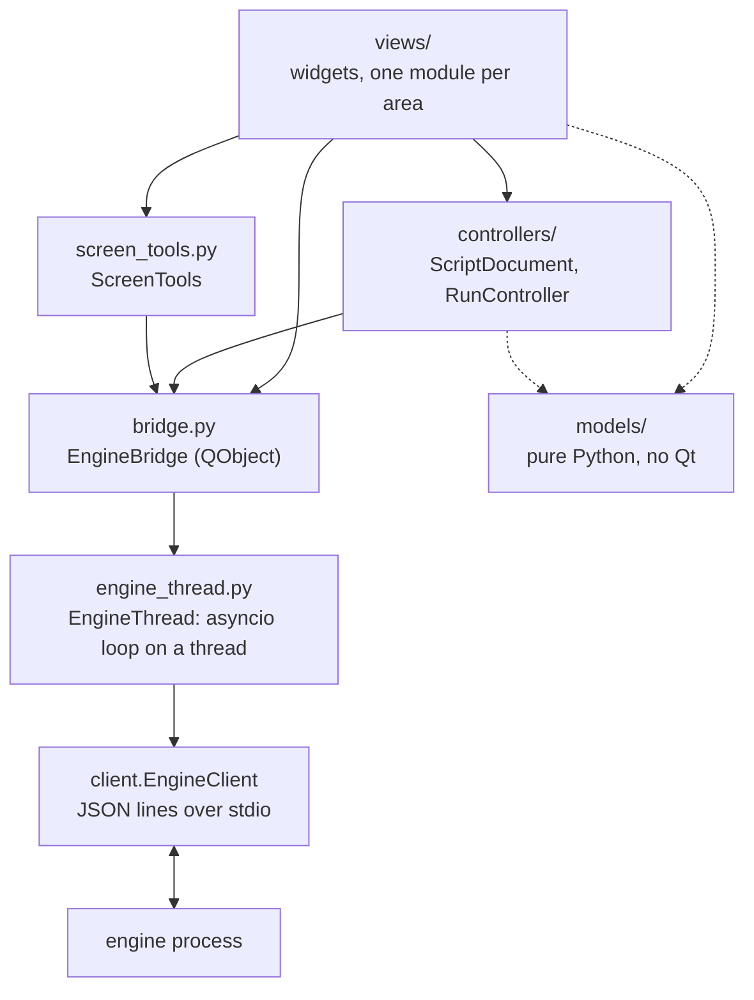

# The GUI package (`j5_macro.gui`)

For contributors. The user guide is [docs/gui.md](../../../docs/gui.md); the protocol the
GUI speaks is [docs/contract.md](../../../docs/contract.md), the source of truth. The GUI
is one more client of the engine, like the CLI and the DAP adapter: it starts
`python -m j5_macro.engine` (or `J5_ENGINE_CMD`) as a child process and only sends
commands and receives events. It never parses or writes YAML, never touches the mouse or
keyboard and never searches the screen itself: the engine does all of that.

PySide6 is optional (the `gui` extra). `j5_macro.gui` itself (`__init__.py`) imports no
Qt, so `j5 gui` can say how to install it; neither do `models/` and `engine_thread.py`.

## Layers



| Module | Holds | Qt |
| --- | --- | --- |
| `models/` | View models built from engine results and events: `StepItem` trees (`steps.py`), `ScriptState` and `ScriptEntry` (`script.py`), `EngineInfo` (`engine_info.py`), `RunLog`, `format_event` and the log filter (`run_log.py`), `RunSummary` (`runs.py`), and for running and debugging: `ParamSpec` and the params prompt's conversion (`params.py`), `RunKind`, `RunOptions` and the `run` payload (`run_options.py`), `debug_actions` and `PauseInfo` (`debugger.py`), `VariableRow` and `set_variable` payloads (`variables.py`). Frozen dataclasses and plain functions, unit tested without a display | None |
| `engine_thread.py` | `EngineThread`: the existing asyncio `EngineClient` on an event loop in a daemon thread (`j5-gui-engine`). `call()` returns a `concurrent.futures.Future`; events and the engine's death reach callbacks **on that thread**. Releases held keys when the engine dies (`cli.release`) | None |
| `bridge.py` | `EngineBridge`: owns the `EngineThread` and turns its futures and callbacks into callbacks and signals **on the GUI thread** | QtCore |
| `controllers/` | Shared state, as QObjects without widgets: `ScriptDocument` (the open script) and `RunController` (the active run, debugging, the breakpoints) | QtCore |
| `screen_tools.py` | `ScreenTools`: `capture_region`, `pick_point`, `find_image`, `screenshot`, `list_windows` | QtCore |
| `context.py` | `AppContext`: the bridge, the document, the run controller and the screen tools, handed to every panel | QtCore |
| `views/` | The widgets (below) | QtWidgets |
| `app.py` | `run_gui(target, engine_cmd)`: the `QApplication`, the context, the main window | QtWidgets |

## The bridge and the threading rules

```python
ctx.bridge.call("list_runs", {"script_id": sid, "limit": 20},
                on_result=lambda result: ...,   # GUI thread, later
                on_error=lambda exc: ...)       # GUI thread, later
ctx.bridge.event_received.connect(self.on_event)  # every Event, GUI thread, in order
```

1. **Only the GUI thread touches widgets and controllers.** Everything that comes from
   the engine thread is posted through a queued signal (`EngineBridge._deliver`), so
   `on_result`, `on_error`, `event_received`, `engine_started`, `engine_failed`,
   `engine_died` and `running_changed` all run on the GUI thread.
2. **Never block the GUI thread on the engine.** No `future.result()` on the GUI thread:
   pass callbacks. `call()` returns the future only for tests and the rare caller that
   wants to cancel or inspect it.
3. **Callbacks never run inside `call()`**, not even for a future that is already done:
   the code after `call()` always runs first.
4. **Commands wait for the handshake.** `call()` right after `start()` is fine; the
   command is sent once `hello` is done. Before `start()` (or after the engine died or
   was shut down) the future fails with `ClientClosed`.
5. **Errors.** `on_error` gets the exception: `EngineError` (the engine answered
   `ok: false`; `exc.code` and `exc.error.details` as in the contract), `ClientError`
   (closed, dead), `TimeoutError`. `engine_thread.describe_error(exc)` makes a message
   for people. Without `on_error`, failures are only logged.
6. **Timeouts.** Requests time out after 30 s by default. Interactive authoring commands
   (`capture_region` without `bbox`, `pick_point`, `find_image` with `show`) answer when
   the user finishes: pass `timeout=None` (`ScreenTools` does).
7. **Events are in `seq` order per stream** (the client fills gaps with `get_events`).
   Run events have a `run_id`; engine events (`ready`, `log`, `script_changed`) have
   `run_id` None. Ignore event types you do not know.
8. **Engine death.** When the engine exits unexpectedly, the GUI releases whatever the
   last `input_state` reported as held, then `engine_died(message)` and
   `running_changed(False)` fire; the `EngineBanner` offers a restart. `restart()`
   starts a new engine; script ids belong to the engine, so `ScriptDocument` loads its
   file again on `engine_started`, and `RunController` forgets the run.
9. **Restarts and late answers.** After `shutdown()` or `restart()`, results and events
   of the old engine are dropped (a generation counter); `on_error` still runs.
10. **Panels may be created after the engine started:** read the current state
   (`ctx.bridge.info`, `ctx.document.state`, `ctx.run.breakpoints`) in the constructor,
   then connect to the signals.

## Shared state

`ScriptDocument` (controllers/document.py):

| Member | Meaning |
| --- | --- |
| `open(path)`, `reopen()`, `reload()`, `close()` | `load` then `get_script`; `reload` re-reads it |
| `edit(edits, on_result=, on_error=)` | `edit_script` against the version shown (`base_version`); the reload comes with `script_changed`; a `conflict` reloads, then reaches `on_error` |
| `state` / `state_changed(ScriptState or None)` | The `get_script` result as a `ScriptState`, after every load and reload |
| `script_id`, `path` | The engine's id; the file asked for (kept while it fails to load) |
| `load_failed(message, errors)`, `notice(message)` | `load` refused the file (errors with `line`); passing messages |

`RunController` (controllers/run.py):

| Member | Meaning |
| --- | --- |
| `start(kind, params=, options=, **extra)`, `stop()` | `run` and `stop`. `kind` is `normal`, `dry`, `debug` (mode `step`) or `debug_dry` (mode `dry` with a breakpoint on the first step until the first pause), or `step`; `options` a `RunOptions`; `extra` other `run` fields (`None` left out). Nothing given is kept, so secret params only pass through |
| `pause_run()`, `resume()`, `step_over()`, `step_into()`, `step_out()` | The control commands; ignored when they do not apply (see `actions`) or while one is in flight |
| `retry()`, `skip(carry_on=None)` | For an error or interference pause: `resume`, and `step_over` (then `resume` at the next pause, unless the run was started to debug) |
| `refresh_state()`, `variables` / `variables_changed(dict or None)` | `get_state`, sent at every pause; the variables (secrets masked) |
| `set_variable(name, text, expression=, on_done=)`, `evaluate(expression, on_result, on_error)` | `set_variable` (a value, JSON else text, or an expression; then `get_state` again) and `evaluate`, only while paused |
| `active` / `active_changed(bool)`, `run_id`, `kind`, `state`, `log` (`RunLog`) | The active run; `state` adds `starting` (requested, no `run_started` yet) to `RunLog.state` |
| `pause` / `paused(PauseInfo or None)` | Why and where the run is paused (again when `get_state` says where) |
| `actions` / `actions_changed(DebugActions)` | Which controls apply now (`models/debugger.py`) |
| `run_started(run_id)`, `event_logged(LogLine)`, `state_changed(state)`, `current_step_changed(step_id or None)`, `run_finished(payload)`, `error(message)` | What happened. The current step comes from `step_started`, `breakpoint_hit` and `get_state` |
| `breakpoints`, `set_breakpoints(ids)`, `toggle_breakpoint(id)`, `breakpoints_changed(frozenset)` | The client breakpoints of the open script, kept per script file for the session and sent with `set_breakpoints` when they change, when the script loads and when a new engine starts |
| `runs_dir`, `capture_path(relative)` | Where the engine saves runs (from `--runs-dir`, `J5_RUNS_DIR` or the default, `AppContext.create` works it out) and a capture of the active run there |
| `remembered_params(script)`, `remember_params(texts, script)` | The non-secret param texts of the last run of a script, for the session |
| `confirm_real_input`, `set_confirm_real_input(bool)`, `use_settings(QSettings)` | Whether views confirm runs that send real input; `app.py` keeps it in `QSettings` |

## The main window and its areas

`views/main_window.py` only lays out the panels, builds the menus (File, Run, Engine)
and shows messages in the status bar. Each area is its own module and gets the
`AppContext`:

| Area | Module | Class | Today |
| --- | --- | --- | --- |
| Left | `views/script_list.py` | `ScriptListPanel` | `list_scripts` of a folder, open, `create_script` |
| Center | `views/editor.py` | `EditorPanel` | Title, problems, and three parts: |
| | `views/step_tree.py` | `StepTreeView` | Read-only tree (ids, types, `then`/`else` rows), breakpoint gutter (column 0), current step highlight (`set_paused` for the stronger paused one) |
| | `views/step_form.py` | `StepFormPanel` | The selected step's parameters, read-only |
| | `views/yaml_view.py` | `YamlView` | `get_script`'s `source`, read-only; highlights the selected step's line |
| Bottom tab | `views/run_panel.py` | `RunPanel` | Run, Dry run (+ Strict), Debug, Options…, the debug toolbar (`run_actions`, with their shortcuts, also in the Run menu), state, stop key, the log with its filter and summary; `request(kind)` (dialogs, then the run) and `start(kind)` (no dialog) |
| | `views/params_dialog.py` | `RunDialog` | The params prompt and the run options; `try_accept()`, `outcome()` |
| | `views/pause_view.py` | `PauseView` | Why the run is paused; the error, the failure capture and Retry / Skip / Stop |
| | `views/variables.py` | `VariablesPanel` | `get_state`'s variables, Set (value or expression), Evaluate |
| Bottom tab | `views/history_panel.py` | `HistoryPanel` | `list_runs` of the open script |
| Top | `views/engine_banner.py` | `EngineBanner` | Engine failed or died, Restart |
| Status bar | `views/main_window.py` | `MainWindow.engine_label` | Backend, vision, stop key (`hello`) |

## Extension points

Work on the next features stays inside these modules, so it can go on in parallel:

- **Script editor**: `views/editor.py`, `views/step_tree.py`, `views/step_form.py`
  (and new modules under `views/`, e.g. a step palette or a header form), plus
  `ScriptDocument.edit` and new models under `models/` (e.g. the step registry from
  `list_step_types`). Every change goes through `edit_script`; the view refreshes on
  `state_changed`, never by itself. Saving as a single file (`j5 pack`'s logic,
  `cli/bundle.py`) belongs here too.
- **Run and debugging**: `controllers/run.py` and the views it drives
  (`views/run_panel.py`, `params_dialog.py`, `pause_view.py`, `variables.py`), with
  their pure logic in `models/params.py`, `run_options.py`, `debugger.py`,
  `variables.py` and `run_log.py`. The step tree shows the breakpoints and the current
  step from the controller's signals (wired in `editor.py` and `main_window.py`).
- **History and screen tools**: `views/history_panel.py` (`get_run`, captures,
  `delete_run`; `selected_run_id()`, `run_selected`), `screen_tools.py` (previews,
  "Test" over a screenshot) and the image and coordinate fields that use it.

Shared files (`context.py`, `views/main_window.py`, `controllers/document.py`) should
only get small, additive changes: a new service in `AppContext`, a menu entry, a signal.

## Tests

`tests/gui/` (see its `conftest.py`): `test_models.py` and `test_engine_thread.py` need no
Qt; the others need the `gui-test` extra (PySide6 and pytest-qt) and are skipped
without it. They run on Qt's `offscreen` platform against a real engine with the fake
input backend (`J5_BACKEND=fake`), a temporary runs directory and a folder of test
scripts. Copy their pattern:

```python
pytest.importorskip("PySide6")
pytest.importorskip("pytestqt")

def test_something(qtbot, window, scripts):
    window.open_target(str(scripts / "quick.yaml"))
    wait_for(qtbot, lambda: window.ctx.document.state is not None)
    with qtbot.waitSignal(window.ctx.run.run_finished, timeout=WAIT) as finished:
        window.run_panel.start("dry")
    assert finished.args[0]["status"] == "completed"
```

Avoid modal dialogs in code paths the tests drive (keep the dialog in a small method
and the work in another, as `ScriptListPanel.ask_new_script` and `create_script` do, and
`RunPanel.exec_dialog` and `confirm_real_input`, which tests replace).
To look at the window, render it offscreen: `window.grab().save("window.png")`.
